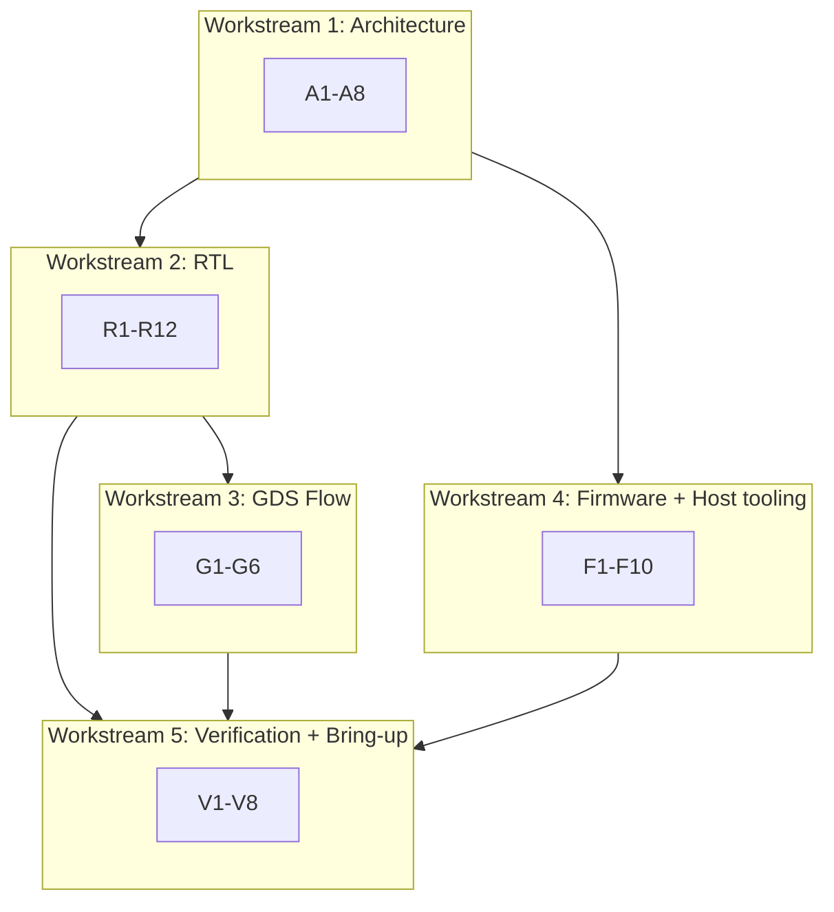

# Protocol Emulator ASIC — Execution Plan

Companion to [PROTOCOL_EMULATOR_ARCHITECTURE.md](PROTOCOL_EMULATOR_ARCHITECTURE.md) | 2026-09-27 | Status: planning, pre-RTL

## Scope decisions locked in for this plan

- **Single engine for v1.** Two engines are a proven, bounded add-on after the
  first engine is validated end-to-end (RTL, GDS flow, firmware). Full-duplex
  UART with independent TX/RX timing is the main reason a second engine exists;
  it is deferred, not abandoned.
- **Baseline protocol scope: UART, SPI, I2C.** These are estimated to fit the
  64-word instruction memory with headroom.
- **JTAG, SWD, PS/2, CAN, USB low speed, 10 Mbit Ethernet are a separate
  research spike**, not committed inside this 3-month plan. JTAG in particular
  does not fit the flat 64-word / no-call-stack model without a redesign
  (arbitrary-length shift chains need host-streamed data, not a preloaded
  program).
- **Reference host**: a Raspberry Pi Pico acts as the external controller,
  bridging a laptop (USB serial, human-facing commands) to the ASIC
  (SPI, 12-byte management frames per the architecture doc §6).

## How the workstreams tie together

---

## Workstream 1 — Architecture (blocks everything else)

| ID | Task | Depends on | Deliverable | Validation |
|---|---|---|---|---|
| A1 | Freeze ISA opcode table for single-engine v1 (drop nothing needed for UART/SPI/I2C only) | — | Opcode table doc, 32-bit field assignments | Peer review: every UART/SPI/I2C step maps to a legal opcode |
| A2 | Freeze register/CSR map (addresses, bit fields, sticky bits) | A1 | Register map doc | Cross-check every management operation (load, start, halt, trace-read) has an address |
| A3 | Freeze SPI host frame format (12-byte frame, CRC-16 params) | — | Frame spec | Hand-compute CRC-16 for a sample frame, verify against a reference CRC implementation |
| A4 | Freeze pin map for single-engine v1 (which `uio` bits = UART/SPI/I2C) | A1 | Pin table | Confirm all 3 protocols fit in 8 `uio` pins simultaneously or via reconfiguration |
| A5 | Firmware code-size budget check for UART, SPI, I2C against 64-word limit | A1 | Instruction count estimate per protocol | Each program ≤ 51 words (80% of 64, 20% headroom target); redesign if over |
| A6 | Explicit scope decision: JTAG/SWD/CAN/USB/Ethernet = research spike, not in 3-month baseline | — | One-paragraph scope doc | Sign-off from project owner |
| A7 | Interconnect/signal-level spec between management, engine, pins, trace (exact signal names/widths) | A1, A2 | Signal table | Every block-diagram arrow from the architecture doc has a named signal |
| A8 | Verification obligations list assigned to owners (V01-V14 subset relevant to single engine) | A1-A4 | Assigned checklist | Every obligation has a named test type (formal/sim) and owner |

**Gate 1**: A1-A8 complete and reviewed. Nothing below starts in earnest until
this passes (GDS flow bring-up in G1 can start early since it is decoupled).

---

## Workstream 2 — RTL (single engine, single instance)

| ID | Task | Depends on | Deliverable | Validation |
|---|---|---|---|---|
| R1 | Reset/abort safety-disarm latch module | A7 | RTL + testbench | Formal proof: reset/abort forces all pin `oe=0` in every state (V01) |
| R2 | Pin ownership + electrical mode mux (push-pull/open-drain) | A4, A7 | RTL + testbench | Formal: nonowner writes never affect pin data/oe (V03); open-drain never drives high (V02) |
| R3 | Input synchronizer (2-stage) + optional filter | A7 | RTL + testbench | Directed sim: inject async transition, confirm 2-cycle latency to consuming logic |
| R4 | Instruction/data storage (flip-flop based, parity) | A1, A5 | RTL + testbench | Write/read-back test for all 64 words + parity fault injection |
| R5 | Engine core: fetch/decode/PC/ALU | A1, R4 | RTL + testbench | Differential test against ISA cycle model for every opcode (V04) |
| R6 | Engine shifters + FIFOs (TX/RX) | A1, R5 | RTL + testbench | Random backpressure test: no loss/duplication, full/empty boundary (V05, V07) |
| R7 | Timestamp/event fabric (32-bit counter, deadline, event bits) | A7 | RTL + testbench | 32-bit wraparound test; simultaneous set/ack ordering test (V08) |
| R8 | Management/CSR controller + SPI frame decode | A2, A3 | RTL + testbench | Randomized truncated/corrupt/duplicate frame tests (V10); bounded response under engine stall (V06) |
| R9 | Trace + first-fault capture | A7 | RTL + testbench | Confirm trace never backpressures engine; first-fault preserved across resets except external reset (V09) |
| R10 | Memory test/BIST controller (March C-) | A7 | RTL + testbench | Inject stuck-bit/alias faults, confirm BIST reports first-fail correctly (V11) |
| R11 | Top-level integration (wire all modules per A7 signal spec) | R1-R10 | Integrated RTL | All module-level testbenches re-run at integration level, no regressions |
| R12 | Full-chip simulation: load+run UART/SPI/I2C firmware against RTL | R11, F-series firmware | Passing integration testbench | Byte-accurate protocol waveform match against independent reference model (V12) |

---

## Workstream 3 — GDS Flow (runs in parallel, starts on stub RTL immediately)

| ID | Task | Depends on | Deliverable | Validation |
|---|---|---|---|---|
| G1 | Stand up LibreLane/CMOS5L flow on a throwaway module (e.g., R1) | R1 (or any trivial module) | Working script/Makefile, one-command run | Clean GDS out, DRC/LVS pass on the stub |
| G2 | Re-run flow on each RTL module as it lands (R2-R10) | R2-R10, G1 | Per-module area/timing reports | No new DRC/LVS errors introduced per module |
| G3 | Establish continuous flow re-run habit (flow triggered on every RTL commit) | G1 | Automation script | Flow completes in a bounded time (track and report turnaround time) |
| G4 | First full-chip GDS run on integrated RTL | R11, G2 | Full GDS + STA report | STA closure at target clock (48 MHz primary, 24 MHz fallback) |
| G5 | Area/timing budget check against architecture doc §11 targets | G4 | Budget comparison doc | Confirms fit within 6x4 tile allocation |
| G6 | Final sign-off GDS run (post iteration fixes) | Workstream 5 fixes | Sign-off GDS, DRC/LVS/STA clean | Full clean report, no waived violations without documented justification |

---

## Workstream 4 — Firmware + Host tooling (Pico + laptop)

| ID | Task | Depends on | Deliverable | Validation |
|---|---|---|---|---|
| F1 | ISA cycle-accurate simulator/model (independent of RTL) | A1 | Python/C model + assembler | Model self-tests: hand-traced instruction sequences produce expected pin/register states |
| F2 | UART TX/RX firmware program | F1, A5 | Assembled instruction words | Runs against simulator: correct baud timing, framing, matches independent UART decoder |
| F3 | SPI controller firmware program | F1, A5 | Assembled instruction words | Runs against simulator: all CPOL/CPHA modes correct vs. reference SPI decoder |
| F4 | I2C controller firmware program | F1, A5 | Assembled instruction words | Runs against simulator: ACK/NACK, repeated START/STOP, stretching handled correctly |
| F5 | Pico-side SPI frame builder (pack op/seq/addr/payload, CRC-16) | A3 | Pico C/MicroPython module | Unit test: encode known frame, compare byte-for-byte against hand-computed reference |
| F6 | Pico-side command dispatcher (USB-serial commands -> SPI frames) | F5 | Pico firmware | Manual test: send "load"/"send"/"trace" commands from laptop, confirm correct SPI frames on a logic analyzer |
| F7 | Laptop-side control script (Python, talks to Pico over USB serial) | F6 | Python CLI tool | Confirms round-trip: laptop command -> Pico -> (simulated) SPI frame -> response parsed correctly |
| F8 | Firmware validation against RTL cosimulation (not just model) | F2-F4, R11 | Cosim test report | Byte-accurate match between model and RTL for all 3 protocols (ties to R12/V12) |
| F9 | Debug/trace readout tooling (decode trace buffer into human-readable log) | R9, F7 | Trace decoder script | Confirms decoded trace matches known injected event sequence |
| F10 | Firmware switch procedure tooling (halt->invalidate->load->verify->arm->start as one Pico command) | F6, R4 | Pico "switch_protocol" command | Confirms protocol switch completes and old program is fully overwritten (checksum verified) |

---

## Workstream 5 — Verification + Bring-up (ties everything together)

| ID | Task | Depends on | Deliverable | Validation |
|---|---|---|---|---|
| V1 | Formal safety proofs (V01-V03) | R1-R3 | SymbiYosys property files | All properties pass, no counterexamples |
| V2 | Full V01-V14 regression suite assembled | R11, F8 | Test suite | All 14 obligations have passing, reproducible tests |
| V3 | FPGA/gate-level smoke test plan (if FPGA available) | R11 | Test report | Same pinout/ABI/timing behavior as RTL sim |
| V4 | Iteration loop: triage Gate-2 failures, re-run affected module + flow + firmware tests | V2, G4 | Bug list + fix commits | Each fix re-passes its original failing test plus full regression (no new regressions) |
| V5 | Bring-up stage 1-3: power/clock alive, ID echo, pin diagnostic (silicon or FPGA) | G6 (or FPGA equiv) | Bring-up log | Each stage passes before proceeding to next |
| V6 | Bring-up stage 4-5: memory BIST, trivial toggle program | V5 | Bring-up log | BIST reports zero faults; scope confirms pin toggling at expected rate |
| V7 | Bring-up stage 6-8: UART, then SPI, then I2C, each with Pico as host | V6, F2-F4, F10 | Bring-up log per protocol | Each protocol validated independently before moving to next; full chain (laptop->Pico->ASIC->target) exercised |
| V8 | Full chip validation: full regression + randomized/adversarial protocol tests (jitter, CPOL/CPHA sweep, NACK/stretch) | V2, V7 | Final validation report | Requirement-to-test mapping complete; no open V01-V14 items |

---

## Sequencing against the 12-week timeline

| Weeks | Primary focus |
|---|---|
| 1-3 | Workstream 1 (A1-A8) -> Gate 1 |
| 4 | R1-R4, G1 start in parallel; F1 starts |
| 5-6 | R5-R7, G2 continuous; F2-F4 against simulator |
| 7-8 | R8-R10, G2 continuous; F5-F7 Pico tooling; V1 formal proofs start |
| 9 | R11-R12, G4 first full-chip GDS; F8 cosim; V2 regression assembly -> Gate 2 |
| 10-11 | V4 iteration loop (fix RTL/firmware/flow issues found at Gate 2) |
| 12 | V8 full chip validation, G6 sign-off GDS |

Post-tape-out (outside the 3-month window): V5-V7 staged bring-up with real
silicon and the Pico.

## Adding the second engine later

This plan assumes single engine only. When adding a second engine:

1. Repeat R5-R7 as a second parameterized instance.
2. Re-run R11/R12 integration and G4 full-chip GDS.
3. Re-run V2/V8 regression and validation.

This is a bounded add-on, not a restart of the whole plan, because the
management controller, pin ownership, trace, and safety logic are already
written generically for N engines.
