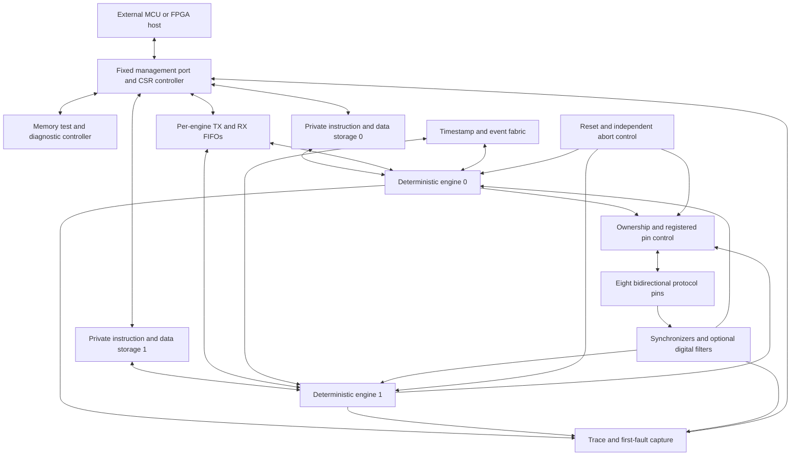

# Programmable Protocol Emulator ASIC

Architecture proposal v0.1 | 2026-09-26, revised 2026-10-11 | Status: long-term target; **two engines and an SPI management link are implemented and verified in simulation, UART TX/RX/duplex are proven on an FPGA, and a measured area study says instruction storage must move to SRAM**

## 0. Implementation status (2026-10-11)

This document is the full-chip target. What exists in `src/` today is two protocol engines of §4 with the datapath
subset below, an SPI slave and a management controller with an interim 7-byte frame, and the Tiny Tapeout top that wires
them. The event fabric, trace, BIST, safety latch, pin ownership and CRC frame are still plan. Measured area numbers and
the SRAM/pin-ownership analysis are in [ASIC_AREA_AND_MEMORY_STUDY.md](ASIC_AREA_AND_MEMORY_STUDY.md); where this document's
text predates them (notably §3's resource table, §6's frame and §11's storage ledger) the study and the status notes win.
Two decisions made during RTL work supersede text further down:

1. **Instruction format is 5-bit opcode + one flat 27-bit operand.** The
   delay/side-set sub-fields proposed in §4.2 were dropped; delay is the
   operand of the timed opcodes (`WAIT`, `OUT1`, `IN1`). Side-set is an open
   item. The authoritative opcode table is [../instructions.md](../instructions.md).
2. **No protocol-specific hardware anywhere.** Early drafts had a UART frame
   shifter and a `TX_DATA` byte register; these were replaced by a generic
   32-bit OSR/ISR pair, generic 32-bit FIFOs and an 8-pin block with per-pin
   data/direction registers. Framing, clocking and open-drain behaviour are
   firmware idioms (`SETH`/`SETLO`/`DIRO`/`DIRI`).

| Block in §3 diagram | Status |
|---|---|
| Deterministic engines 0 and 1 (PC, decode, delay counter, loop counter) | **Built, verified** — 17 opcodes, exact d+1 timing; per-engine `run` gate |
| Private instruction storage (64×32 per engine) | Built **in flip-flops** with a host write port (only while the engine is held); **no parity**. Flops are 80 % of the chip (§11), so this is to be replaced by SRAM |
| Per-engine TX/RX FIFOs | Built as 32-bit × 4 (plan says 16-bit × 8). Four FIFOs are 41k um^2; to be shrunk |
| Serial datapath (shifters) | Built as 32-bit OSR + ISR, LSB/MSB-first selectable |
| Pin control + synchronizers | Built (8 pins, 2-stage sync). **Ownership mux not built**: pads of both engines are merged and engine 0 wins (prototype in `synth/experiments/pin_mgr.v`, §5); edge detect not needed so far |
| Event fabric, timestamp, deadline | Not built |
| Management port, CSR, frame decode | **Built, interim frame v1** (7 bytes, big endian, no CRC/sequence), simulation only. Windows as built are in [MGMT_PLAN.md](MGMT_PLAN.md) |
| Safety latch (abort, `ena`), watchdog, trace, BIST | Not built (reset synchronizer and `run` gating already release all pins) |
| Firmware | UART TX (12 words) and RX (9 words) verified cycle-exact in simulation **and on the DE0-Nano at 115200, including full-duplex echo**; SPI/I2C/JTAG drafted, not run on RTL |
| FPGA | DE0-Nano + HC-05: TX to a phone, RX to LEDs, duplex echo — done. The SPI management link has not been put on the FPGA |
| Synthesis | Yosys on the real CMOS5L cell library: 414,137 um^2 (57.5 % of nominal) with flop memory, 143,425 with SRAM macros. No LibreLane flow run yet |

Next milestones: settle the SRAM question with the organizers, build the SRAM next-PC fetch and the pin manager, finish the
management frame (CRC, sequence, ID), then the first real GDS flow run (see [EXECUTION_PLAN.md](EXECUTION_PLAN.md)).

## 1. Recommendation

Build a small, deterministic I/O computer with two independently executing
protocol engines, private writable instruction memories, and an independent
hardware management and test controller. Protocols are software, not peripheral
blocks. Timing, pin ownership, safe shutdown, and observability are hardware
contracts.

The distinguishing feature should be explainable behavior: every output edge can
be traced to an instruction and timestamp, every stall has a visible reason, and
recovery never depends on the program that stopped working.

Baseline: two engines, eight bidirectional protocol pins, 64 x 32-bit instructions
per engine, small local data stores and FIFOs, on-chip trace, register access,
memory self-test, and safe pin control. Flip-flop storage was the initial
implementation and it is built, but synthesis on the real library shows it is 80 % of the chip,
so instruction storage should move to SRAM (study: [ASIC_AREA_AND_MEMORY_STUDY.md](ASIC_AREA_AND_MEMORY_STUDY.md)); qualify
CMOS5L SRAM acceptance before making it a dependency. Target a
48 MHz operating point, with 24 MHz fallback and low-frequency bring-up. These
are design targets, not measured performance or an area-fit claim.

Two engines permit two independent simple tasks, or a cooperating pair such as
UART TX and RX. This is not a promise of simultaneous full-duplex UART, SPI, and
I2C. Supporting each protocol by loading different firmware is mandatory;
concurrency is explicitly bounded by engine count, pins, and host bandwidth.

### Why this architecture

| Option | Decision and reason |
| --- | --- |
| General-purpose CPU alone | Reject for the pin-critical path: interrupt latency, instruction fetch, and software scheduling complicate timing and concurrency. |
| Fixed UART/SPI/I2C blocks | Reject as the product architecture: future protocols would need new silicon. |
| PIO-like independent engines | Adopt determinism, shift registers, local loops, and explicit waits. |
| Large PRU-like subsystem | Borrow direct I/O and useful arithmetic, but omit the large SoC bus and software environment. |
| Shared arbitrated instruction memory | Reject in the baseline: one engine must not delay another's pin edges. Refined 2026-10-11: a **single-port** macro shared by two engines is rejected for that reason; a **dual-port** macro with one port per engine and a page/ownership directory keeps private fetch bandwidth and is a live option (study §4). |
| Deep autonomous waveform sequencer | Defer: useful for replay but duplicates storage and cannot replace data-dependent execution. |

Relative to a minimal PIO design, prioritize native timeout/deadline handling,
modest arithmetic and scratch storage, protected pin ownership, and first-class
post-silicon debug. This is a custom ISA, not RP2040 binary compatibility.

## 2. Confirmed Constraints and Open Dependencies

The supplied challenge requires the Tiny Tapeout CMOS5L template and
`project.tiles: "6x4"` in its project manifest. An 8x4 option is not assumed.
This document does not initialize that project or modify the puzzle repository.

Checked against the public template on the date above:

- Eight dedicated inputs, eight dedicated outputs, eight bidirectional pins,
  plus `clk`, active-low `rst_n`, and `ena`.
- Bidirectional output enable is active high.
- The CMOS5L workflow selects `ihp-sg13cmos5l` and LibreLane-based actions.
- The current default clock constraint is 20 ns. It is a template setting, not
  evidence that this design or the full board interface will run at 50 MHz.
- Template comments still list older tile shapes and approximately 167 x 108 um
  tiles. The challenge gives approximately 200 x 150 um. Neither comment is a
  substitute for the actual shuttle floorplan and accepted 6x4 configuration.
- The linked SRAM example instantiates a foundry 1024 x 8 single-port macro;
  its published layout links use `ihp-sg13g2`. CMOS5L compatibility, metal stack,
  available timing views, and shuttle acceptance remain unverified.
  *Update 2026-10-11:* in the IHP Open PDK, `ihp-sg13cmos5l/libs.ref/sg13cmos5l_sram` is a symlink to the SG13G2 macro
  directory (and the CMOS5L SRAM LVS deck is a symlink to the G2 one), so no CMOS5L-specific views exist in the public
  PDK. Macro sizes and timing are known from the G2 views (study §3); acceptance on the CMOS5L shuttle is still the first
  question for the organizers.
- The CMOS5L standard-cell library has 89 cells, site 0.48 x 3.78 um, **no plain flip-flop** (cheapest flop is an
  async-reset `dfrbpq_1`, 48.99 um^2; NAND2 7.26, mux2 18.14, latch 30.84, clock gate 27.22 um^2). All area numbers in this
  repo come from this library (`synth/`).
- The general Tiny Tapeout clock/GPIO pages explicitly describe SKY130 pads.
  Their frequency, drive-current, and voltage numbers are not CMOS5L evidence.
  The memory guide likewise labels its SRAM tables SG13G2 and warns that
  integration details are changing.

Before physical implementation, obtain the authoritative usable rectangle,
power-grid obstructions, pad electrical specifications, wrapper delays, approved
clock range, and current 6x4 precheck support. Never import SKY130 assumptions
from the existing reverse-engineering work into this project.

## 3. Block Architecture

Use one functional clock domain. External serial clocks are sampled as data in
the baseline, not routed into clock trees. Engine delays use clock enables;
there is no PLL, fabric-generated clock, cache, speculative execution, or
interrupt preemption inside an engine.

### Baseline resource contract

| Resource | Proposed implementation | Built today |
| --- | --- | --- |
| Protocol engines | 2, independently running | 2 |
| Instruction storage | 64 x 32 bits per engine, plus one parity bit per word | 64 x 32 per engine in flops, host write port, no parity. **Flops do not fit the budget (§11); SRAM planned** |
| Data scratchpad | 16 x 16 bits per engine | none (no opcode uses it yet) |
| General registers | 4 x 16 bits per engine | none; one 16-bit loop counter |
| Serial datapath | Separate TX/RX shifters and valid-bit counts | 32-bit OSR + 32-bit ISR, no bit counts (firmware loops via `SETL`/`DJNZ`) |
| FIFOs | 8 x 16-bit TX and 8 x 16-bit RX per engine | 4 x 32-bit each (width/depth parameters) |
| Timing | Global 32-bit timestamp; per-engine 32-bit deadline and bounded wait timer | 27-bit per-instruction delay counter only |
| Coordination | Four sticky event bits with independent per-engine pending state | none |
| Debug | Two PC comparators per engine; coherent halted-state access | `pc`, `halted`, `fault` outputs |
| Trace | 16 x 64-bit circular buffer; selectable engine or pin-sample mode | none |
| Safety | Reset release sequencing, output arm, per-engine watchdog, abort input | reset releases all pins |

All capacities are discoverable through read-only capability registers. The
initial program-store depth is a sizing hypothesis: complete UART, SPI, and
I2C programs must fit before freezing it. At least 20% instruction headroom for
each baseline firmware image is an acceptance target. A failed code-size check
requires revisiting memory allocation, not quietly omitting error handling.

## 4. Engine and ISA Contract

### 4.1 Execution

Each engine has its own PC, instruction decode, ALU, shifters, local storage,
timing state, and FIFO endpoints. A program may read any protocol input but
write only pins assigned to that engine. The host cannot write running engine
state or steal its instruction/data access cycles.

Use combinational reads from the small flip-flop instruction and scratch stores
in the baseline. Ordinary instructions commit once on a rising clock edge.
Branches, including taken branches, cost one cycle. This timing contract must
survive synthesis; it is not permissible to introduce unadvertised wait states
to rescue timing. A pipelined or synchronous-SRAM implementation needs a new,
explicitly verified fetch contract before adoption.

*Proposed fetch contract for SRAM (2026-10-11, not yet simulated):* present `next_pc` (the D input of the PC register: hold on
a stall, pc+1, or the jump target) to the macro address pin, so the instruction for the new PC is on the macro output in the
cycle the PC changes. This keeps one-cycle branches and exact d+1 delays with no added wait state; a stalled instruction
re-reads the same address. The cost is a longer critical path (macro clock-to-output 3.0-3.1 ns typ, 5.05-5.3 ns at the
slow corner, then decode, stall/jump select, address setup). The host owns the macro port only while the engine is held.

For an ordinary instruction committing at edge `commit_cycle` with delay `d`,
the earliest next instruction commits at `commit_cycle + 1 + d`. The input
operand is the synchronized value available immediately before the commit
edge. Pin registers take their new value after that edge; external pad delay
is additional. Explicit delays do not slow input synchronizers or the timestamp.

On a blocked instruction, PC and architectural operands hold, no data is
consumed, no pin or side-set effect occurs, and the stall reason is visible.
When the condition succeeds, the instruction commits exactly once. Its delay
starts then. Illegal instructions and parity faults produce no instruction
side effects and enter the fault state.

### 4.2 Instruction format (as implemented)

Fixed 32-bit words, one flat operand:

| Bits | Meaning |
| --- | --- |
| 31:27 | Opcode: 32 encodings, 17 implemented, reserved ones trap |
| 26:0 | Operand — meaning fixed per opcode: delay, address, count, pin index, or `CFG` bits |

The earlier proposal split the low bits into a 6-bit post-commit delay, 3
side-set bits and an 18-bit operand. That was dropped: a flat operand keeps
every instruction single-purpose, makes the decoder a one-level `case`, and
gives timed instructions a 27-bit range (2.68 s at 50 MHz) instead of 63
cycles. The cost is that "toggle a second pin in the same instruction"
(side-set) has no field; when SPI/I3C speed needs it, the candidates are a
dedicated opcode or a `CFG`-selected clock pin that `OUT1`/`IN1` toggle
implicitly. Decide before v0.4.

Implemented families (details and cycle costs in [../instructions.md](../instructions.md)):

| Family | Opcodes | Semantics |
| --- | --- | --- |
| Control | `NOP`, `WAIT d`, `JMP a`, `HALT` | `WAIT d` holds exactly d+1 cycles |
| Loop | `SETL n`, `DJNZ a` | 16-bit loop counter; `DJNZ` jumps while the decremented value is nonzero |
| Data movement | `PULL`, `PUSH` | Blocking FIFO ↔ shifter transfer; stall holds PC with no side effects |
| Serial | `OUT1 d`, `IN1 d` | One bit between the mapped pin and OSR/ISR, then hold d cycles; bit order from `CFG` |
| Pins | `SETH p`, `SETLO p`, `DIRO p`, `DIRI p` | Per-pin data / direction; open-drain = `DIRO` to drive low, `DIRI` to release |
| Wait on pin | `WAITH p`, `WAITL p` | Level waits (I2C stretch, handshakes); `WAITR`/`WAITF` edge waits reserved |
| Config | `CFG v` | out_pin, in_pin, OSR/ISR MSB-first |

Planned families from the original proposal, not yet needed by any verified
program and therefore not built: `LDI`/`MOV`, `ADD`/`SUB`/`AND`/`OR`/`XOR`/`CMP`,
`SHIFT`, `LD`/`ST` scratch, `BR` (conditional), parallel `IN`/`OUT` 8, `TIME`,
`SYNC` deadline, `EVENT`, `YIELD`, side-set. Each is added only when a
protocol program demonstrably needs it; reserved encodings trap until then.

There is no implicit auto-push or auto-pull. Firmware places explicit FIFO
operations in safe intervals, so an innocent-looking bit instruction never
stalls unexpectedly. Full-duplex SPI uses OSR and ISR together within one
engine; concurrent asynchronous UART TX and RX use both engines.

`PULL` loads the whole 32-bit OSR; firmware chooses how many bits to shift
out. `PUSH` moves the whole ISR and clears it; partial words are fine. A host
must honor `tx_full` — a write to a full FIFO is dropped as a whole word, in
order, without corrupting any frame in flight (verified).

### 4.3 Deadlines, waits, and event ordering

Deadline arithmetic is modulo 2^32. Signed modular comparisons are valid only
for scheduling distances less than 2^31 clocks, approximately 44.7 seconds at
48 MHz. The global counter wraps approximately every 89.5 seconds.

`SYNC` retires on the deadline edge if already waiting. An attached side-set
therefore changes pins on that edge; a following PINS instruction changes pins
no earlier than the next edge. If entered after the deadline, SYNC reports
lateness immediately; it never waits an entire counter wrap. Strict timing mode
faults instead. Deadline advance is relative to the prior deadline, avoiding
cumulative loop drift. Firmware accounts for all intervening instructions.

WAIT timeout starts when that instruction first attempts execution. A matching
condition wins over timeout on the same edge. A timeout retires once with a
status flag, or faults if configured. With timeout disabled, waiting can be
indefinite, but host abort remains independent.

Edge pending bits capture synchronized edges while an engine computes or delays;
they are not queues and multiple edges may coalesce. Dedicated overrun status
records another edge while a pending edge is unconsumed. For data sampling at
an edge, the firmware must meet the external data hold budget; WAIT alone does
not preserve an earlier data vector. Add an edge-associated capture register
only if protocol timing tests show it is necessary, and budget it explicitly.

An EVENT set at one edge is visible to a waiting peer on the following edge.
Set wins over acknowledge, including simultaneous host and engine operations.
Each engine acknowledges its own copy so two waiters cannot steal an event.
START_MASK releases selected, preloaded engines on the same specified edge.

## 5. Pins, Electrical Safety, and Reset

### Proposed package allocation

| Tiny Tapeout port | Assignment |
| --- | --- |
| `ui_in[0]` | Management serial SCLK |
| `ui_in[1]` | Management MOSI |
| `ui_in[2]` | Management CS_N |
| `ui_in[3]` | ABORT_N, dedicated active-low emergency release |
| `ui_in[4]` | External trigger 0 |
| `ui_in[5]` | External trigger 1 |
| `ui_in[6]` | Recovery strap sampled during reset release |
| `ui_in[7]` | Board-controlled test-permit strap sampled during reset release |
| `uo_out[0]` | Management MISO, dedicated output, not a shared tri-state bus |
| `uo_out[1]` | IRQ, asserted for enabled pending conditions |
| `uo_out[2]` | READY, reset/controller initialization complete |
| `uo_out[3]` | FAULT, sticky summary |
| `uo_out[4]` | Clock-alive divided-clock indicator |
| `uo_out[5]` | Trace trigger marker |
| `uo_out[6]` | Diagnostic serial-out, in explicitly entered test mode |
| `uo_out[7]` | Diagnostic status/result bit |
| `uio[7:0]` | P0 through P7, protocol input/output/open-drain |

More tiles do not inherently provide more package pins. Do not count the fixed
management or status pins again as freely available protocol pins.

Each protocol pin has an owner (none, engine 0, engine 1, diagnostic controller),
push-pull/open-drain mode, and normal idle data/direction. Ownership and electrical
mode change only while affected engines are halted and outputs disarmed.
Inputs remain observable independently of ownership. Hardware rejects writes
outside an engine's ownership; it does not arbitrate competing writers.

*Status 2026-10-11:* **not built.** The current top merges the pads (`uio_oe` = enable of engine 0 OR engine 1, engine 0
wins), so engine 1 can drive a pad engine 0 is using, and a protocol loaded later can take a pin from a running one. A
prototype directory (`synth/experiments/pin_mgr.v`, area study only, not simulated) implements: owner per pad (none /
engine 0 / engine 1 / diagnostic), drive allowed only for the owner and only while it runs, claim refused if the pad's owner is
running (sticky `deny`), sticky per-engine violation bits, per-pad open-drain, and optional pad remap. Area 5.2k um^2
(0.7 % of nominal), 14.7k with remap. It lives at the `0x0200` management window. See study §5.

In open-drain mode (a per-pad mode of the directory; today open-drain is only a firmware idiom with `DIRO`/`DIRI`), logical
zero requests a low drive and logical one releases the pin. This makes `OUT1`/`SETH`/`SETLO` I2C-safe and replaces the
proposed `CFG` open-drain bit. The physical output data is always zero and only output enable changes.
External pull-ups are required. Firmware cannot accidentally drive high in that
mode. In push-pull mode, DRIVE updates data and direction on one edge.

Reset, ABORT_N assertion, or loss of design enable unconditionally disarms all
bidirectional outputs and overrides every engine and test command. Use
asynchronous assertion of the safety-disarm latch and synchronized release;
releasing the input alone never rearms outputs. Avoid an unqualified combinational
enable path that could briefly re-enable stale pin state. Qualify `ena` behavior
against the actual shuttle wrapper before RTL sign-off.

External reset resets control/validity, not every memory bit. No instruction can
execute until its image has been loaded and explicitly marked ready. Reset
deassertion is synchronized, straps are sampled after settling, and READY rises
within a specified bound (initial target: 16 clocks) without requiring firmware
or successful memory BIST. Normal mode starts halted and unarmed, too.

Software faults and watchdog expiry halt the affected engine and release its
owned pins; the first fault is preserved. Normal HALT may apply configured idle
levels, whereas emergency abort always releases. An external board buffer with
a default-disabled enable is required where release alone is not electrically
safe. The fixed output pins are not bidirectional and cannot be made high-Z by
this logic; they carry only host-facing status.

The engine watchdog counts elapsed clocks since an explicit firmware service
operation, not merely since the last retired instruction. An infinite branch
loop must not keep it alive. Its period is configurable while halted; intentional
long waits need an appropriate period. It cannot detect loss of the system
clock. ABORT_N and external reset are the clock-independent release mechanisms.

### Input timing

Use two-stage synchronizers for asynchronous pins, with physical placement and
CDC constraints. The engine consumes the second-stage value, never the first.
For a transition first captured at edge `sample_cycle`, the second stage updates
one edge later and an ordinary consuming instruction can commit using it at
`sample_cycle + 2`. Thus phase-dependent response is nominally two to three
clock periods plus pad/logic delay; metastability adds a probabilistic tail.
This is not an absolute analog latency guarantee.

Optional symmetric digital filtering requires a programmable number of stable
samples and adds documented latency. Keep it disabled for high-speed modes.
Separate synchronizers do not make a changing parallel bus coherent: external
setup/hold and firmware sampling windows must establish coherence. No
synchronizer bypass is part of the baseline contract.

No assumption of 5 V tolerance, configurable drive strength, on-chip pull-ups,
Schmitt inputs, or analog PHY capability. Verify actual shuttle specifications.
Use suitable level translators/transceivers for RS-232, RS-485, CAN, USB, and
Ethernet. Include direction turnaround and board propagation in timing budgets.

## 6. Management, Loading, and Data Movement

> **As built (2026-10-11).** The management controller exists with an **interim 7-byte frame** (`op`, 16-bit address, 32-bit
> data, big endian, no sequence number, no CRC, response STATUS in byte 0) and the engine windows `0x1000`/`0x2000`
> (`+0x000` CTRL, `+0x100+4i` instruction words, `+0x200` TX FIFO, `+0x204` RX FIFO). Writes commit on CS_N rising of a
> complete frame; instruction writes are accepted only while that engine's RUN is 0; TX pushes and RX pops are exactly-once
> via the frame's own STATUS. The FIFO addresses and the STATUS word differ from the register table below, which stays
> the target. The sections that follow (12-byte CRC frame, pipelined responses, duplicate-sequence cache, ID/capability
> registers) are **not built**; see [MGMT_PLAN.md](MGMT_PLAN.md) for the as-built contract and the deferred list.

The hardware management controller is intentionally fixed-function and never
implemented by a protocol engine. Its operation requires clock and reset logic,
but no instruction memory, scratchpad, FIFO progress, or protocol firmware.

Baseline transport is SPI mode 0, MSB-first, oversampled in the system clock
domain. Start at 10 kHz for bring-up with a 1 MHz system clock. Normal design
target: 3 MHz management clock at 48 MHz system clock; require at least eight
system clocks per high and low half-period. Specify CS setup/hold and response
turnaround as well as SCLK frequency. Verify this contract over all relative
phases, actual wrapper delays, and input/output timing corners.

Use fixed 12-byte frames: operation (1), sequence (1), address (2), payload (4),
reserved/status (2), CRC-16 (2). Address and data byte order is explicitly little
endian, independently of serial bit order. Choose CRC-16/CCITT-FALSE parameters
(poly 0x1021, init 0xffff, no reflection, xorout 0), covering the first 10 bytes.
All writes commit only after the complete frame and CRC have been accepted.

Responses are pipelined: one transaction returns the previous accepted command's
result and sequence. A NOP retrieves a result without additional side effects.
CS deassertion mid-frame discards that incomplete frame. Duplicate requests with
the immediately preceding sequence and identical frame return the cached result
without reapplying a write or popping another FIFO item; a changed frame with
the same sequence returns an error. Limit the protocol to one outstanding
command and define sequence wrap and reset resynchronization in the host ABI.

The controller must return BUSY/error for inaccessible resources, never wait
forever behind an engine or a full FIFO. A separate safety command path can abort
engines or memory tests without waiting for those blocks. Recovery strap disables
output arming and provides ID, CSR, test, and reload access.

### Register organization

| Byte address window | Contents |
| --- | --- |
| 0x0000-0x00ff | ID, ISA/ABI versions, build identifier, capacities, reset cause, scratch echo |
| 0x0100-0x01ff | Global start/halt/abort, output arm, timestamp, IRQ status/mask |
| 0x0200-0x02ff | Ownership, mode, idle state, filters, trigger routing, pin readback |
| 0x1000-0x10ff | Engine 0 configuration, registers, PC, flags, stall/fault state |
| 0x1100-0x11ff | Engine 0 instruction memory window |
| 0x1200-0x12ff | Engine 0 scratchpad, FIFO access/peek/levels |
| 0x2000-0x22ff | Corresponding engine 1 windows |
| 0x3000-0x30ff | Trace configuration, status, frozen records |
| 0x4000-0x40ff | Memory test, diagnostic access, test results |

Each 32-bit instruction occupies one aligned word address. Scratchpad/FIFO words
use aligned 32-bit host transfers with 16-bit payload; reject nonzero reserved
write bits. Unmapped addresses and misaligned transactions return errors, not
aliases. Sticky status uses write-one-to-clear, with a new event winning over a
clear. Live multiregister reads require snapshot semantics or documented
noncoherence; do not present them as an atomic state dump.

Loading procedure: disarm and halt the selected engine; invalidate its image;
write all 64 instruction words (unused words become HALT); read back and check a
host-side image checksum; configure pin maps and timing; clear/reset engine
state; mark image ready; preload TX; arm outputs; issue START_MASK. Each write
updates parity. Any subsequent program write invalidates ready status. No
self-modifying code, implicit boot from uninitialized storage, or live patching.

Each FIFO has one producer and one consumer. Evaluate transfers using pre-edge
occupancy: an empty FIFO cannot pop a simultaneously arriving word, and a full
FIFO cannot accept a simultaneous replacement. These conservative boundary
rules may cost one cycle but remove fall-through ambiguity. Blocking operations
hold; nonblocking operations return failure without mutation. Levels, high-water
marks, underrun/overrun, and the last fault are visible. Debug PEEK never pops.

There is no shared bulk RAM or DMA in the baseline. Engines exchange control
through events; host software bridges payloads. Autonomous payload bridging
would require a separately budgeted peer FIFO or routing extension.

Post-fabrication reprogrammability means replacing the programs and configuration
using the existing ISA. It does not mean adding opcodes, registers, memory, pins,
or analog functions. Reserved opcodes remain traps on the fabricated revision.
All storage is volatile: a host must reload after power loss. A standalone
power-on application would need external nonvolatile storage and a separately
designed boot path; that is not included in the baseline.

### Bandwidth is an explicit limit

At 3 MHz, one 12-byte frame takes 32 us. Sustained pipelined transfers carry at
most one 16-bit FIFO word per frame: 62.5 kB/s of payload in a single direction,
before host gaps and other traffic. Alternating writes and reads splits that
budget. Packing two UART bytes in one FIFO word is important. General FIFO
framing is not a line-rate SPI or Ethernet streaming link.

An 8 x 16-bit FIFO holds 16 bytes. At 1 Mbaud UART 8N1 with packed bytes, that is
160 us of buffering; a non-real-time desktop host cannot reliably service it.
Use an external MCU/FPGA with local buffering and bounded service latency.
Higher-speed traffic is initially bounded/preloaded, locally generated, or
summarized into counters/checksums. It is not sustained arbitrary host streaming.

For any flow require `free_capacity_bytes >= arrival_bytes_per_second *
worst_case_service_gap_seconds + burst_margin_bytes`, and separately verify
that long-term service throughput exceeds arrival throughput. UART cannot
silently pause an incoming sender; optional RTS/CTS must be implemented in the
firmware/pin allocation. I2C stretching and SPI controller clock pauses are
usable only where permitted by the selected protocol/device.

## 7. Protocol Coverage and Timing Budgets

Rates below are proposed qualification targets at 48 MHz, not compliance claims.
Final supported rates are the minimum allowed by instruction schedules, input
synchronization, pad/wrapper timing, external electronics, and buffering.

*Measured so far (2026-10-11, 50 MHz FPGA clock, not the 48 MHz target):* UART TX and RX 8N1 at 9.6-115.2 kbaud are
cycle-exact in simulation and work on a DE0-Nano with an HC-05 module, including full-duplex echo at 115200 with TX and RX
on separate engines (RX has no stop-bit check; tolerates about -4.5 % / +6 % peer baud error). SPI, I2C and JTAG exist only
as draft firmware in [../instructions.md](../instructions.md); none has been run on the RTL.

| Protocol | Baseline or extension | Firmware responsibilities and limits |
| --- | --- | --- |
| UART | Baseline: TX/RX, 9.6-115.2 kbaud sustained; 1 Mbaud bounded target | 5-9 data bits, parity, 1/2 stop bits, break and framing errors; TX/RX on separate engines; baud error and sample-phase sweep. |
| SPI | Baseline: controller and peripheral; initial 1 MHz target | All CPOL/CPHA modes, both bit orders, selectable lengths, CS boundaries; peripheral reply preloaded or delayed by a documented command phase. |
| I2C | Baseline: controller and 7-bit target, 100/400 kHz | Open-drain, ACK/NACK, repeated START/STOP, stretching, stuck-bus timeout and recovery; abort partial target frames on START/STOP. |
| JTAG | Firmware extension: controller | Arbitrary TAP sequences, TMS/TDI/TDO timing, long shift chains streamed with pauses. Not the ASIC's own debug TAP. |
| SWD | Firmware extension: host/debug probe | Bidirectional turnaround, ACK, parity, WAIT/FAULT retries; target emulation is a separate feature. |
| PS/2 | Firmware extension: host/device | Open-drain clock/data, inhibit, parity, bidirectional handshaking; external voltage adaptation. |
| CAN | Stretch: monitor first, then classic CAN controller | External CAN transceiver; arbitration, bit stuffing, CRC, resynchronization, ACK/error frames, error counters and bus-off all need implementation. No CAN FD claim. |
| USB low speed | Stretch: 1.5 Mbit/s device first | External suitable PHY/transceiver; NRZI, stuffing, EOP/reset, CRC5/16, token/handshake timing, endpoint 0 and enumeration. Not a GPIO electrical-compliance claim. |
| 10 Mbit Ethernet | Research stretch | External PHY; digital interface pin budget, clocks, elasticity, CRC32, frame storage and host throughput require a separate feasibility gate. |

Multi-controller I2C arbitration and clock synchronization are an additional
firmware milestone, not implied by basic controller/target support. The I/O
hardware permits read-while-released arbitration checks, but that alone is not
a complete multi-controller implementation. SMBus timeouts, I2C 10-bit addressing,
and 1 MHz Fast-mode Plus require separate qualification.

### Representative schedules

At 48 MHz one cycle is approximately 20.833 ns. Initial checks:

- A requested board clock frequency is not necessarily an exact, low-jitter
  waveform. Verify its actual period distribution and accuracy with an external
  instrument. Use a suitable external oscillator for tight-tolerance profiles
  such as USB; a fractional board divider is not automatically acceptable.
- UART 115200 has about 416.667 clocks per bit. A fixed 417-clock schedule is
  about -0.080% baud error; fractional scheduling can alternate intervals with
  less than one clock of phase quantization. RX establishes a start reference,
  validates the start bit, and samples at bit centers after compensating input
  latency. Do not use a slow engine divider that also hides start edges.
- SPI 1 MHz has 24 clocks per half-period, leaving substantial instruction and
  synchronizer allowance. An aspirational 6 MHz controller has only four clocks
  per half-period and needs an explicit board round-trip budget. A peripheral
  must detect an external edge and produce data before its peer's next sample;
  it cannot inherit the controller's advertised rate.
- I2C 400 kHz gives 120 clocks per bit nominally. Choose low/high durations
  separately to meet minima and rise time, rather than enforcing a 50% duty
  cycle. A controller releases SCL and waits until the physical input is high;
  counting high time before that would ignore stretching and RC rise delay.
- USB low speed has 32 clocks per bit at 48 MHz. This is a useful computational
  budget, but says nothing by itself about legal turnaround, clock tolerance,
  endpoint memory, or compliance. Worst-case stuffed and error paths must fit.
- Raw Manchester 10 Mbit/s has a 50 ns half-bit, only 2.4 clocks at 48 MHz.
  Do not claim a software GPIO implementation. An external PHY moves that
  problem off chip but introduces its own digital interface constraints.

SPI mode 0 illustrative bit loop (preloaded TX; no FIFO operations in this loop):
drive next MOSI while SCLK is low; leave setup time; raise SCLK; leave enough
time for the synchronized MISO observation; sample RX; lower SCLK; loop. Every
operation and branch consumes its specified cycles. Byte-boundary PUSH/PULL
must occur in an explicitly permitted pause, or the loop must schedule those
operations without altering the edge grid. Test both cases.

For SPI controller reception require
`half_period >= output_path_delay + peer_clock_to_data + return_path_delay +
input_observation_latency + sample_margin` for the chosen launch/sample edges.
For peripheral transmission include edge detection, firmware response, output
delay, and the controller's setup requirement. Use actual minimum/maximum
delays, not only nominal cycle arithmetic.

### Ethernet feasibility boundary

MII needs more pins than a simple two-wire protocol; RMII commonly needs a
50 MHz reference and bidirectional data/control allocations. RMII cannot be
assumed to work by casually sampling it at 48 MHz. Freeze a specific PHY and
interface, include MDIO/reset/clock pins, and analyze CDC before claiming a fit.
A full 1518-byte Ethernet frame exceeds the baseline data storage, and 10 Mbit/s
arbitrary traffic exceeds the management path. Filtered capture, generated
frames, or limited fixed responses may be practical with extra memory/interface
hardware. An external SPI Ethernet controller is useful board equipment, but
does not demonstrate that this ASIC emulates the Ethernet protocol itself.

### Additional useful applications

The same firmware primitives support pulse-width measurement, edge timestamping,
custom sensor buses, 1-Wire with external pull-up circuitry, infrared modulation,
WS2812-style patterns, PWM, quadrature stimulus/decoding at bounded rates, custom
serial codecs, and logic-level fault injection on a controlled test bench.
One engine can generate traffic while the other checks responses. Trace provides
a short triggered logic-analyzer window; it is not a deep continuous analyzer.

## 8. Debug Features That Survive Tape-Out

### Independent access and recovery

Keep ID, echo, clock status, halt, abort, pin release, memory access, and diagnostic
results outside the engines. A dead PC, blocked WAIT, FIFO deadlock, invalid image,
or failed memory test must not remove the ability to inspect and reload the chip.
These features still depend on a working management path and system clock; no
architecture can guarantee communication through arbitrary physical defects.

### Halt, step, and coherent state

- BREAK_BEFORE compares the next PC before it commits and leaves that instruction
  unexecuted. RESUME_SKIP_ONCE explicitly bypasses that comparator for one commit.
- HALT_NOW freezes engine state at the next clock boundary, even while blocked;
  default debug policy releases outputs. A keyed HOLD_PINS option is available
  only in an isolated fixture because it can wedge a live bus.
- HALT_AT_YIELD waits for a firmware-declared safe boundary; a bounded host
  timeout falls back to HALT_NOW. It does not magically complete a transaction.
- STEP_CYCLE advances one engine cycle, including delay/wait state. STEP_INSN
  runs until one retirement or a configured cycle limit, then halts with reason.
- Debugging does not stop real time or external peers. On live resume, existing
  absolute deadlines can be late; do not silently rebase them.
- SNAPSHOT_HALT stops selected engines together and captures timestamp, PC,
  flags, registers, shifters, counters, FIFO levels, pending events, and pin state.
  FIFO enqueue/dequeue is disabled for those endpoints until release. Memory and
  state are then stable for inspection; input synchronizers and global time run.

Arbitrary state writes require a halted engine. Resuming after editing a waiting
instruction requires an explicit restart of its wait context. External protocol
state cannot be restored by restoring the ASIC's registers alone.

### Trace and first-fault capture

Trace is a separate store and never backpressures an engine. In engine mode it
observes one selected engine and writes at most one record per clock: retire,
stall transition, or fault. Continuous stalls are represented by transition
records and timestamp differences, not repeated identical entries.

Each 64-bit engine record contains timestamp low 24 bits, PC 6 bits, event 4 bits,
engine ID 1 bit, pin input 8 bits, effective output data 8 bits, effective output
enable 8 bits, and flags 5 bits. Record the pre-commit input and post-commit
output state. Instruction words are recovered from the saved firmware image.
Store the full 32-bit timestamp at freeze; insert a time-extension record on
24-bit timestamp rollover so long waits are not ambiguous. If overwritten,
mark the unavailable history rather than fabricate a duration.

Pin mode instead captures full 32-bit timestamp plus input/data/OE and event
flags, every cycle or on masked change. Triggers include PC match, masked pin
match/edge, firmware marker, external trigger, and fault. Support circular
pretrigger capture and a programmable posttrigger record count. Freeze before
host readout. At 48 MHz, 16 every-cycle entries cover only about 333 ns; use
event mode, targeted repeatable tests, and an external analyzer for longer spans.

Separate first-fault latches preserve full timestamp, PC, opcode, fault/stall
cause, and pin state even if trace is disabled, full, or observing the other
engine. Fault capture has priority over lower-priority trace events. Overflow
and dropped/overwritten history must be reported. Soft engine reset preserves
fault and trace evidence; external reset clears it. Read before resetting.

## 9. Design for Testability

Distinguish functional silicon diagnosis from manufacturing fault coverage.
Firmware self-tests and register access are essential, but are not equivalent
to ATPG or evidence of a particular stuck-at/transition coverage percentage.

| Layer | Mandatory baseline | Evidence and limitation |
| --- | --- | --- |
| Controller | Constant ID, scratch echo, divided-clock indicator | Works without protocol firmware or successful RAM initialization. |
| Pin test | Direct diagnostic data/OE control and input observation | Tests tile logic; external loopback is needed to include pads and PCB. |
| Memory | Direct read/write, parity observation, destructive March test | Tests accessible storage, not every possible coupling or retention fault. |
| Engine | Host-injected instructions plus downloaded self-test programs | Tests ALU, branches, shift paths, timing, events and FIFO boundaries. |
| Debug | Deterministic trace patterns, trigger and first-fault injection | Tests the diagnostic machinery itself. |
| Structural scan | Qualify an insertion/ATPG path early; do not assume the template provides it | Coverage is a measured result and a separate release decision. |

### Memory test controller

A small fixed FSM runs destructive March C- independently of engine execution:
all-address write 0; ascending (read 0/write 1); ascending (read 1/write 0);
descending (read 0/write 1); descending (read 1/write 0); all-address read 0.
This is 10 accesses per word before implementation overhead. For word-oriented
storage repeat with complementary checkerboard and walking-bit patterns to
exercise intra-word faults. Also test address uniqueness with address-derived
patterns. Retention requires a separately specified dwell test.

Latch memory ID, first failing address, expected/actual word, failing phase, and
failure count. Enforce a host timeout on completion. Test instruction parity
storage/checking using an explicit test-only corruption control. Never execute
an image after destructive test until it has been reloaded and validated.

Diagnostic ownership temporarily exposes FIFO backing storage and trace storage
to the test controller while their normal users are disabled. Test FIFO pointer
logic separately through ordinary enqueue/dequeue operations. Host direct
read/write remains a fallback when the BIST controller itself is suspect.

### Scan and boundary-style access

Before committing to full internal scan, prove library cell support, insertion
tools, scan ordering after placement, test-mode timing, ATPG accessibility, and
functional equivalence. Exclude SRAM bitcells from logic scan and test them
through memory access/BIST. Scan must not inadvertently drive protocol pins.

Reserve diagnostic serial-out and a test-permit strap now. If scan is qualified,
the management controller can shift chains using system-clock enables and
generate controlled capture pulses, avoiding a second unconstrained clock in
v1. Measure area/timing overhead with scan included. Direct full-rate scan
clocking or at-speed launch/capture needs a separately constrained test plan.

Mandatory pin diagnostic registers provide boundary-style controllability and
observability at the tile interface, not IEEE 1149.1 boundary-scan compliance.
The actual pad ring and shuttle mux are outside the tile. Do not invent a JTAG
IDCODE or claim access to their internal scan chains. If full scan is not
qualified, document the residual structural-coverage limitation before tape-out.

Destructive test entry requires both the sampled test-permit strap and a keyed
host command while halted/unarmed. Data-path test remains isolated from output
arming. Pin-drive test additionally requires a separate explicit arm command;
reset and ABORT_N always override it. On-chip keys prevent accidents, not hostile
host access; this is a lab tool, not a secure processor.

## 10. Verification Strategy

Use an independent executable cycle model of the ISA and pin semantics, not a
model mechanically copied from RTL. Compare retirement records and pin edges
cycle by cycle. Use independent protocol peers/decoders so matching bugs in
two copies of our own UART or SPI do not masquerade as successful loopback.

Recommended implementation stack: synthesizable SystemVerilog with a conservative
Yosys-compatible subset, Verilator/cocotb tests, and SymbiYosys properties.
Hardcaml is a valid alternative if the team prefers OCaml; use one RTL source of
truth and still retain an independently written model and protocol checkers.
Do not maintain handwritten RTL and generated RTL as divergent implementations.

### Verification obligations

| ID | Required claim | Check |
| --- | --- | --- |
| V01 | Reset/abort dominates every pin drive path | Formal safety proof; reset/abort injected in every engine and test state. |
| V02 | Open-drain cannot actively drive high | Formal invariant at final tile output data/OE. |
| V03 | Nonowners cannot affect pin data/OE | Formal ownership isolation, including side-set and diagnostics. |
| V04 | Every committed instruction has exact effects and latency | Model differential tests; all opcodes, operands, taken/untaken branches, delay extrema. |
| V05 | Stalls never replay side effects | Formal stable-state/one-commit properties; FIFO and WAIT random backpressure. |
| V06 | Management remains responsive while engines stall | Bounded CSR response proof under legal host timing; independent halt/abort tests. |
| V07 | FIFO ordering and occupancy are correct | Formal no loss/duplication and bounds; simultaneous full/empty boundary tests. |
| V08 | Event set/ack ordering and deadline wrap are correct | Formal reduced-width proofs plus 32-bit boundary tests; simultaneous events. |
| V09 | Debug reads are coherent and trace is nonintrusive | Halt/step/snapshot reference tests; run equivalence with trace enabled/disabled. |
| V10 | Partial/invalid host commands cannot mutate state | Random truncation, CRC errors, duplicate retry, sequence wrap, CS timing tests. |
| V11 | Every memory test failure is observable | Inject address alias, stuck bit, bad parity and read faults; check first-fail result. |
| V12 | Every required protocol meets its declared profile | Independent peer, payload/phase sweeps, worst-case instruction paths and error recovery. |
| V13 | Loading cannot execute stale/uninitialized instructions | Randomized power-up storage, invalid image, interrupted upload, restart testing. |
| V14 | Watchdog catches executing-but-stuck firmware | Infinite branch, long wait, disabled engine and service-boundary tests. |

Formal liveness must state assumptions: a WAIT cannot be proven to finish if
its peer never responds, and no synchronous CSR can answer without a clock.
Use cover traces to establish reachability; review assumptions for vacuity.
CDC analysis and physical synchronizer treatment are separate from Boolean
simulation. Digital simulation does not establish metastability MTBF.

Protocol randomization must include UART clock mismatch, jitter and false starts;
SPI CPOL/CPHA, first/last bit and short CS pulses; I2C NACK, repeated START,
arbitrary STOP, long stretching, missing pull-ups and slow edges in a suitable
electrical model. Include minimum legal data hold/setup, not only nominal peers.
Test firmware with FIFOs empty/full at each transfer boundary and management
activity at the same time.

AI-assisted generation is useful for scenarios, assertions and adversarial peer
behavior. Accept results only with reproducible seeds, independently checked
expected outcomes, and reviewed assumptions. Keep a requirement-to-test mapping;
coverage percentages alone are not a sign-off argument.

### FPGA and gate-level stages

An FPGA prototype should expose the same pinout, management ABI, storage sizes,
ISA latencies, and safety behavior. Do not hide ASIC memory constraints behind
large FPGA block RAM. If an FPGA memory has different latency, explicitly adapt
and verify it rather than changing the protocol schedule silently.

Use an external MCU/FPGA peer and logic analyzer to validate realistic host
service gaps, reset recovery, electrical direction switching, UART, SPI, I2C,
and debug under load. Replay the same host transactions against the RTL model,
FPGA, gate netlist, and eventual silicon. No FPGA availability is assumed.

Run post-synthesis equivalence where supported. Run gate-level reset, load,
pin-release and protocol smoke tests, with SDF where the chosen flow supports
meaningful annotation. STA, including wrapper I/O budgets, remains mandatory;
gate-level simulation does not replace it.

## 11. Area, Timing, and Physical Design Gates

The challenge's nominal geometry gives 24 x 200 x 150 = 720000 square um,
or 0.72 square mm. This is not a usable standard-cell placement-area figure.
The rough 24000-cell estimate is not a technology-independent gate budget:
flip-flops, muxes, buffers, and complex cells have very different areas.

### Storage ledger, before control overhead

| Storage | Bit count |
| --- | ---: |
| Two 64 x 32 instruction stores | 4096 |
| Instruction parity | 128 |
| Four 8 x 16 FIFOs | 512 |
| Two 16 x 16 scratchpads | 512 |
| Two sets of four 16-bit registers | 128 |
| Four 16-bit serial shifters | 64 |
| 16 x 64 trace store | 1024 |
| Subtotal | 6464 |

PCs, instruction/response staging, counters, CRC state, CSR configuration,
breakpoints, snapshots, first-fault records, and test controls are additional.
Budget approximately 1000-2000 more state bits as an initial estimate, then
replace that estimate with synthesis. Flip-flop memories also need substantial
read muxing and write selection. Do not quote 6464 bits as 6464 total cells.

Storage is the largest early area risk. The general Tiny Tapeout memory guide's
rough DFF-per-tile examples are not a CMOS5L capacity model, but they reinforce
why the challenge's logic-cell estimate must not be treated as a memory budget.
Do not commit to this storage configuration solely from nominal tile area.

**Measured 2026-10-11** (Yosys, real CMOS5L library, hierarchy kept, no CTS/buffers; reproduce with `synth/run_synth.sh`):
the chip as built is **414,137 um^2, 15,516 cells, 5,091 flops** = 57.5 % of the nominal 720,000 um^2. The two flop
instruction memories are **331,909 um^2 (80 %)**; the four FIFOs 40,843; everything else (engines, shifters, management,
SPI) 41,385. At the template's 60 % placement density the usable cell budget is about 430k um^2 at best, so the flop-based
design leaves no room for CTS, a pin manager, trace or BIST. The storage ledger above is therefore *not* a flop budget:
flops cost 49 um^2 per bit (67 with an enable) because the library has no plain or enable flop. With four 1P 64x16 SRAM macros
the same chip is **143,425 um^2 (19.9 %)**; a shared 2P 256x32 macro is estimated at about 182k (25 %). Full tables, risks
and the recommendation are in [ASIC_AREA_AND_MEMORY_STUDY.md](ASIC_AREA_AND_MEMORY_STUDY.md).

Working feasibility hypothesis: this modest two-engine configuration can fit
6x4 while preserving diagnosis. The first cheap disconfirming checks are actual
firmware word counts and mapped storage/engine area. The architecture is not
approved for tape-out until they pass.

After architecture approval, synthesize the management/safety shell, one complete
engine and storage, then the full two-engine system with trace/test enabled.
Report absolute mapped area in square um by hierarchy, flop count, memory mux
cost, critical paths, and clock load. Retain those reports for every milestone.

Use a planning ceiling of roughly 60% of the usable placement region for mapped
functional cells, after macro blockages/halos, leaving explicit headroom for CTS,
resizing, hold repair, and routing. This is a conservative gate to be adjusted
with actual flow evidence, not a change to the template density setting or a
guarantee of routability. Run placement/global routing early, not only synthesis.

Physical sign-off requires final detailed routing, legal placement, setup/hold
closure at required corners, clock uncertainty and I/O budgets, electrical
max-transition/fanout/capacitance checks, clean required DRC/LVS/precheck, and
no unreviewed unconstrained endpoints. Review power-grid connectivity, IR/EM
where flow support exists, and worst-case switching power against board limits.
Do not waive congestion or timing failures simply because GDS was produced.

### SRAM decision gate

Adopt SRAM only after confirming CMOS5L-compatible LEF/GDS, Liberty corners,
functional models, legal power hookups, metal stack, redistribution terms, and
macro placement with routing channels inside 6x4. A 1024 x 8 macro does not
magically provide two independent 32-bit instruction fetches every cycle.
Byte-wide assembly, banking, or time division changes latency or macro count.

Prefer an initially optional macro for larger packet/trace storage with explicit
access latency. Replacing instruction storage needs a separate port/bandwidth
and branch-latency design review. Do not infer a giant flip-flop replacement for
an unavailable SRAM and assume the area budget survives.

*Revised 2026-10-11:* the area measurement above reverses the default. Flip-flop instruction storage does not fit, so SRAM
for instruction storage is now the baseline **if the macros are accepted on the CMOS5L 6x4 shuttle**; the port/bandwidth and
branch-latency review is done on paper (next-PC fetch in §4.1; one macro port per engine, because a single-port macro cannot
serve two engines fetching every cycle) but not simulated or timed. Fallbacks if SRAM is refused: a latch array (about 244k um^2
total, measured, with unproven latch support in the flow), flops with per-word clock gates (about 343k, estimate), or fewer
instruction words, each of which breaks the area ceiling or the 64-word promise and needs an architecture review. Verify
macro power hookups, the PDN script, DRC/LVS blackboxing and the gate-level model before relying on it (study §3 risks).

If area fails: first reduce optional trace depth (retain first-fault capture and
an external marker), then reconsider scratch/FIFO sizes with firmware evidence.
Do not remove reset/abort, independent management, memory access, ownership, or
basic debug. Reducing engine count or program capacity changes the promised
capabilities and requires explicit architecture review. An approved 8x4 option
should first buy memory/trace headroom; extra engines are not a free consequence.

## 12. Post-Silicon Bring-Up Procedure

Prepare the fixture and test software before tape-out. The shipped deliverable
includes a diagnostic firmware bundle, host loader, scripts, golden results,
pin map, known-good waveforms, safe reset sequence, and a troubleshooting guide.

### Fixture requirements

Use the approved Tiny Tapeout board with verified supply/I/O specifications,
current monitoring, controllable external clock, reset and ABORT_N, a buffered
MCU/FPGA management host, logic analyzer, oscilloscope, and a removable loopback
header. Provide external pull-ups for open-drain tests and correctly rated level
translators. Series resistors help limit accidental test contention but do not
replace correct drive arbitration. Disconnect real targets during first bring-up.

Set a board-specific current limit from documented board consumption and the
design's power estimate before powering up. Never guess a process supply voltage
or raise it to make a marginal clock pass. Shared shuttle supply current cannot
automatically be attributed to this tile alone.

### Ordered test sequence

| Stage | Action | Pass evidence / next diagnostic if it fails |
| --- | --- | --- |
| S00: Fixture | Select the correct shuttle design, confirm pin mapping, voltages and clock source with target detached. Assert reset and abort. | Rails and current within approved limits; no drive onto protocol pins. Stop immediately on excess current. |
| S01: Reset/clock | Supply 1 MHz clock; keep abort asserted; release reset and wait at least 16 clocks. | READY rises; clock-alive output toggles at its specified divide ratio. If absent, check clock/reset/design selection before memory or firmware. |
| S02: Management | Use 10 kHz management SCLK. Read ID/version/capacity repeatedly and perform walking-bit scratch echo. | Exact values and valid CRC/sequence; malformed/truncated frames leave scratch unchanged. If absent with READY present, inspect host pin ordering and CS/SCLK timing. |
| S03: Safety | Test reset and abort with controlled diagnostic pin drive; release abort without rearming. | Protocol pins release and remain released. Measure release delay; compare with characterized pad path and safety specification. |
| S04: Inputs/outputs | Under test-permit, drive one pin at a time into a loopback fixture; walk zeros/ones, test output disable with external pull-up/down. | Physical pin and synchronized readback agree, no adjacent-pin shorts, correct data/OE polarity. Never drive two connected push-pull outputs against one another. |
| S05: Storage | Run BIST, read first-fail state, then independent host address/walking-bit tests at 1 MHz. | Every address/pattern passes, including parity injection producing the expected fault. If BIST fails, direct access distinguishes controller versus storage symptoms. |
| S06: Engine | Load instruction self-tests; run injected NOP/ALU/branch/shift, then local scratch and FIFO sequences. Repeat for each engine. | Expected register results, exact retired counts, correct flags, no pin changes while unarmed. |
| S07: Timing/debug | Run a fixed pulse schedule, PC breakpoints, step modes, trigger trace, watchdog and forced WAIT timeout. | External edge spacing and trace timestamps match the model; management can always halt/abort stalled engines. |
| S08: UART | First transmit 0x55 at a conservative baud chosen for the current clock. Test RX against an independent host; then full duplex using two engines. | Correct framing/data and expected error detection; only increase baud with a compatible system clock. |
| S09: SPI | Test each CPOL/CPHA and bit order against an independent peer, initially at a low rate; reverse controller/peripheral roles. | First/last bit and CS behavior correct; underflow/overflow and short transaction behavior match specification. |
| S10: I2C | Install pull-ups; test controller against a known target, then target against a known controller. Add NACK, repeated START, STOP, stretching and stuck-low cases. | ACK/data and low/high timing correct; no active high drive; timeout/recovery behavior documented. |
| S11: Stress | Operate both engines, host polling, trace and FIFO boundary traffic concurrently. Inject reset/abort at randomized points. | No unexplained edges or data corruption; faults observable and recoverable without power cycling. |
| S12: Characterize | Repeat tests at 12, 24 and 48 MHz only as permitted by STA and board specifications; sweep legal peer phase/rate, load and operating conditions. | Publish measured operating envelope with margin, not the fastest single passing run. |
| S13: Extensions | Qualify JTAG/SWD/PS2, then any selected CAN/USB/Ethernet profile with proper external hardware. | Separate protocol-specific acceptance results; failure does not erase baseline evidence or imply universal support. |

First-silicon diagnosis should proceed from independent infrastructure toward
dependent functionality: clock/reset -> ID/echo -> pins -> memory -> ISA ->
timing -> protocols. Do not start by running a complex protocol image and trying
to infer which prerequisite failed from a silent pin.

Store each run's board/chip label, build and firmware hashes, host version, clock,
measured voltage, temperature if available, fixture revision, seed, first-fault
record, trace and external waveform. There is no assumed per-die on-chip unique
ID or temperature sensor; use external identification and instruments.

### Qualification targets and production smoke test

For engineering qualification, require at least 100 reset/load cycles without
unexpected drive, all address/pattern memory tests, every supported ISA family,
all baseline protocol modes, and a long reproducible mixed-traffic run. A useful
starting traffic target is 10^6 checked bits per protocol profile, with explicit
negative tests and zero unexplained mismatches; it is not a reliability or BER
certification. Select final run durations from project risk and available time.

The short repeatable per-device smoke test runs S01-S07 plus low-speed external
UART/SPI/I2C loopbacks. Engineering qualification adds independent peers, clock
and load sweeps, error recovery, and long runs. Manufacturing structural coverage
requires its own scan/ATPG report if that path is implemented.

## 13. Delivery Milestones and Approval Gates

*Status 2026-10-11:* milestones 1-2 are partly done (two-engine scope accepted and built; ISA frozen; UART firmware measured,
SPI/I2C not; register ABI only partly frozen), milestone 3 is partly done (management, run gating; no CRC, safety latch or
ownership), milestone 4 is done (UART TX and RX, verified on RTL and on an FPGA), and milestone 5 is partly done (second engine
in; trace/test not; first synthesis estimate done, no placement or routing). Milestones 6-9 have not started.

1. Architecture review: accept the two-engine scope, private stores, pinout,
   management bandwidth, electrical boundaries, and mandatory diagnostic features.
2. Executable specification: freeze ISA effects/encoding and host register ABI;
   assemble complete baseline firmware, measure word counts and every critical
   path's cycles, and demonstrate recovery paths in the model. Resolve 64-word
   capacity before architectural freeze.
3. Infrastructure RTL: management, reset/safety, direct pin test and storage
   access. Prove V01-V03/V06/V10/V13 before relying on programmable execution.
4. First engine: synthesize early; demonstrate a programmable UART transmitter,
   then RX/SPI/I2C primitives with differential tests and exact timing.
5. Complete baseline: add second engine, trace/test and full firmware profiles;
   synthesize and run early placement/routing with all mandatory features enabled.
6. Prototype qualification: FPGA if available, otherwise independent simulated
   peers plus gate-level tests; exercise the actual bring-up host workflow.
7. Physical sign-off: final flow, accepted 6x4 geometry, PVT/I/O timing closure,
   required physical checks, and pinned tool/PDK/template revisions. No unresolved
   assumption may be advertised as a silicon capability.
8. Release: publish RTL source, models, assembler, host tools, firmware, test
   seeds/results, reproducible flow configuration and bring-up documentation.
   Recommend Apache-2.0 for original code and a suitable open documentation
   license; review all reused IP/PDK licenses and redistribution restrictions.
9. Silicon qualification: execute the ordered procedure above, publish supported
   rate/role profiles and errata, and retain a known-good recovery/test bundle.

Unresolved decisions are bounded: actual shuttle geometry/electrical limits,
CMOS5L SRAM availability, measured area/timing, full-scan feasibility, and
firmware capacity. They do not prevent agreeing on the architecture, but they
do prevent declaring it tape-out-ready today.

## 14. Sources

External references checked 2026-09-26; dynamic branches must be pinned during
project creation. The architecture's rates and resource sizes are proposals,
not values asserted by these references.

- [CMOS5L template](https://github.com/TinyTapeout/ttihp-verilog-template/tree/cmos5l)
- [Template project metadata](https://github.com/TinyTapeout/ttihp-verilog-template/blob/cmos5l/info.yaml)
- [Template top-level interface](https://github.com/TinyTapeout/ttihp-verilog-template/blob/cmos5l/src/project.v)
- [Template timing/placement configuration](https://github.com/TinyTapeout/ttihp-verilog-template/blob/cmos5l/src/config.json)
- [CMOS5L GDS workflow](https://github.com/TinyTapeout/ttihp-verilog-template/blob/cmos5l/.github/workflows/gds.yaml)
- [Tiny Tapeout technical specification index](https://www.tinytapeout.com/specs/)
- [General clock guidance, with SKY130-specific limits](https://www.tinytapeout.com/specs/clock/)
- [General GPIO guidance, with SKY130-specific limits](https://www.tinytapeout.com/specs/gpio/)
- [Memory guidance and SG13G2 macro tables](https://www.tinytapeout.com/specs/memory/)
- [Published SRAM test](https://www.tinytapeout.com/chips/ttihp0p2/tt_um_urish_sram_test)
- [SRAM test implementation](https://github.com/urish/ttihp-sram-test/blob/main/src/project.v)
- [Raspberry Pi PIO documentation](https://www.raspberrypi.com/documentation/pico-sdk/hardware.html#hardware_pio)
- Added 2026-10-11: IHP Open PDK (`dev` branch) `ihp-sg13cmos5l/libs.ref/sg13cmos5l_stdcell` (liberty, LibreLane config, latch/mux maps)
  and `ihp-sg13g2/libs.ref/sg13g2_sram` (macro datasheets, LEF, liberty, Verilog); the SRAM example's `src/config.json` and
  `pdn_cfg.tcl` (`urish/ttihp-sram-test`); CMOS5L template `info.yaml`, `src/config.json`, `.github/workflows/gds.yaml`,
  `test/Makefile`; [Tiny Tapeout memory guide](https://www.tinytapeout.com/specs/memory/); [Tiny Tapeout IHP 0.4 (sg13cmos5l) shuttle](https://tinytapeout.com/chips/ttihp0p4/).
  Summaries and numbers: [ASIC_AREA_AND_MEMORY_STUDY.md](ASIC_AREA_AND_MEMORY_STUDY.md).

Protocol compliance work must additionally pin the relevant UART profile,
peer-specific SPI timing, NXP I2C specification, and the selected USB/CAN/IEEE
Ethernet specifications. No certification or exhaustive standards review has
been performed as part of this architecture proposal.