# Protocol Emulator Chip: User Guide

**Draft skeleton.** Every chapter and heading is in place with short placeholder text; sections marked **[PLACEHOLDER]** wait for a tool or a decision that
does not exist yet and must be edited once it does (the list is in "Document status"). The HTML version (`USER_GUIDE.html`) is generated from this file with
`python3 docs/build_user_guide.py`: edit this file, not the HTML.

## Document status

| Marker | Meaning |
|---|---|
| *Status: verified in simulation* | the feature is built and has passed its tests against independent models |
| *Status: verified on FPGA* | also run on a development FPGA board (UART only so far) |
| *Status: planned* | designed, not yet built or tested; the text is a plan |
| **[PLACEHOLDER]** | text or a tool is missing and must be written before the guide is final |

Items that must be edited once the work behind them is complete:

| # | Placeholder | Where in this guide | Waiting for |
|---|---|---|---|
| 1 | Pico host library (`pe_chip`) and every Pico code example | 4, 5.10, 6-12 examples | the library, tested against the simulator |
| 2 | Logic analyser registers and the host tool `la_capture.py` | 11, Appendix A | logic analyser Phase 3 and Phase 8 |
| 3 | Engine debug (halt, step, breakpoint, read-back) registers | 12, Appendix A | logic analyser Phase 4 |
| 4 | Sniffer images and protocol triggers | 12.2, 12.3 | logic analyser Phase 5 |
| 5 | The `TSTAMP` instruction and the timestamp counter | 8.8, 9.5 | logic analyser Phase 3 |
| 6 | Standalone USB device (descriptors on the chip) | 10.13 | the standalone USB plan |
| 7 | Ethernet (10BASE-T) transmit | 10.16 | the Ethernet feasibility study, phases E1-E4 |
| 8 | Final pin map, absolute maximum ratings, power figures | 2.2, 15 | the final layout run |
| 9 | Remaining protocols of the catalogue | 10.16 | firmware and peer models for each |

## Contents

The clickable contents list is generated from the headings below (see the HTML version). Chapters:

- Front matter: Document status, How to read this guide, Safety and handling, Revision history
- Part I, Getting started: 1 Introduction, 2 Hardware setup, 3 First power-on, 4 The Raspberry Pi Pico as host
- Part II, Using the chip: 5 The management link, 6 Pins, 7 Running programs, 8 Instruction set and assembler, 9 Built-in helpers,
  10 Protocol cookbook, 11 Logic analyser, 12 Sniffer and engine debug, 13 Writing your own protocol
- Part III, Reference: 14 Clock and timing, 15 Electrical and timing limits, 16 Troubleshooting and debug, 17 How the chip was verified
- Appendices: A Register map, B Opcode table, C Pin tables, D Result codes and error flags, E Script index, F Glossary, G References, H Quick-reference card

## List of figures

The list is generated in the HTML version; in this file the figures are the `![...]` lines.
## How to read this guide

### Conventions
Code blocks starting with `$` are commands for a PC, blocks marked `# Pico` are MicroPython for the Raspberry Pi Pico. Numbers are decimal unless prefixed `0x`.
Registers are written `NAME (address)`. A *word* is 32 bits.

### Status labels
Each chapter starts with a status line (see "Document status"). Nothing is described as working that has not been tested.

### Who this guide is for
Anyone who wants to use the chip from a Raspberry Pi Pico or a PC without knowing how it was designed.

### Notation for timing and clocks
Times are given in clock cycles and, at the 50 MHz reference clock, in nanoseconds (1 cycle = 20 ns). Chapter 14 shows how to rescale.

## Safety and handling

### Electrostatic discharge
Handle the board by its edges and discharge yourself before touching it. **[PLACEHOLDER]** final handling notes.

### Supply and signal voltage
The chip's pins use 3.3 V logic, the same as the Raspberry Pi Pico. Never connect 5 V to any pin ([Pico pin guidance](https://datasheets.raspberrypi.com/pico/pico-datasheet.pdf)).

### Connecting to other equipment
Use level shifters or isolation for RS-485, CAN, USB, Ethernet and anything above 3.3 V (chapter 10 says where).

## Revision history

| Revision | Date | Change |
|---|---|---|
| 0.1 | 2026-10-20 | skeleton with all chapters and placeholder text |

# Part I: Getting started

## 1. Introduction
*Status: verified in simulation.*

### 1.1 What this chip is
A programmable protocol engine: two small processors with an instruction set built for reading pins, writing pins and counting clock cycles, so that serial protocols
are programs you load rather than fixed circuits.

### 1.2 What you can do with it
Speak and listen to UART, SPI, I2C, CAN, USB low speed and many other protocols, from one chip, by loading a different program. **[PLACEHOLDER]** overview figure.

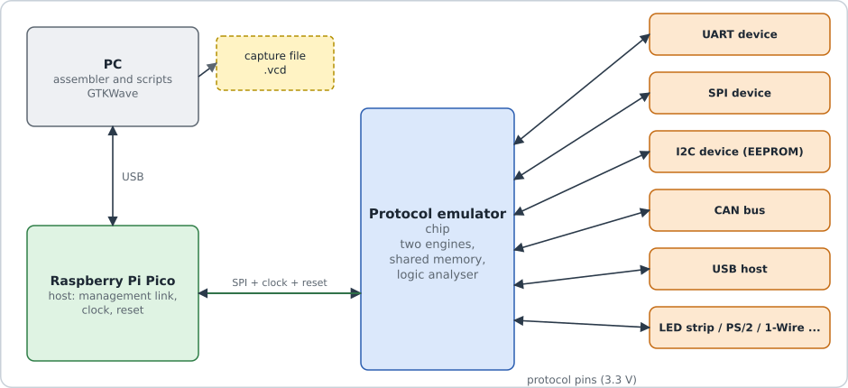

### 1.3 Block diagram
**[PLACEHOLDER]** figure: management link, pin manager, two engines, shared instruction memory, FIFOs, helper units.

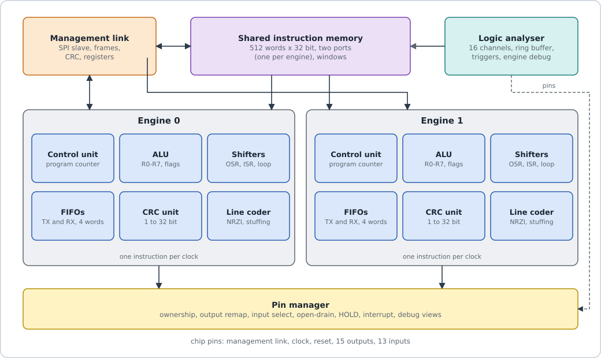

### 1.4 Specifications at a glance
**[PLACEHOLDER]** table: clock up to 50 MHz, two engines, 512-word shared instruction memory (32-bit words), 4-word FIFOs, 8 protocol pins per engine, 3.3 V logic.

### 1.5 Supported protocols
UART, SPI (master and slave), I2C (master and slave), SMBus, Modbus RTU, 1-Wire, JTAG, SWD, CAN 2.0A, USB low speed, WS2812, PS/2. See 10.

### 1.6 What you need
A Raspberry Pi Pico, a PC with Python 3, jumper wires, the chip on its board, a target device for the protocol you want, and GTKWave for captures.

### 1.7 How this guide is organised
Part I gets the chip running, Part II explains each feature, Part III is reference.

## 2. Hardware setup
*Status: verified in simulation.*

### 2.1 Pin overview
The chip has a clock, a reset, a management SPI link and a set of programmable protocol pins.

### 2.2 Pin map
| Pin | Direction | Function |
|---|---|---|
| `ui_in[0]` | host to chip | management SCLK |
| `ui_in[1]` | host to chip | management MOSI |
| `ui_in[2]` | host to chip | management CS_N (active low) |
| `uo_out[0]` | chip to host | management MISO |
| `ui_in[3]` | host to chip | HOLD (high releases all engine-driven pins), or a protocol input |
| `uio[7:0]` | bidirectional | protocol pins |
| `ui_in[7:4]`, `uo_out[7:1]` | in / out | protocol inputs / outputs and the default debug and interrupt functions |
| `clk`, `rst_n`, `ena` | host to chip | system clock, reset (active low), enable |

> **[PLACEHOLDER]** confirm every name and the default functions against the final pin map (Appendix C).

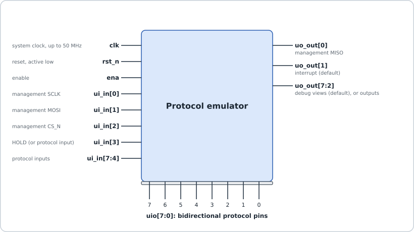

### 2.3 Power supply
**[PLACEHOLDER]** supply voltage, current, decoupling.

### 2.4 Clock
A clock up to 50 MHz on `clk`; the Pico can generate it (4.3). Any slower clock works; see 14.

### 2.5 Reset
`rst_n` low resets the chip; hold it low for at least a few clock cycles, then release. **[PLACEHOLDER]** exact minimum.

### 2.6 Connecting a Raspberry Pi Pico
**[PLACEHOLDER]** wiring table and diagram: Pico SPI0 (SCK, TX, RX, CS) to the management link, a Pico clock output pin to `clk`, a GPIO to `rst_n`, optional GPIO to HOLD and the interrupt output.
See the [Pico pinout](https://datasheets.raspberrypi.com/pico/Pico-R3-A4-Pinout.pdf) and the [RP2040 datasheet](https://datasheets.raspberrypi.com/rp2040/rp2040-datasheet.pdf).

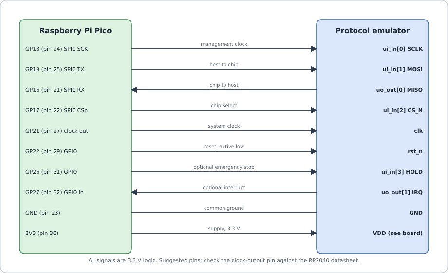

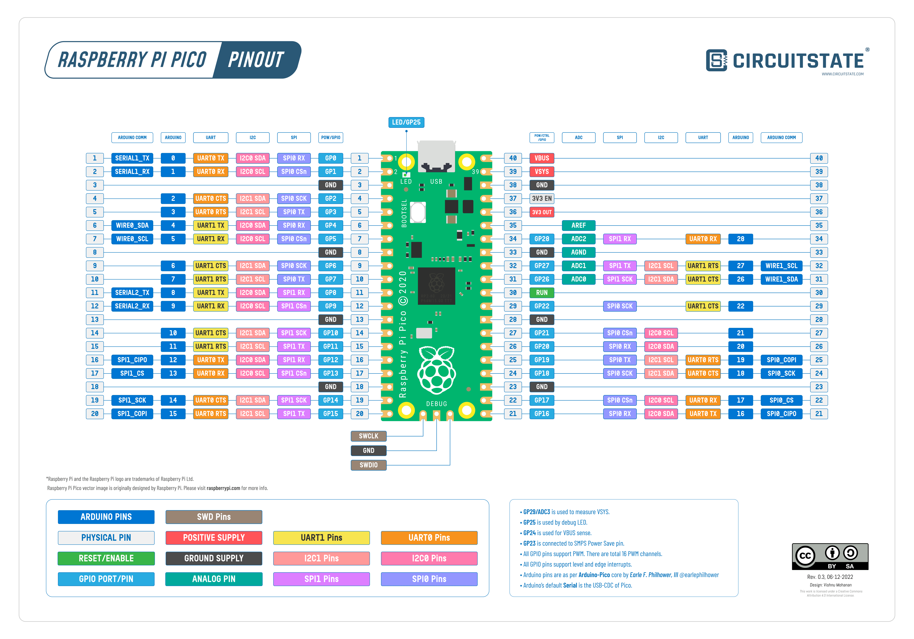

### 2.7 Voltage levels and protection
Both sides are 3.3 V. Add series resistors (about 100 ohm) on the management link if the wires are long.

### 2.8 Connecting the target device
Protocol wiring is in chapter 10, one recipe per protocol (pull-ups, termination, level shifting).

### 2.9 Recommended layout and cabling
Keep the management link wires short and the clock wire away from the data wires. **[PLACEHOLDER]** layout figure.

## 3. First power-on
*Status: verified in simulation.*

### 3.1 Pre-power checklist
Wiring checked against 2.6, 3.3 V only, clock source ready, nothing on the protocol pins yet.

### 3.2 Applying power and reset
Power the board, start the clock, release `rst_n`. The chip comes up with both engines held and every protocol pin undriven.

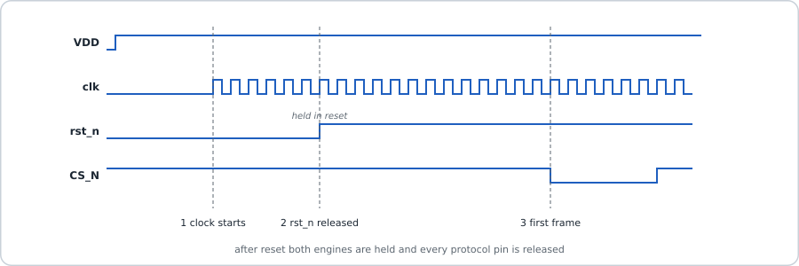

### 3.3 Reading the identity registers
Read ID (0x0000) = `0x50454D31` ('PEM1'), VERSION (0x0004), CAPABILITY (0x0008): engines, instruction words (512), FIFO depth (4). **[PLACEHOLDER]** Pico code.

### 3.4 Scratch register loopback test
Write a value to SCRATCH (0x000C), read it back. If it matches, the link works in both directions.

### 3.5 The status byte
Every frame returns a STATUS byte: alive, error, RUN of each engine, TX FIFO full, RX FIFO has data (details in 5.5).

### 3.6 Running a first test program
Load the tiny "write a word to the RX FIFO" program of 8.10 and read the word back. **[PLACEHOLDER]** Pico code.

### 3.7 What success looks like
ID reads 'PEM1', the scratch value comes back, the test program's word arrives, and the error flag stays clear.

### 3.8 If something fails
Go to 16.1 and 16.2.

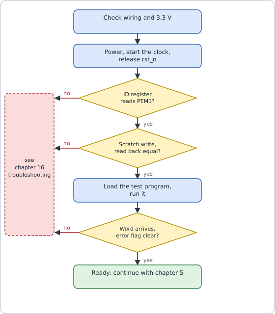

## 4. The Raspberry Pi Pico as host
*Status: **[PLACEHOLDER]** the Pico library does not exist yet; the PC library `host/chip_host.py` is verified in simulation.*

### 4.1 Choosing a toolchain
MicroPython is the default in this guide ([MicroPython RP2 quick reference](https://docs.micropython.org/en/latest/rp2/quickref.html)); the C SDK is an alternative ([Pico C SDK](https://datasheets.raspberrypi.com/pico/raspberry-pi-pico-c-sdk.pdf)).

### 4.2 Installing MicroPython and the library
**[PLACEHOLDER]** firmware download, copying `pe_chip.py` to the Pico.

### 4.3 Configuring SPI and the clock output
SPI mode 0, MSB first, SCLK no faster than about one sixteenth of the chip clock ([machine.SPI](https://docs.micropython.org/en/latest/library/machine.SPI.html)). **[PLACEHOLDER]** clock output setup.

### 4.4 The host library overview
**[PLACEHOLDER]** the API of `pe_chip`: connect, read, write, load image, start, stop, FIFO access, errors.

### 4.5 Hello chip: first script
**[PLACEHOLDER]** the ten-line script of 3.3 to 3.6.

### 4.6 Using the assembler and sending images to the Pico
Write and assemble programs on a PC (8.9), then send the words to the Pico over USB serial or store them on its flash. **[PLACEHOLDER]** transfer script.

### 4.7 Storing images in flash
**[PLACEHOLDER]** image file format and loader.

### 4.8 Power, USB and serial console
**[PLACEHOLDER]** powering from USB, using the REPL, safe shutdown.

# Part II: Using the chip

## 5. The management link
*Status: verified in simulation.*

### 5.1 How the link works
The Pico is the SPI master. Every access is one fixed-length frame, full duplex: the chip answers while the host sends.

### 5.2 Frame format v1
Seven bytes, big endian: operation (0x01 write, 0x02 read), 16-bit address, 32-bit data. No CRC.

### 5.3 Frame format v2
Twelve bytes with a sequence number and CRC-16/CCITT-FALSE in both directions: use it on real wiring. Operations 0x80 (no-op), 0x81 (write), 0x82 (read).

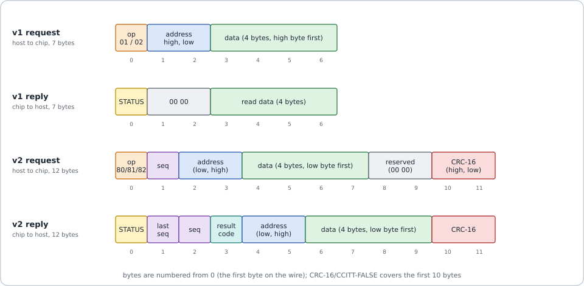

### 5.4 Commands: write and read
**[PLACEHOLDER]** worked examples with bytes on the wire (see `host/chip_host_demo.py` for a guided tour).

### 5.5 The STATUS byte and flow control
Bit 7 alive, bit 6 error, bits 5:4 RUN of engines 1 and 0, bits 3:2 TX FIFO full, bits 1:0 RX FIFO has data. v1 writes to a full FIFO are dropped and must be resent.

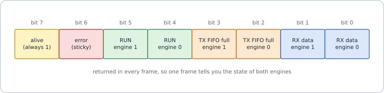

### 5.6 Retries and exactly-once behaviour
In v2 a repeated frame never runs twice and the older result is returned again. **[PLACEHOLDER]** retry loop for the Pico.

### 5.7 Result codes and errors
OK, BUSY, BAD_ADDR, BAD_VALUE, NOT_ALLOWED, BAD_OP (Appendix D).

### 5.8 Timing and maximum SPI speed
SCLK high and low at least 8 chip clocks (about 3 MHz at 50 MHz); chip select set up 4 clocks before the first edge.

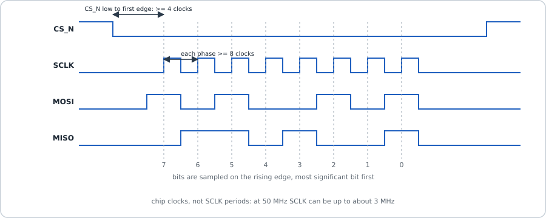

### 5.9 Address map
Summary in Appendix A: identity registers at 0x0000, pin window 0x0200, instruction memory window 0x0400, engine 0 at 0x1000, engine 1 at 0x2000.

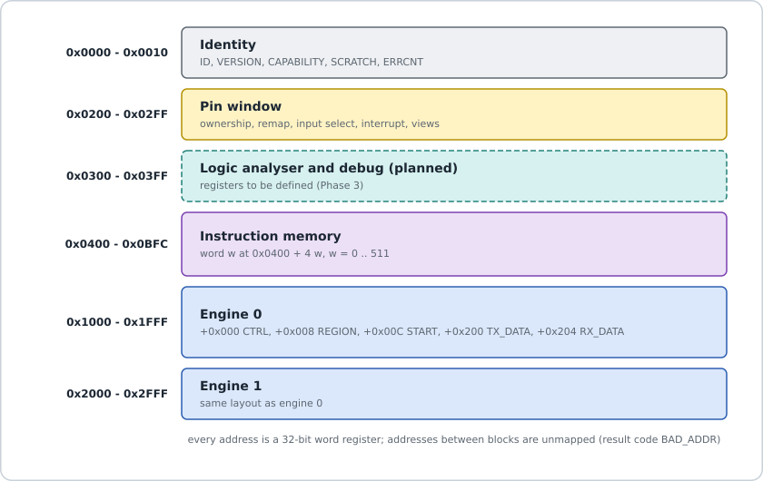

### 5.10 Pico code examples
**[PLACEHOLDER]** read, write, retry, burst (needs the Pico library).

## 6. Pins
*Status: verified in simulation.*

### 6.1 Pin ownership
A protocol pin is driven only by the engine that owns it; claims are refused while that engine runs.

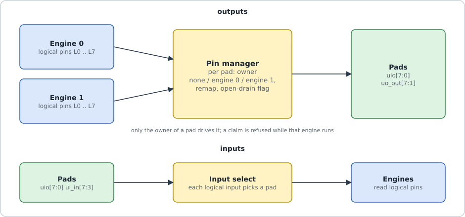

### 6.2 Output remapping
Any logical pin of an engine can be placed on any output pin. **[PLACEHOLDER]** register recipe.

### 6.3 Input selection
Each logical input can be taken from any input pin.

### 6.4 Open-drain mode
For I2C, 1-Wire and other shared buses: the pin is driven low or released, never high.

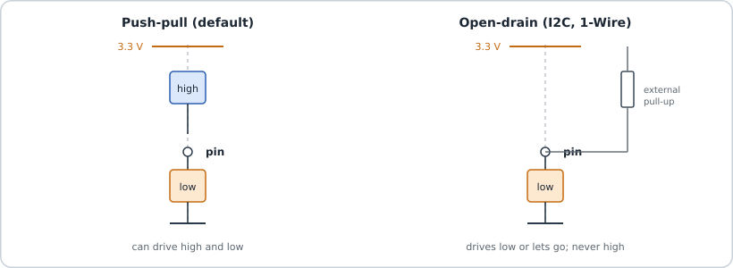

### 6.5 The HOLD pin
Raising HOLD stops both engines and releases every driven pin within a clock; useful as an emergency stop.

### 6.6 Interrupt output and mask
**[PLACEHOLDER]** sources, mask register, how to wire it to a Pico GPIO.

### 6.7 Debug views
**[PLACEHOLDER]** the status signals that can be shown on the spare output pins.

### 6.8 Violation flags
The chip records when an engine drives a pin it does not own; read and clear in the pin window.

### 6.9 Pin planning examples
**[PLACEHOLDER]** worked pin plans for common combinations (UART + SPI, I2C + CAN).

## 7. Running programs
*Status: verified in simulation.*

### 7.1 The two engines
Two independent engines, each with its own registers, shifters, FIFOs and pins; they run side by side from one memory.

### 7.2 The shared instruction memory
512 words of 32 bits. Both engines fetch from it at the same time; the host chooses where each program lives.

### 7.3 Windows and OP_REGION
A program's first instruction states which words it may fetch (`OP_REGION`); fetching outside the window faults the engine, and the window cannot be changed while the engine runs.

### 7.4 Choosing origins and planning images
Place images so that images that run together do not overlap. The host layer checks this.

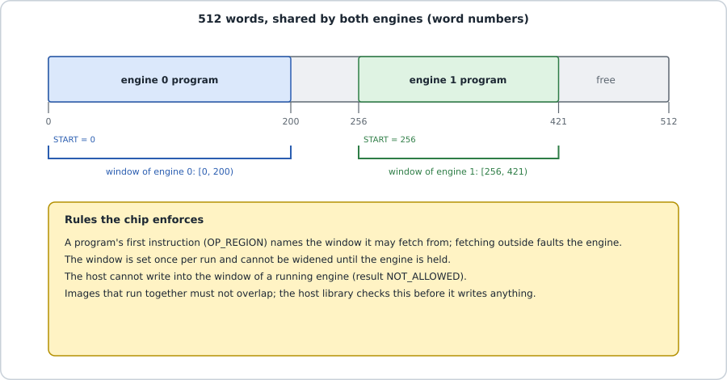

### 7.5 Loading and verifying an image
Write the words with the engines held and read them back (frame v2). **[PLACEHOLDER]** Pico code.

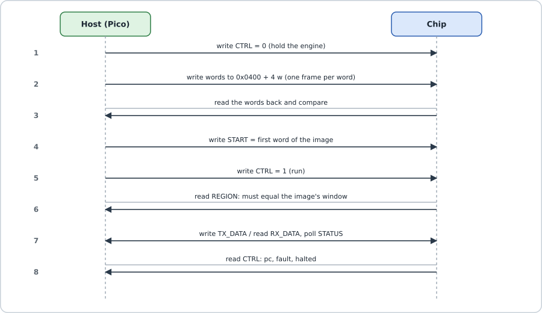

### 7.6 START, RUN and HOLD
Write START to the program's first word, then set RUN. Clearing RUN holds the engine and clears its window.

### 7.7 Reading status, faults and the PC
CTRL (base + 0x000) reads the program counter, fault and halted flags; REGION (base + 0x008) reads the window the engine holds.

### 7.8 Running both engines together
Load two images at different origins, start both, check each REGION.

### 7.9 Stopping and re-loading
Stop the engine, load, write START, run again. Loading into a running engine's window is refused.

### 7.10 Data in and out: FIFOs
The host pushes words into an engine's TX FIFO and reads its RX FIFO (base + 0x200 and + 0x204); both hold four words.

### 7.11 Fault handling
A fault stops the engine and sets its flag (illegal instruction, fetch outside the window, bad window); stop, fix, reload.

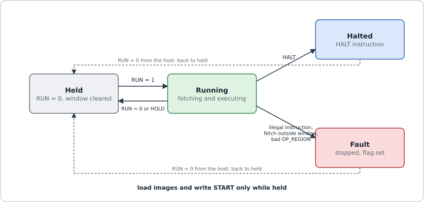

## 8. Instruction set and assembler
*Status: verified in simulation.*

### 8.1 Programming model
Eight 32-bit registers R0-R7, flags Z N C, output and input shift registers, a loop counter, one instruction per clock.

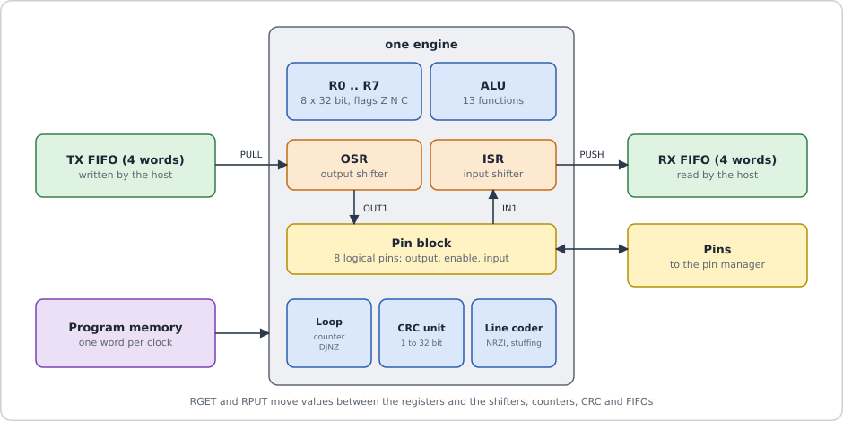

### 8.2 Instruction summary
**[PLACEHOLDER]** table of all instructions (full table in Appendix B and in the repository file `instructions.md`).

### 8.3 Timing rules
Every instruction takes one clock except the waits (WAIT d, OUT1 d, IN1 d take d + 1) and the stalls on empty or full FIFOs.

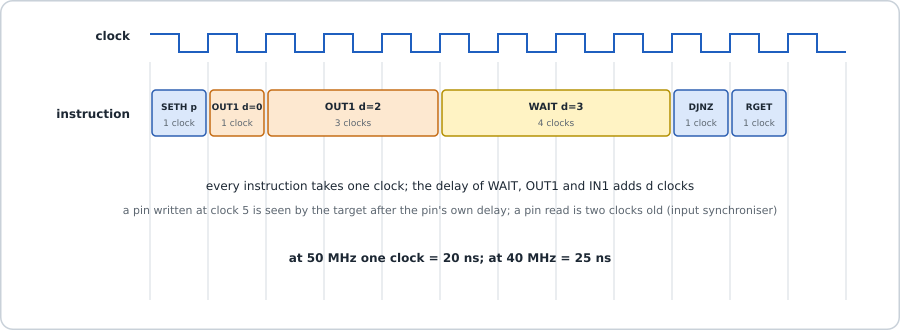

### 8.4 Pin instructions
SETH, SETLO, DIRO, DIRI, OUT1, IN1, WAITH, WAITL.

### 8.5 Flow control
JMP, DJNZ, JPH, JPL, JPO, JCC, HALT.

### 8.6 Data and ALU
LDI, ALU (13 functions), RGET, RPUT.

### 8.7 FIFO instructions
PULL, PUSH, PUSHI.

### 8.8 Special instructions
CRC (programmable), LINE (line coder), REGION (window). **[PLACEHOLDER]** TSTAMP (timestamp), planned.

### 8.9 The assembler
`host/asm.py` builds programs from Python; `words_at(origin)` links a program for a shared-memory address. **[PLACEHOLDER]** command-line wrapper.

### 8.10 Your first program
**[PLACEHOLDER]** a program that loads 7 into a register, pushes it to the RX FIFO and halts, with the exact assembler lines and the expected result.

### 8.11 Debugging a program on the model
`host/isa_model.py` runs a program cycle by cycle on a PC and prints pins and registers before you load it into the chip.

## 9. Built-in helpers
*Status: verified in simulation.*

### 9.1 FIFOs
Two four-word FIFOs per engine, host to engine and engine to host.

### 9.2 ALU and registers
Add, subtract, logic, shifts, compare, parity, bit reverse; flags drive conditional jumps.

### 9.3 CRC unit
A programmable CRC of 1 to 32 bits (CRC-5, CRC-16, CRC-32 and others), one byte per instruction.

### 9.4 Line coder
Sends and receives bytes with NRZI coding, bit stuffing and an end-of-packet, used for USB.

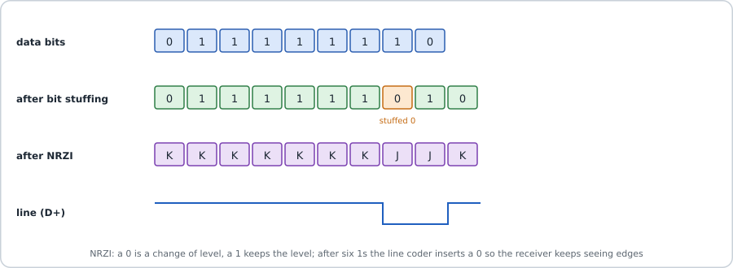

### 9.5 Timestamp counter
**[PLACEHOLDER]** free-running counter read with TSTAMP, planned.

### 9.6 Shifters
Output and input shift registers for serialising bits.

## 10. Protocol cookbook
*Status: verified in simulation unless stated.*

### 10.1 How to read a recipe
Each recipe lists: wiring, pins to claim, firmware generator script, host steps, expected result, limits. **[PLACEHOLDER]** one fully worked recipe as the template.

### 10.2 UART
Transmit, receive and full duplex; scripts `uart_workload.py`, `uart_rx_prog.py`. Verified on a development FPGA board as well.

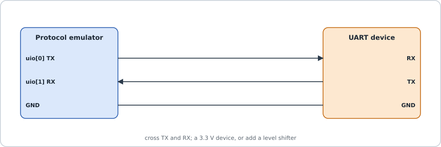

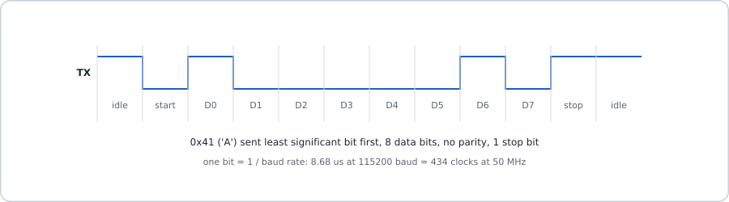

### 10.3 SPI master
Modes 0 to 3, script `spi_prog.py`.

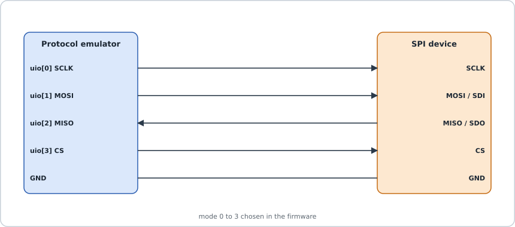

### 10.4 SPI slave
Modes 0 and 1 (and the others), script `spi_prog.py`; the host must keep the FIFOs served.

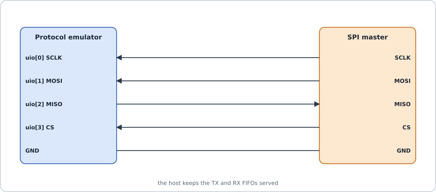

### 10.5 I2C master
100, 400 and 1000 kHz with clock stretching, script `i2c_prog.py`; open-drain pins and external pull-ups.

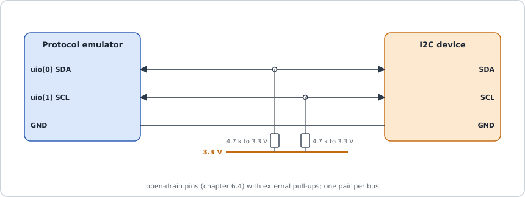

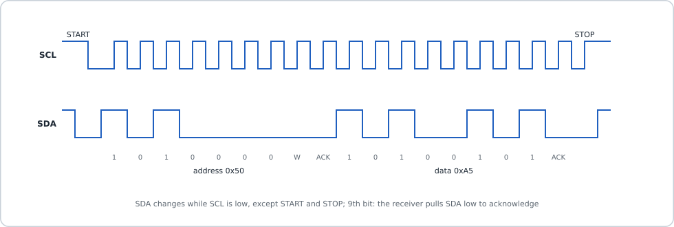

### 10.6 I2C slave
Host decides the address match; the slave stretches the clock while waiting for the host. See the [I2C specification](https://www.nxp.com/docs/en/user-guide/UM10204.pdf).

### 10.7 SMBus
I2C with packet error checking (CRC-8), script `i2c_prog.py` (PEC variant).

### 10.8 Modbus RTU
Master and slave with CRC-16, script `modbus_prog.py`; needs an RS-485 transceiver ([Modbus serial line specification](https://modbus.org/docs/Modbus_over_serial_line_V1_02.pdf)).

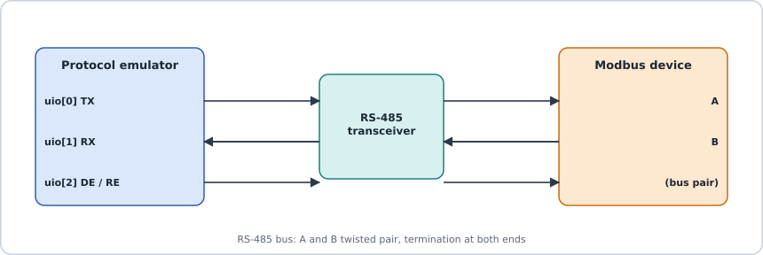

### 10.9 1-Wire
Reset, presence, bit and byte transfers, script `onewire_prog.py`.

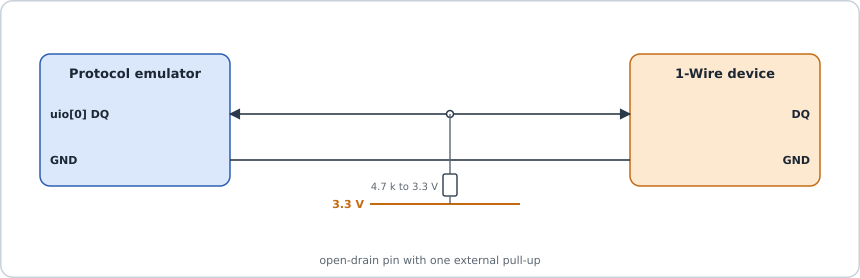

### 10.10 JTAG
TAP master, IDCODE read and shifts, script `jtag_prog.py`.

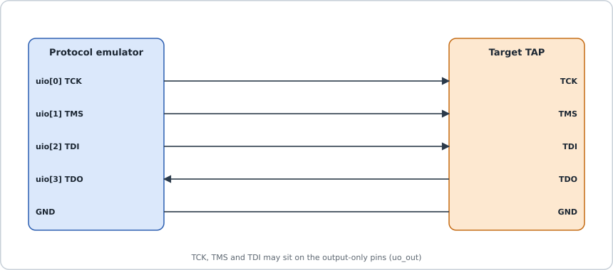

### 10.11 SWD
Host side with DP and memory access, script `swd_prog.py`.

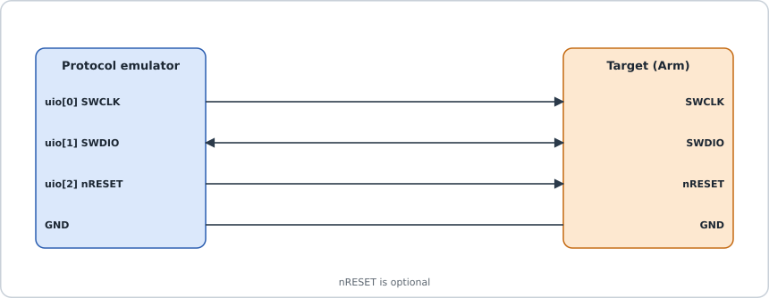

### 10.12 CAN
CAN 2.0A transmit and receive (no arbitration or error frames), script `can_prog.py`; needs a CAN transceiver.

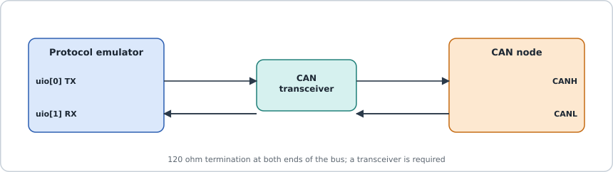

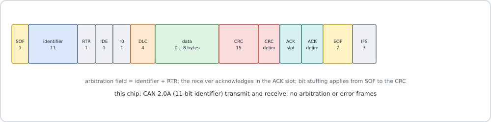

### 10.13 USB low speed
Today: a packet-relay firmware (`usb_prog.py`) with descriptors supplied by host software. **[PLACEHOLDER]** the standalone device with descriptors on the chip, planned. See the [USB 2.0 specification](https://www.usb.org/document-library/usb-20-specification).

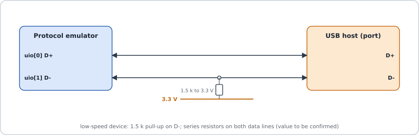

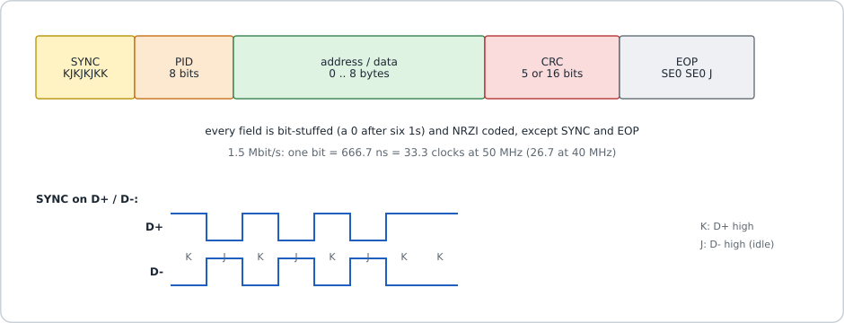

### 10.14 WS2812
Addressable LED strips, script `ws2812_prog.py`.

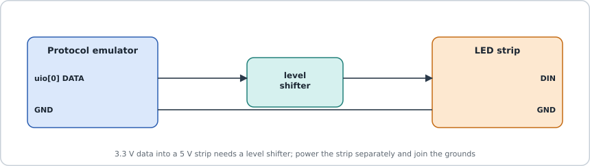

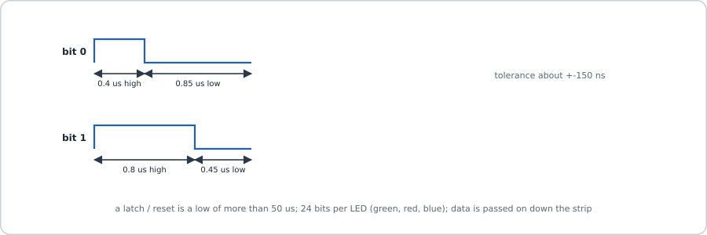

### 10.15 PS/2
Device link layer, script `ps2_prog.py`.

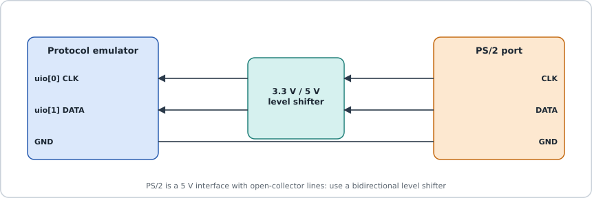

### 10.16 Other protocols
**[PLACEHOLDER]** the catalogue of further protocols (`docs/PROTOCOL_CATALOGUE.md`): MIDI, DMX512, LIN, DShot, I2S, IR remotes and more, firmware only; Ethernet (10BASE-T) transmit, planned.

### 10.17 Running two protocols at once
One protocol per engine, on separate pins; example: SPI master on engine 0 and I2C master on engine 1.

## 11. Logic analyser
*Status: capture unit verified in simulation; **[PLACEHOLDER]** registers and host tool planned.*

### 11.1 What it does
Records what the pins do, with the time of every change, around an event you choose, and gives it to you as a waveform file.

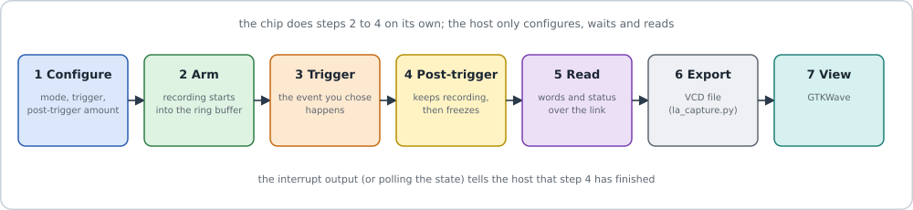

### 11.2 Channels
Sixteen: channels 0-7 are `uio[7:0]`, 8-12 are `ui_in[7:3]`, 13 and 14 are RUN of engines 0 and 1, 15 is a marker line set by firmware.

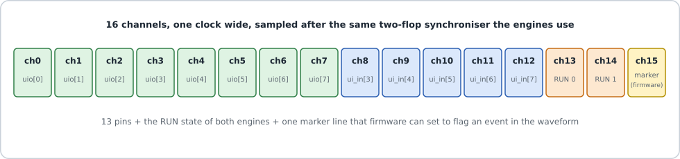

### 11.3 Setting up a capture
**[PLACEHOLDER]** choose mode, trigger, post-trigger amount (registers and host calls to be defined in logic analyser Phase 3).

### 11.4 Trigger types
Manual, pattern (mask and value), rising edge, falling edge, firmware marker.

### 11.5 Change mode and sample mode
Change mode stores one word per change with the clocks since the last one (idle time costs nothing); sample mode stores 8 channels every N clocks.

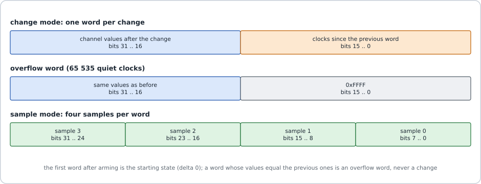

### 11.6 Arming and waiting
Arm, then wait for the interrupt or poll the state (idle, armed, triggered, done). Re-arming restarts the capture.

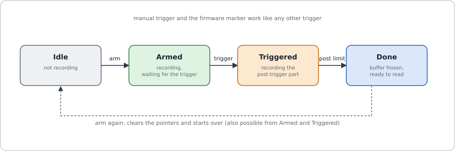

### 11.7 Reading the buffer
The buffer is a ring of 256 words, read oldest first after the capture has stopped. **[PLACEHOLDER]** read procedure.

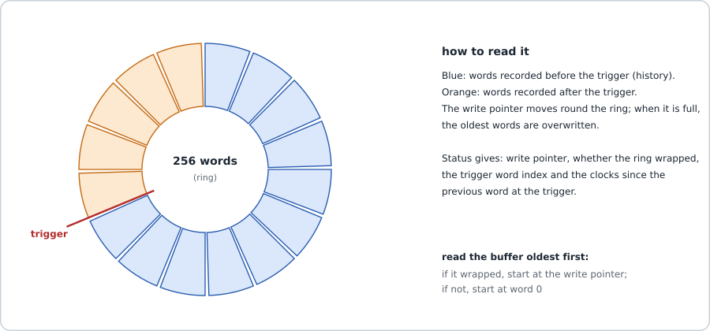

### 11.8 Exporting a VCD file
`host/la_model.py` already contains the decoder and VCD writer used by the tests; **[PLACEHOLDER]** the host tool `la_capture.py` that reads the chip and writes the file.

### 11.9 Viewing the capture in GTKWave
Open the file with `gtkwave capture.vcd` (try the sample `docs/images/example_capture.vcd` first), add the signals from the left tree, zoom to fit, and use markers to measure times; one VCD tick is one chip clock. See the [GTKWave site](https://gtkwave.sourceforge.net/). **[PLACEHOLDER]** screenshots and the save-file (.gtkw) with names and colours for the 16 channels.

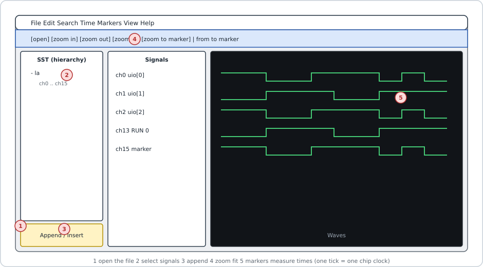

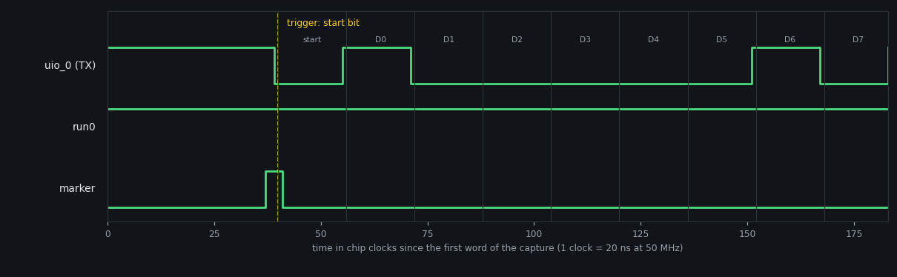

### 11.10 Marking events from firmware
Firmware sets the marker line (channel 15) at the moment of interest; it shows up in the waveform and can be the trigger.

### 11.11 Capture recipes
**[PLACEHOLDER]** capture the start of an I2C transfer, one UART byte, a CAN frame.

### 11.12 Limits
256 words of history, 20 ns resolution at 50 MHz, readout only after the capture stops, pins only (no analog).

## 12. Sniffer and engine debug
*Status: **[PLACEHOLDER]** planned.*

### 12.1 Overview
A sniffer is a program that watches a bus without driving it; engine debug lets you stop and inspect an engine.

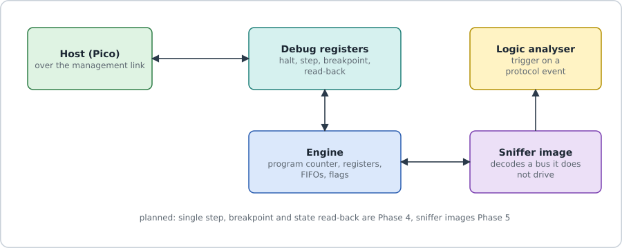

### 12.2 Protocol sniffer images
**[PLACEHOLDER]** I2C, SPI, UART, CAN and USB monitors: how to load and read them.

### 12.3 Protocol triggers
**[PLACEHOLDER]** starting the logic analyser on a protocol event.

### 12.4 Halting and resuming
RUN and HOLD already stop and restart an engine (7.6).

### 12.5 Single-stepping
**[PLACEHOLDER]** execute exactly one instruction.

### 12.6 Breakpoints
**[PLACEHOLDER]** one breakpoint per engine.

### 12.7 Reading engine state
**[PLACEHOLDER]** registers, flags, shifters, FIFO levels, counters.

### 12.8 Reading back instruction memory
Available: read loaded words back through a held engine's port (frame v2) to verify a load.

## 13. Writing your own protocol
*Status: verified in simulation (method).*

### 13.1 Method
Read the specification, compute the timing in clocks, write the program, test it on the model, then against an independent peer model, then on the chip.

### 13.2 Clocks per bit arithmetic
Clocks per bit = clock frequency / bit rate; write it down for the clocks you will use (14.4).

### 13.3 Choosing pins and modes
Decide direction, open-drain or push-pull, and which engine owns each pin (chapter 6).

### 13.4 Writing and testing on the model
Use `host/asm.py` and `host/isa_model.py` (8.9, 8.11).

### 13.5 Testing against a peer
The test scripts show how to drive an independent model of the other side (Appendix E).

### 13.6 Timing checks
Check set-up and hold times against the specification in clock cycles; the peer models report violations.

### 13.7 Common mistakes
Forgetting to claim pins, sampling at the wrong point in the bit, not serving the FIFOs, assuming a clock other than the one used.

# Part III: Reference

## 14. Clock and timing
*Status: verified in simulation.*

### 14.1 Choosing the clock frequency
Anything up to 50 MHz; 40 MHz makes I2C at 1 MHz, CAN at 1 Mbit/s and WS2812 come out as whole numbers of clocks.

### 14.2 Maximum clock
The chip meets timing at 50 MHz in the worst case. **[PLACEHOLDER]** final figure from the last layout run.

### 14.3 Rescaling firmware for another clock
Times are counts of clocks, so regenerate the firmware with the new clock frequency; logic does not change.

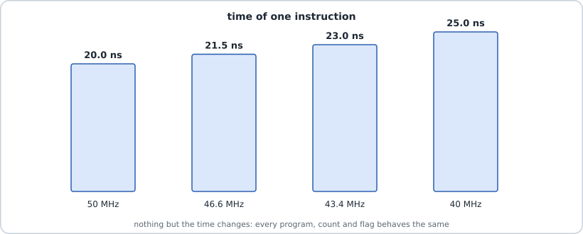

### 14.4 Rates and limits per protocol
**[PLACEHOLDER]** table of clocks per bit and maximum rate at 50, 46.6, 43.4 and 40 MHz (see `docs/CLOCK_SPEED_EFFECTS.md`).

### 14.5 Management link speed versus clock
The SPI clock must stay below one sixteenth of the chip clock.

## 15. Electrical and timing limits
*Status: **[PLACEHOLDER]**.*

### 15.1 Supply and logic levels
3.3 V logic. **[PLACEHOLDER]** supply range and input thresholds.

### 15.2 Pin drive and loading
**[PLACEHOLDER]** output current, load limits, external drivers needed for RS-485, CAN, USB.

### 15.3 Input timing and synchronisation
Inputs pass two flip-flops, so a pin read is two clocks old.

### 15.4 Maximum clock frequency
See 14.2.

### 15.5 Power
**[PLACEHOLDER]** typical power at 50 MHz.

### 15.6 Absolute maximum ratings
**[PLACEHOLDER]**

## 16. Troubleshooting and debug

### 16.1 First checks
Power, ground, 3.3 V, clock present, `rst_n` released, wires on the right pins.

### 16.2 No response on the link
MISO stays low: check CS_N polarity, SPI mode 0, SCLK speed, clock running.

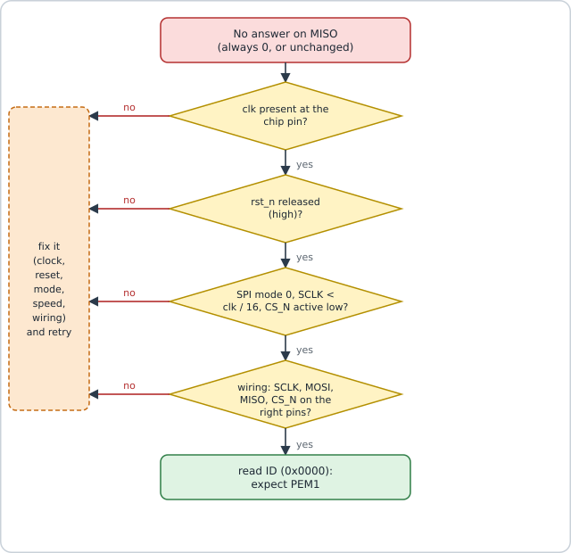

### 16.3 Wrong or garbled data
Use frame v2 (CRC); check the SPI speed against 5.8 and the wire length.

### 16.4 Program does not start, stops or faults
Read CTRL and REGION (7.7); check origin, START, window, and the fault flag.

### 16.5 Protocol problems
**[PLACEHOLDER]** per-protocol checklists: UART baud tolerance, SPI mode, I2C pull-ups and open-drain, CAN transceiver, USB pull-up.

### 16.6 Using the logic analyser to debug
Capture around the failing event and compare with the protocol specification in GTKWave (11).

### 16.7 Using the model to reproduce a problem
Run the same program on `host/isa_model.py` and compare.

### 16.8 Result and error code lookup
Appendix D.

### 16.9 Reporting a problem
**[PLACEHOLDER]** what to include: program image, clock, wiring, capture, result codes.

## 17. How the chip was verified
*Status: verified in simulation.*

### 17.1 What was tested
Every instruction against an independent model, every protocol against an independent peer model, planted-bug checks on the tests, and formal proofs of the pin and memory safety rules.

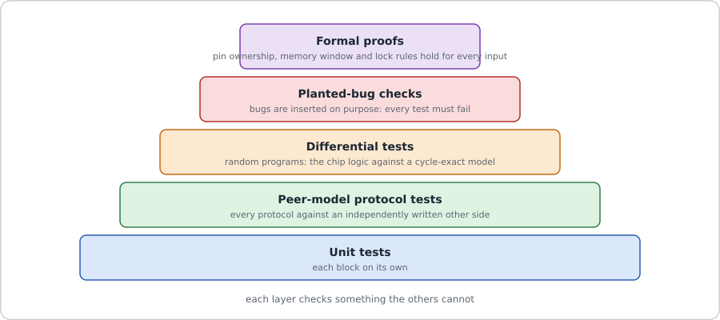

### 17.2 Running the checks yourself
`python3 host/regress.py` runs the whole regression on a PC; **[PLACEHOLDER]** a short self-test for a connected chip.

### 17.3 Known limits
CAN has no arbitration or error frames; UART receive accepts a glitch as a start bit; the management link moves about one word per frame.

# Appendices

## Appendix A. Register map
**[PLACEHOLDER]** full table (copy from `docs/HOST_INTERFACE.md`); logic analyser and debug registers to be added.

| Address | Name | Access | Meaning |
|---|---|---|---|
| 0x0000 | ID | R | 'PEM1' |
| 0x0004 | VERSION | R | frame versions, ISA version |
| 0x0008 | CAPABILITY | R | engines, instruction words, FIFO depth |
| 0x000C | SCRATCH | R/W | 32-bit scratch register |
| 0x0010 | ERRCNT | R | counters of CRC, length and sequence errors |
| 0x0200-0x02FF | pin window | R/W | pin ownership, remap, input select, interrupt, views |
| 0x0400 + 4w | instruction word w | R/W | shared memory, w = 0..511 |
| 0x1000 / 0x2000 + 0x000 | CTRL | R/W | RUN; read: pc, fault, halted |
| + 0x008 | REGION | R | window the engine holds |
| + 0x00C | START | R/W | first program counter value |
| + 0x200 | TX_DATA | W | word into the TX FIFO |
| + 0x204 | RX_DATA | R | word from the RX FIFO (pops) |

## Appendix B. Opcode table
**[PLACEHOLDER]** all opcodes with encodings (source: `instructions.md`).

## Appendix C. Pin tables
**[PLACEHOLDER]** final pin map, reset-default functions, remap field encoding.

## Appendix D. Result codes and error flags
| Code | Name | Meaning |
|---|---|---|
| 0 | OK | done |
| 1 | BUSY | TX FIFO full or RX FIFO empty: try again |
| 2 | BAD_ADDR | address not mapped |
| 3 | BAD_VALUE | value or reserved bits not allowed |
| 4 | NOT_ALLOWED | refused in the current state (for example loading into a running window) |
| 6 | BAD_OP | unknown operation |

## Appendix E. Script index
All scripts are in the `host/` folder of the repository; **[PLACEHOLDER]** one line of usage for each.

| Script | Purpose |
|---|---|
| `asm.py` | assembler for engine programs |
| `chip_host.py`, `shmem_host.py` | host library for the management link and the shared memory (PC; simulator) |
| `chip_host_demo.py` | guided tour of the link |
| `isa_model.py` | cycle-exact model of an engine |
| `*_prog.py` | firmware generators: `uart_rx_prog`, `spi_prog`, `i2c_prog`, `can_prog`, `jtag_prog`, `swd_prog`, `modbus_prog`, `onewire_prog`, `ps2_prog`, `usb_prog`, `ws2812_prog` |
| `*_test.py` | protocol tests against peer models: `spi_test`, `i2c_test`, `can_test`, `jtag_test`, `modbus_test`, `onewire_test`, `ps2_test`, `swd_test`, `usb_test`, `ws2812_test` |
| `regress.py` | the whole regression |
| `la_model.py` | logic analyser model, decoder and VCD writer |

## Appendix F. Glossary
**[PLACEHOLDER]** engine, window, frame, FIFO, OSR, ISR, NRZI, bit stuffing, VCD.

## Appendix G. References and links
Links marked ✔ answered when checked; the others were not reachable from the check environment and need a manual check.

| Topic | Link | Checked |
|---|---|---|
| Pico datasheet | https://datasheets.raspberrypi.com/pico/pico-datasheet.pdf | ✔ |
| Pico pinout | https://datasheets.raspberrypi.com/pico/Pico-R3-A4-Pinout.pdf | ✔ |
| RP2040 datasheet | https://datasheets.raspberrypi.com/rp2040/rp2040-datasheet.pdf | to check |
| Pico C SDK | https://datasheets.raspberrypi.com/pico/raspberry-pi-pico-c-sdk.pdf | to check |
| MicroPython RP2 | https://docs.micropython.org/en/latest/rp2/quickref.html | ✔ |
| MicroPython SPI | https://docs.micropython.org/en/latest/library/machine.SPI.html | ✔ |
| GTKWave | https://gtkwave.sourceforge.net/ | ✔ |
| I2C specification | https://www.nxp.com/docs/en/user-guide/UM10204.pdf | to check |
| USB 2.0 | https://www.usb.org/document-library/usb-20-specification | ✔ |
| Modbus serial line | https://modbus.org/docs/Modbus_over_serial_line_V1_02.pdf | ✔ |
| CAN 2.0 | http://esd.cs.ucr.edu/webres/can20.pdf | to check |
| WS2812B | https://cdn-shop.adafruit.com/datasheets/WS2812B.pdf | to check |
| PS/2 protocol | http://www.computer-engineering.org/ps2protocol/ | to check |
| Arm debug interface (SWD) | https://developer.arm.com/documentation/ihi0031/latest/ | to check |

## Appendix H. Quick-reference card
**[PLACEHOLDER]** one page: frame formats, STATUS bits, address map, the load-and-run sequence, and the pin-claim sequence.

## Appendix I. Figure credits

Every diagram in this guide is drawn for it and regenerated by `python3 docs/images/make_images.py` (SVG, plus the capture example from `host/la_model.py`).
One image comes from outside:

| Figure | Author and source | Licence |
|---|---|---|
| Raspberry Pi Pico pinout (section 2.6) | Vishnu Mohanan, CIRCUITSTATE Electronics, revision 0.3, https://www.circuitstate.com/pinouts/raspberry-pi-pico-rp2040-microcontroller-board-pinout-diagrams/ | CC BY-SA 4.0 (https://creativecommons.org/licenses/by-sa/4.0/), unchanged; see `docs/images/third_party/ATTRIBUTION.md` |

Check pin functions against the official [Pico pinout](https://datasheets.raspberrypi.com/pico/Pico-R3-A4-Pinout.pdf) and the [RP2040 datasheet](https://datasheets.raspberrypi.com/rp2040/rp2040-datasheet.pdf).
