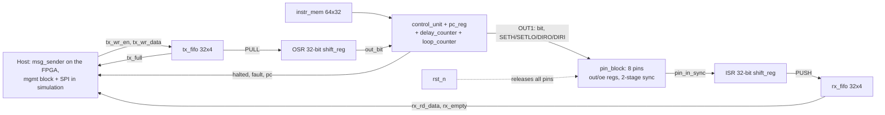

# Workstream 1 — Architecture: Staged, Incremental Plan

Companion to [PROTOCOL_EMULATOR_ARCHITECTURE.md](PROTOCOL_EMULATOR_ARCHITECTURE.md)
and [EXECUTION_PLAN.md](EXECUTION_PLAN.md) | 2026-09-27, revised 2026-10-11 |
Status: **v0.1 through v0.3 are built** (single engine, FPGA bring-up, host-writable memory, second engine, UART RX and
full duplex, SPI management link). Remaining work is the memory architecture (SRAM), pin ownership, the final management
frame, SPI/I2C firmware and the GDS flow. See [../instructions.md](../instructions.md) for the authoritative opcode table
and per-protocol programs, and the [roadmap table](#version-roadmap-brief--full-detail-for-v01-only-further-down) for
per-version status.

> **Revision note (2026-10-11).** Statuses were brought up to date: the roadmap below is annotated with what is built,
> A2/A3/A4/A5/A7/A8 describe what exists today, and the v0.2 hardware checklist is marked done. The v0.1 text itself is
> kept as the record of the original reasoning. Two decisions changed: the 12-byte CRC frame is **not** built yet (an
> interim 7-byte frame is, see A3), and the physical instruction-memory size is **no longer frozen** because flip-flop
> memory is 80 % of the chip (see [ASIC_AREA_AND_MEMORY_STUDY.md](ASIC_AREA_AND_MEMORY_STUDY.md)).

> **Revision note (2026-10-03).** The original v0.1 below was UART-shaped: a
> dedicated 10-bit TX shifter, a single `TX_DATA` register, and opcodes such as
> `LDBYTE`/`OUT1` carrying a delay sub-field. Review replaced that with a
> protocol-agnostic engine (generic OSR/ISR shifters, generic FIFOs, an 8-pin
> block, a loop counter) and a flat instruction format. Sections A1, A2, A5, A7
> are rewritten to match what is built; the frozen-decisions table is amended.

## Why a staged architecture, and the one rule that makes it safe

Building everything at once is how a small ASIC project runs out of time
re-doing early decisions. So this plan builds **one working thing at a time**,
starting from the smallest possible useful design (UART transmit only) and
adding one capability per version.

The risk with "start small" is usually: you build something minimal, then
discover the minimal version's addressing/format/wiring choices don't fit the
next feature, and you have to re-do work you already validated. This plan
avoids that with one rule:

> **Some decisions are frozen at v0.1 and never change again. Everything else
> is deliberately minimal and grows version by version.**

| Frozen from v0.1 onward (never renumbered/reshaped later) | Deliberately minimal at v0.1 (grows later) |
|---|---|
| Host frame format (target 12 bytes, CRC-16; **interim 7-byte v1 frame built**, see A3) | Number of opcodes implemented (17 today, up to 32) |
| Register address windows (which address range means "engine 0", "instruction memory", etc.) | Number of registers populated inside each window |
| Instruction word format: **5-bit opcode `[31:27]` + one flat 27-bit operand `[26:0]`** | Number of opcodes actually decoded (unused encodings trap) |
| Timing contract: non-timed instruction = 1 cycle; `WAIT`/`OUT1`/`IN1 d` = exactly d+1 cycles | — |
| Instruction word width (32 bits) and the 6-bit PC / 64-word program window per engine (**the physical store is open**: flops today, SRAM planned) | Number of instructions your v0.1 firmware actually uses (12 for UART TX, 9 for UART RX) |
| 8-pin block with per-pin data/direction registers, reset = all released | Number of pins a given program drives (1 for UART TX) |
| Generic datapath: 32-bit OSR + ISR, 32-bit TX/RX FIFOs — no protocol-named hardware | FIFO depth (4 today), side-set, edge detect, ownership mux |

**Decision reversed from the original table:** the 32-bit word no longer
reserves separate delay (`26:21`) and side-set (`20:18`) sub-fields. A flat
operand keeps every instruction single-purpose and the decoder trivial; delay is
simply the operand of the three timed opcodes. Side-set therefore needs its own
mechanism when SPI/I3C speed demands it (open; see Workstream 2).
| Reset/abort-dominates-everything safety behavior | Number of things reset has to reach (trivial today, all engines/pins later) |

Because the *shape* of these contracts is fixed now, later versions only ever
**add** entries into already-reserved space — they don't rename addresses,
resize words, or renumber pins out from under earlier firmware or host code.
That is what makes each step "fail-proof" in the sense you asked for: nothing
about v0.1 needs to be revisited when v0.2 arrives, only extended.

## Version roadmap (brief — full detail for v0.1 only, further down)

| Version | Adds | One-line reason | Status (2026-10-11) |
|---|---|---|---|
| **v0.1** (this document) | Single generic engine, 17 opcodes, 8-pin block, 4-deep TX/RX FIFOs, OSR/ISR; first firmware = UART TX | Prove the entire chain works end to end: load program → run → pin toggles correctly. Verified cycle-exact 9600–115200 against a Python reference. | **DONE** |
| v0.2 | **FPGA bring-up (DE0-Nano)** + host-writable instruction memory | First hardware proof: message from an on-FPGA host → engine → HC-05 → phone. | **DONE.** Phone received the message; instruction memory has a synchronous write port and a `run` gate |
| v0.3 | UART **RX**, a second engine, input synchronizer, event handshake between engines | Full-duplex UART — this needs two independently-timed engines | **DONE except the event handshake** (not needed so far). UART RX (9 words) uses level waits, no edge detect. Full-duplex echo works on hardware at 115200, and through SPI in simulation |
| *(added)* management link | SPI slave + management module, frame v1 (7 bytes), per-engine RUN | Host loading and control without an on-FPGA host | **DONE in simulation** ([MGMT_PLAN.md](MGMT_PLAN.md)); not yet on the FPGA |
| *(added)* ASIC area study | Yosys on the real CMOS5L cell library | "Think of the whole chip, not the RTL" | **DONE**: flop instruction memory is 80 % of the chip; SRAM and a pin manager evaluated ([ASIC_AREA_AND_MEMORY_STUDY.md](ASIC_AREA_AND_MEMORY_STUDY.md)) |
| v0.4 | SPI firmware + pin ownership/electrical mode mux | Reuses the same engine/ISA; adds pin ownership and optionally side-set | SPI firmware drafted, **not run on RTL**. Ownership: area prototype only |
| v0.5 | I2C firmware + open-drain pin mode | Reuses v0.4's pin mux; adds ACK/NACK handling | Draft primitives only. Open-drain is now planned as a per-pad mode in the pin manager, replacing the `CFG` bit idea |
| v0.6 | Trace buffer, first-fault latch, memory BIST, watchdog, full CRC/sequence-pipelined frame robustness | Debug/bring-up hardening — added once the functional core is proven, not before | Not started; area-dependent |
| v0.7+ | JTAG/SWD/CAN/USB/Ethernet research spike | Explicitly out of scope until v0.1–v0.6 are solid (per earlier scope decision) | Not started |

---

## v0.1 — Full detail: UART TX only, bare minimum

### Goal

One engine executes a small program that bit-bangs a protocol. The host pushes
32-bit words into a TX FIFO and sees them come out as a correct waveform on
whichever pin the program selects; the engine can also sample a pin into an ISR
and push words back through an RX FIFO. No second engine, no trace buffer, no
BIST, no management block yet. The first firmware is UART TX because it is the
simplest protocol with an unambiguous external check (a terminal).

### A1 — ISA: 17 opcodes, flat operand

```
bit 31      27 26                                  0
    +---------+-----------------------------------+
    | opcode  |        operand (27 bits)          |
    +---------+-----------------------------------+
```

One operand, one meaning per opcode. Only `CFG` has sub-fields. Reserved
encodings (17–31) trap: `halted=1, fault=1`, PC frozen, no side effects.

| Enc | Mnemonic | Operand | Effect | Cycles |
|---|---|---|---|---|
| 0 | `NOP` | — | nothing | 1 |
| 1 | `WAIT d` | delay | hold PC | d+1 |
| 2 | `JMP a` | addr | pc ← a | 1 |
| 3 | `HALT` | — | halted=1 | — |
| 4 | `SETL n` | count | loop counter ← n | 1 |
| 5 | `DJNZ a` | addr | loop--; jump if result ≠ 0 | 1 |
| 6 | `PULL` | — | block until tx_fifo non-empty; OSR ← word | 1 (+wait) |
| 7 | `PUSH` | — | block until rx_fifo not full; rx_fifo ← ISR; ISR ← 0 | 1 (+wait) |
| 8 | `OUT1 d` | delay | pin[out_pin] ← OSR bit; shift OSR | d+1 |
| 9 | `IN1 d` | delay | ISR ← pin_in[in_pin] (shift in) | d+1 |
| 10 | `SETH p` | pin | pin_out[p] ← 1 | 1 |
| 11 | `SETLO p` | pin | pin_out[p] ← 0 | 1 |
| 12 | `DIRO p` | pin | pin_oe[p] ← 1 | 1 |
| 13 | `DIRI p` | pin | pin_oe[p] ← 0 | 1 |
| 14 | `WAITH p` | pin | block until pin_in[p]==1 | 1 (+wait) |
| 15 | `WAITL p` | pin | block until pin_in[p]==0 | 1 (+wait) |
| 16 | `CFG v` | `[2:0]` out_pin, `[5:3]` in_pin, `[6]` OSR MSB-first, `[7]` ISR MSB-first | routing/shift config | 1 |
| 17–18 | *(reserved)* | | `WAITR`/`WAITF` edge waits, v0.3 | trap |

The `DRIVE`, `LDBYTE`, `WAIT_DATA` opcodes from the earlier draft are gone:
`SETH`/`SETLO`/`DIRO`/`DIRI` replace `DRIVE`, `PULL` replaces both `LDBYTE`
and `WAIT_DATA`, and `OUT1` no longer carries a delay sub-field — its single
operand *is* the delay. A bit-banged bit period is therefore
`d + (number of 1-cycle instructions in the loop) + 1`.

### A2 — Host-facing interface and register map

> **Update 2026-10-11.** The management block now exists (frame v1, [MGMT_PLAN.md](MGMT_PLAN.md)). The windows below are
> **as built**; they differ from the first draft in this table (which put FIFOs at `0x1200` and status at `0x0104`).

| `engine_top` port | Address as built (engine 0; engine 1 uses base `0x2000`) | Meaning |
|---|---|---|
| `run` | `0x1000` CTRL write, bit 0 | RUN. 0 holds PC/control/counters/shifters/pins in reset; FIFOs and instruction memory are kept. Reset value 0 |
| `halted`, `fault`, `pc[5:0]` | `0x1000` CTRL read: `{pc[13:8], fault[2], halted[1], RUN[0]}` | Per-engine status. `pc==3` in the UART TX program means "idle, waiting for data" |
| `imem_we/waddr/wdata` | `0x1100 + 4*i` write, only while RUN=0 | Instruction word i. A write to a running engine is rejected and sets the sticky `err` |
| `tx_wr_en`, `tx_wr_data`, `tx_full` | `0x1200` write | TX FIFO push (4 deep). Accepted only if the frame's STATUS showed not-full; otherwise dropped and the host resends. Allowed while RUN=0 so TX can be preloaded |
| `rx_rd_en`, `rx_rd_data`, `rx_empty` | `0x1204` read | RX FIFO pop (byte in `[31:24]` for LSB-first receive); pops only if the frame's STATUS showed data |
| (global status) | every frame's byte 0 | `[7]` alive, `[6]` err, `[5:4]` RUN, `[3:2]` tx_full, `[1:0]` rx has data |

Still reserved and unbuilt: `0x0000` ID/version/capacity, `0x0100` global control and timestamp, `0x0200` pin
ownership/mode (planned pin manager), `0x3000` trace, `0x4000` memory test. The single `TX_DATA` register from the first
draft was replaced by the FIFO; its "data valid" flag is simply `!tx_empty`.

### A3 — Host frame format (target; interim v1 built)

> **Update 2026-10-11.** What is built and tested is an **interim 7-byte frame** (`op`, 16-bit address, 32-bit data,
> big endian, no sequence number, no CRC), described in [MGMT_PLAN.md](MGMT_PLAN.md). It was chosen to prove loading,
> control and data movement first. The 12-byte CRC frame below remains the target and must replace it before tape-out,
> so "frozen from v0.1" no longer holds for the frame: it is frozen only in shape (fixed-length frames, commit on
> complete frame, STATUS in the response).

Target 12-byte SPI frame, MSB-first bit order, little-endian multi-byte fields:

| Byte offset | Field | Size |
|---|---|---|
| 0 | Operation (read/write) | 1 |
| 1 | Sequence number | 1 |
| 2–3 | Address | 2 |
| 4–7 | Payload | 4 |
| 8–9 | Reserved/status | 2 |
| 10–11 | CRC-16/CCITT-FALSE (poly 0x1021, init 0xFFFF, no reflection, xorout 0) over bytes 0–9 | 2 |

This is the same frame format the full architecture doc specifies for the finished chip. The original intent was to
build it once, now; in practice the simpler v1 frame was built first (above) and the CRC frame is deferred.

### A4 — Pin map (firmware convention, not hardware)

All 8 pins are identical in RTL: each has its own data/direction register and
any pin can be `out_pin`/`in_pin` via `CFG`. The assignment below is the
convention the programs in [../instructions.md](../instructions.md) use, so that
one board wiring serves every protocol:

| Pin | Convention | Used by |
|---|---|---|
| `pin 0` | UART TX | UART TX program (verified, on hardware) |
| `pin 1` | UART RX | UART RX program (verified, on hardware). In the duplex builds TX runs on one engine and RX on the other, on pins 0 and 1 |
| `pin 2` | SCLK / TCK | SPI, JTAG drafts |
| `pin 3` | MOSI / TDI | SPI, JTAG drafts |
| `pin 4` | MISO / TDO | SPI, JTAG drafts |
| `pin 5` | CS / TMS | SPI, JTAG drafts |
| `pin 6` | SDA | I2C draft |
| `pin 7` | SCL | I2C draft |

Reset releases every pin (`pin_oe=0`); each program's init block drives only
the pins it owns. The DE0-Nano wrapper maps `pin[i]` → `GPIO_0[i]`.

Nothing in hardware enforces this convention yet: in the Tiny Tapeout top the pads of both engines are merged and engine 0
wins a conflict. The planned pin-management block (owner per pad, claim/deny, violation flags, per-pad open-drain) is
prototyped in `synth/experiments/pin_mgr.v` and costed in [ASIC_AREA_AND_MEMORY_STUDY.md](ASIC_AREA_AND_MEMORY_STUDY.md) §5.

### A5 — Code-size budget

Measured, not estimated (see [../instructions.md](../instructions.md)):

| Program | Words | Status |
|---|---|---|
| UART TX 8N1, any baud | **12** | verified, on hardware |
| UART RX 8N1, any baud (no framing check) | **9** | verified, on hardware |
| SPI mode 0, 8-bit full duplex, CS per byte | 18 | draft, not run on RTL |
| JTAG shift loop (per TAP-walk sequence extra) | ~10 + walks | draft |
| I2C byte write with ACK | **not measured**; the unrolled form was judged too large, the loop form needs open-drain `OUT1` (now a pin-manager mode rather than a `CFG` bit) | draft primitives |

UART, SPI and the JTAG loop fit comfortably in 64 words with the 20% headroom target. **I2C and every stretch protocol are
unmeasured, and that measurement decides the SRAM macro choice** (4 x 64x16 keeps 64 words per engine; a shared 2P 256x32
allows more). Only `WAIT`/`OUT1`/`IN1` operands change with baud rate; the program shape is baud-independent.

### A6 — Scope decision (v0.1)

**In scope**: one generic engine with the full 17-opcode ISA, 8-pin block,
4-deep TX/RX FIFOs, OSR/ISR shifters; UART TX firmware verified end to end.

**Explicitly not in scope for v0.1** (each deferred to a named later version):
host-writable instruction memory and the management block (v0.2), UART receive
and edge detect (v0.3), a second engine (v0.3), side-set and SPI (v0.4), I2C
open-drain `OUT1` mode (v0.5), trace buffer, first-fault latch, memory BIST,
watchdog (v0.6), any protocol beyond UART/SPI/I2C/JTAG (v0.7+ research spike).

*Status 2026-10-11:* host-writable memory, the management block (interim frame), UART RX and the second engine are built.
UART RX turned out not to need edge detect. Side-set, SPI/I2C on RTL, the open-drain mode, trace, BIST and watchdog are not
built.

### A7 — Interconnect / signal spec (v0.1 minimal)



This is the v0.1 single-engine view. Since then `instr_mem` gained a write port and `engine_top` gained `run`, a second
engine was added and a management block drives both ([diagram_full_chip.mmd](diagram_full_chip.mmd)). Exact port names and
widths are in [diagram_core_internal.mmd](diagram_core_internal.mmd) and `src/engine_top.v`. Trace and BIST are still
absent; adding them does not rename or restructure what exists.

### A8 — Verification obligations (v0.1 subset of the full V01–V14 list)

| ID | Applies now? | What to check | Status (2026-10-11) |
|---|---|---|---|
| V01 (reset/abort dominates pin drive) | Yes | Reset and `run`=0 force every pin to a non-driving state | Directed sims pass (reset mid-frame in `tb_engine_top`, stop/restart in `tb_mgmt_dual`). **No formal proof; abort pin / `ena` path not built** |
| V03 (non-owners cannot affect pins) | **Yes, now that two engines exist** | A pad is driven only by its owner | **Not met.** Pads are merged and engine 0 wins; the pin manager is prototyped only |
| V04 (every instruction has exact effect/latency) | Yes | Exact strobes and d+1 timing for all opcodes | `tb_control_unit` and lockstep golden-engine comparisons in `tb_mgmt_load`/`_dual` pass. The golden engine is a second copy of the RTL, not an independent model |
| V05 (stalls never replay side effects), V07 (FIFO order/occupancy) | Yes | Blocking instructions hold with zero side effects; no loss/duplication | `tb_control_unit`, `tb_fifo`, `tb_mgmt_tx` (flow control with 218 resends), `tb_mgmt_duplex`. No formal check |
| V06 (management responsive while engines stall) | Yes | Frames answer regardless of engine state | Exercised in `tb_mgmt_*` with engines stalled on PULL/PUSH; no bounded-response proof |
| V10 (corrupt/partial frames can't mutate state) | Yes | Aborted or malformed frames change nothing | Passes for v1 (length, abort, bad op/address, write to running engine). **CRC and duplicate-sequence cases cannot be tested until they exist** |
| V13 (can't execute stale/uninitialized image) | Yes | Engine does not run before a program is loaded | Held by `run`=0 after reset; there is no "image valid" flag or checksum read-back yet |
| V02 (open-drain cannot drive high), V08 (events/deadlines), V09 (trace), V11 (memory test), V14 (watchdog) | Not yet | Need open-drain mode, event fabric, trace, BIST, watchdog | Do not exist |

### v0.1 bring-up checklist — simulation (DONE)

1. Load the 12-word UART TX program via `$readmemh`. ✔
2. Push `0x55, 0xA3, 0x00, 0xFF` into `tx_fifo`. ✔
3. Decode pin 0 with an ideal receiver: start, 8 data bits, stop, every bit interval exactly 434 (115200) / 5208 (9600) cycles. ✔
4. Confirm the engine parks at `pc==3` with the line idle-high when the FIFO empties. ✔
5. Reset mid-frame: all `pin_oe` drop within one cycle; next byte after reset decodes correctly. ✔
6. Workload: 1 KB with all 256 byte values, long runs, host silence gaps, 8 baud rates — every frame cycle-exact versus the Python reference; receiver clock tolerance ±5.25%. ✔

### v0.2 bring-up checklist — DE0-Nano hardware (DONE)

1. Simulate `de0_nano_top` (engine + `msg_sender` + reset sync) with the same decoder. ✔ at the time. Today `tb_de0_nano_top` hangs when run (known, FPGA-only, not investigated; the RX top's testbench passes and all hardware builds work).
2. Program the FPGA; LEDs show `halted=0, fault=0`, TX mirror idle-high. ✔
3. Press the start key: TX LED flickers. ✔
4. Connect HC-05, pair the phone, open a terminal: the message appears. ✔
5. Switch to 115200 (`D=432`), repeat. ✔
6. Added since: UART RX on the FPGA (byte sent from the phone shows on the 8 LEDs, `de0_nano_rx_top`) ✔, then full-duplex
   echo (RX engine → TX engine, `de0_nano_duplex_top`) at 115200 ✔. Each build is its own Quartus revision under `quartus/`.

### Next hardware step

The SPI management link has only been run in simulation. Putting `tt_um_protocol_emulator` (or the management block with the
duplex build) on the DE0-Nano with a Pico or USB-SPI bridge as host would check the synchronizer and SCLK-oversampling
assumptions on real pins.

---

## Brief roadmap for later versions (as requested — no full detail yet)

*Status 2026-10-11: v0.2 and v0.3 below are done (see the roadmap table at the top); what follows is the original wording.*

- **v0.2 — FPGA bring-up + host loading**: DE0-Nano wrapper with an on-chip
  message host, then the host write port on `instr_mem` and the minimal
  management block. (The FIFO and `PULL` originally planned here already exist.)
  **Done.**

- **v0.3 — Full-duplex UART**: add a second engine instance (same RTL module,
  parameterized), an input synchronizer, a receive shift register/FIFO, and
  the minimal event-bit handshake so the host can run TX and RX
  simultaneously and independently. This is the point where the "why two
  engines" discussion becomes concrete hardware. **Done** (no event handshake was needed).

- **v0.4 — SPI**: reuse the existing engine/ISA; add the pin ownership and
  electrical-mode mux (push-pull vs. later open-drain) plus side-set so one
  instruction can toggle SCLK and shift data on the same cycle.
  **Open.** Ownership is the planned pin manager; run the SPI draft on RTL before deciding on side-set.

- **v0.5 — I2C**: reuse v0.4's pin mux, add open-drain mode and the
  ACK/NACK/clock-stretching firmware logic. **Open.** Open-drain is planned as a per-pad pin-manager mode.

- **v0.6 — Debug and safety hardening**: trace buffer, first-fault latch,
  memory BIST, watchdog, and the full CRC/sequence-pipelined frame robustness
  behaviors from the main architecture doc. Deliberately deferred until the
  functional core (v0.1–v0.5) is proven, so debug infrastructure is built once
  against a stable target instead of chasing a moving one.

- **v0.7+ — Research spike**: JTAG/SWD/PS2/CAN/USB/Ethernet, each requiring
  its own feasibility check against the 64-word/no-call-stack ISA model
  before any commitment is made (per the existing scope decision in
  [EXECUTION_PLAN.md](EXECUTION_PLAN.md)).
