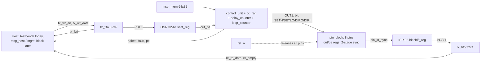

# Workstream 1 — Architecture: Staged, Incremental Plan

Companion to [PROTOCOL_EMULATOR_ARCHITECTURE.md](PROTOCOL_EMULATOR_ARCHITECTURE.md)
and [EXECUTION_PLAN.md](EXECUTION_PLAN.md) | 2026-09-27, revised 2026-10-03 |
Status: **v0.1 ISA frozen and implemented** — see [../instructions.md](../instructions.md)
for the authoritative opcode table and per-protocol programs.

> **Revision note (2026-10-03).** The original v0.1 below was UART-shaped: a
> dedicated 10-bit TX shifter, a single `TX_DATA` register, and opcodes such as
> `LDBYTE`/`OUT1` carrying a delay sub-field. Review replaced that with a
> protocol-agnostic engine (generic OSR/ISR shifters, generic FIFOs, an 8-pin
> block, a loop counter) and a flat instruction format. Sections A1, A2, A5, A7
> are rewritten to match what is built; the frozen-decisions table is amended.

## Why a staged architecture, and the one rule that makes it safe

Building everything at once is how a small ASIC project runs out of time
re-doing early decisions. So this plan builds **one working thing at a time**,
starting from the smallest possible useful design (UART transmit only) and
adding one capability per version.

The risk with "start small" is usually: you build something minimal, then
discover the minimal version's addressing/format/wiring choices don't fit the
next feature, and you have to re-do work you already validated. This plan
avoids that with one rule:

> **Some decisions are frozen at v0.1 and never change again. Everything else
> is deliberately minimal and grows version by version.**

| Frozen from v0.1 onward (never renumbered/reshaped later) | Deliberately minimal at v0.1 (grows later) |
|---|---|
| Host frame format (12 bytes, CRC-16) | Number of opcodes implemented (17 today, up to 32) |
| Register address windows (which address range means "engine 0", "instruction memory", etc.) | Number of registers populated inside each window |
| Instruction word format: **5-bit opcode `[31:27]` + one flat 27-bit operand `[26:0]`** | Number of opcodes actually decoded (unused encodings trap) |
| Timing contract: non-timed instruction = 1 cycle; `WAIT`/`OUT1`/`IN1 d` = exactly d+1 cycles | — |
| Physical instruction memory size (64 words, built full-size in RTL now) | Number of instructions your v0.1 firmware actually uses (12) |
| 8-pin block with per-pin data/direction registers, reset = all released | Number of pins a given program drives (1 for UART TX) |
| Generic datapath: 32-bit OSR + ISR, 32-bit TX/RX FIFOs — no protocol-named hardware | FIFO depth (4 today), side-set, edge detect, ownership mux |

**Decision reversed from the original table:** the 32-bit word no longer
reserves separate delay (`26:21`) and side-set (`20:18`) sub-fields. A flat
operand keeps every instruction single-purpose and the decoder trivial; delay is
simply the operand of the three timed opcodes. Side-set therefore needs its own
mechanism when SPI/I3C speed demands it (open; see Workstream 2).
| Reset/abort-dominates-everything safety behavior | Number of things reset has to reach (trivial today, all engines/pins later) |

Because the *shape* of these contracts is fixed now, later versions only ever
**add** entries into already-reserved space — they don't rename addresses,
resize words, or renumber pins out from under earlier firmware or host code.
That is what makes each step "fail-proof" in the sense you asked for: nothing
about v0.1 needs to be revisited when v0.2 arrives, only extended.

## Version roadmap (brief — full detail for v0.1 only, further down)

| Version | Adds | One-line reason |
|---|---|---|
| **v0.1** (this document) — **DONE in simulation** | Single generic engine, 17 opcodes, 8-pin block, 4-deep TX/RX FIFOs, OSR/ISR; first firmware = UART TX | Prove the entire chain works end to end: load program → run → pin toggles correctly. Verified cycle-exact 9600–115200 against a Python reference. |
| v0.2 | **FPGA bring-up (DE0-Nano)** + host-writable instruction memory | First hardware proof: message from an on-FPGA host → engine → HC-05 → phone. (Original v0.2 "add TX FIFO + PULL" is already in v0.1.) |
| v0.3 | UART **RX**, a second engine, input synchronizer, event handshake between engines | Full-duplex UART — this needs two independently-timed engines, as discussed earlier |
| v0.4 | SPI firmware + bidirectional pin ownership/electrical mode mux | Reuses the same engine/ISA; adds pin direction switching and multi-pin side-set |
| v0.5 | I2C firmware + open-drain pin mode | Reuses everything from v0.4; adds one electrical mode and ACK/NACK handling |
| v0.6 | Trace buffer, first-fault latch, memory BIST, watchdog, full CRC/sequence-pipelined frame robustness | Debug/bring-up hardening — added once the functional core is proven, not before |
| v0.7+ | JTAG/SWD/CAN/USB/Ethernet research spike | Explicitly out of scope until v0.1–v0.6 are solid (per earlier scope decision) |

---

## v0.1 — Full detail: UART TX only, bare minimum

### Goal

One engine executes a small program that bit-bangs a protocol. The host pushes
32-bit words into a TX FIFO and sees them come out as a correct waveform on
whichever pin the program selects; the engine can also sample a pin into an ISR
and push words back through an RX FIFO. No second engine, no trace buffer, no
BIST, no management block yet. The first firmware is UART TX because it is the
simplest protocol with an unambiguous external check (a terminal).

### A1 — ISA: 17 opcodes, flat operand

```
bit 31      27 26                                  0
    +---------+-----------------------------------+
    | opcode  |        operand (27 bits)          |
    +---------+-----------------------------------+
```

One operand, one meaning per opcode. Only `CFG` has sub-fields. Reserved
encodings (17–31) trap: `halted=1, fault=1`, PC frozen, no side effects.

| Enc | Mnemonic | Operand | Effect | Cycles |
|---|---|---|---|---|
| 0 | `NOP` | — | nothing | 1 |
| 1 | `WAIT d` | delay | hold PC | d+1 |
| 2 | `JMP a` | addr | pc ← a | 1 |
| 3 | `HALT` | — | halted=1 | — |
| 4 | `SETL n` | count | loop counter ← n | 1 |
| 5 | `DJNZ a` | addr | loop--; jump if result ≠ 0 | 1 |
| 6 | `PULL` | — | block until tx_fifo non-empty; OSR ← word | 1 (+wait) |
| 7 | `PUSH` | — | block until rx_fifo not full; rx_fifo ← ISR; ISR ← 0 | 1 (+wait) |
| 8 | `OUT1 d` | delay | pin[out_pin] ← OSR bit; shift OSR | d+1 |
| 9 | `IN1 d` | delay | ISR ← pin_in[in_pin] (shift in) | d+1 |
| 10 | `SETH p` | pin | pin_out[p] ← 1 | 1 |
| 11 | `SETLO p` | pin | pin_out[p] ← 0 | 1 |
| 12 | `DIRO p` | pin | pin_oe[p] ← 1 | 1 |
| 13 | `DIRI p` | pin | pin_oe[p] ← 0 | 1 |
| 14 | `WAITH p` | pin | block until pin_in[p]==1 | 1 (+wait) |
| 15 | `WAITL p` | pin | block until pin_in[p]==0 | 1 (+wait) |
| 16 | `CFG v` | `[2:0]` out_pin, `[5:3]` in_pin, `[6]` OSR MSB-first, `[7]` ISR MSB-first | routing/shift config | 1 |
| 17–18 | *(reserved)* | | `WAITR`/`WAITF` edge waits, v0.3 | trap |

The `DRIVE`, `LDBYTE`, `WAIT_DATA` opcodes from the earlier draft are gone:
`SETH`/`SETLO`/`DIRO`/`DIRI` replace `DRIVE`, `PULL` replaces both `LDBYTE`
and `WAIT_DATA`, and `OUT1` no longer carries a delay sub-field — its single
operand *is* the delay. A bit-banged bit period is therefore
`d + (number of 1-cycle instructions in the loop) + 1`.

### A2 — Host-facing interface (v0.1) and register map (reserved)

The management/CSR block is not built yet. What `engine_top` exposes today, and
which register window each item will land in when RTL-8 arrives:

| `engine_top` port today | Future address | Meaning |
|---|---|---|
| `tx_wr_en`, `tx_wr_data[31:0]`, `tx_full` | `0x1200` window | TX FIFO push (4 deep). Host **must** honor `tx_full`; a write while full is dropped whole, never corrupts a frame |
| `rx_rd_en`, `rx_rd_data[31:0]`, `rx_empty` | `0x1200` window | RX FIFO pop |
| `halted`, `fault` | `0x0104` `STATUS` | bit0 = HALTED, bit1 = FAULT |
| `pc[5:0]` | `0x1000` `PC_READBACK` | `pc==3` in the UART program means "idle, waiting for data" |
| `rst_n` | `0x0100` `CONTROL` | today reset is the only start/stop control |
| `$readmemh` into `imem.mem` | `0x1100`–`0x117f` | Instruction memory window; host write port is RTL-5b |
| `0x0000` `ID` | — | not yet |

The single `TX_DATA` byte register from the first draft is replaced by the
FIFO; its "data valid" flag is simply `!tx_empty`. Address windows above are
unchanged from the main architecture doc.

### A3 — Host frame format (frozen, unchanged from the main doc)

Fixed 12-byte SPI frame, MSB-first bit order, little-endian multi-byte fields:

| Byte offset | Field | Size |
|---|---|---|
| 0 | Operation (read/write) | 1 |
| 1 | Sequence number | 1 |
| 2–3 | Address | 2 |
| 4–7 | Payload | 4 |
| 8–9 | Reserved/status | 2 |
| 10–11 | CRC-16/CCITT-FALSE (poly 0x1021, init 0xFFFF, no reflection, xorout 0) over bytes 0–9 | 2 |

This is deliberately the *same* frame format the full architecture doc
specifies for the finished chip — it is complex enough to need getting right
once, so it is done once, now, rather than simplified and redone later.

### A4 — Pin map (firmware convention, not hardware)

All 8 pins are identical in RTL: each has its own data/direction register and
any pin can be `out_pin`/`in_pin` via `CFG`. The assignment below is the
convention the programs in [../instructions.md](../instructions.md) use, so that
one board wiring serves every protocol:

| Pin | Convention | Used by |
|---|---|---|
| `pin 0` | UART TX | UART TX program (verified) |
| `pin 1` | UART RX | v0.3 |
| `pin 2` | SCLK / TCK | SPI, JTAG drafts |
| `pin 3` | MOSI / TDI | SPI, JTAG drafts |
| `pin 4` | MISO / TDO | SPI, JTAG drafts |
| `pin 5` | CS / TMS | SPI, JTAG drafts |
| `pin 6` | SDA | I2C draft |
| `pin 7` | SCL | I2C draft |

Reset releases every pin (`pin_oe=0`); each program's init block drives only
the pins it owns. The DE0-Nano wrapper maps `pin[i]` → `GPIO_0[i]`.

### A5 — Code-size budget

Measured, not estimated (see [../instructions.md](../instructions.md)):

| Program | Words | Status |
|---|---|---|
| UART TX 8N1, any baud | **12** | verified |
| SPI mode 0, 8-bit full duplex, CS per byte | 18 | draft |
| JTAG shift loop (per TAP-walk sequence extra) | ~10 + walks | draft |
| I2C byte write with ACK | needs `CFG` open-drain bit first | draft |

All fit comfortably in 64 words with the 20% headroom target. Only `WAIT`/`OUT1`
operands change with baud rate; the program shape is baud-independent.

### A6 — Scope decision (v0.1)

**In scope**: one generic engine with the full 17-opcode ISA, 8-pin block,
4-deep TX/RX FIFOs, OSR/ISR shifters; UART TX firmware verified end to end.

**Explicitly not in scope for v0.1** (each deferred to a named later version):
host-writable instruction memory and the management block (v0.2), UART receive
and edge detect (v0.3), a second engine (v0.3), side-set and SPI (v0.4), I2C
open-drain `OUT1` mode (v0.5), trace buffer, first-fault latch, memory BIST,
watchdog (v0.6), any protocol beyond UART/SPI/I2C/JTAG (v0.7+ research spike).

### A7 — Interconnect / signal spec (v0.1 minimal)



Exact port names and widths are in [diagram_core_internal.mmd](diagram_core_internal.mmd)
and `src/engine_top.v`. The second engine, management block, trace and BIST
are absent for now, not renamed or restructured when they are added.

### A8 — Verification obligations (v0.1 subset of the full V01–V14 list)

| ID | Applies at v0.1? | What to check |
|---|---|---|
| V01 (reset/abort dominates pin drive) | **Yes** | Even with 1 pin, reset must force it to a safe, non-driving state |
| V04 (every instruction has exact effect/latency) | **Yes** | Differential test against a hand-written model for all 7 opcodes |
| V10 (corrupt/partial frames can't mutate state) | **Yes** | Frame format is frozen now, so this must be right from the start |
| V13 (can't execute stale/uninitialized image) | **Yes** | Engine must not run before a program is explicitly marked ready |
| V02, V03, V05, V07, V08, V11, V14 | Not yet | No open-drain, no ownership contention, no FIFO, no second engine, no BIST, no watchdog exist yet — these apply starting at the version that introduces them |

### v0.1 bring-up checklist — simulation (DONE)

1. Load the 12-word UART TX program via `$readmemh`. ✔
2. Push `0x55, 0xA3, 0x00, 0xFF` into `tx_fifo`. ✔
3. Decode pin 0 with an ideal receiver: start, 8 data bits, stop, every bit interval exactly 434 (115200) / 5208 (9600) cycles. ✔
4. Confirm the engine parks at `pc==3` with the line idle-high when the FIFO empties. ✔
5. Reset mid-frame: all `pin_oe` drop within one cycle; next byte after reset decodes correctly. ✔
6. Workload: 1 KB with all 256 byte values, long runs, host silence gaps, 8 baud rates — every frame cycle-exact versus the Python reference; receiver clock tolerance ±5.25%. ✔

### v0.2 bring-up checklist — DE0-Nano hardware (NEXT)

1. Simulate `de0_nano_top` (engine + `msg_host` + reset sync) with the same decoder. 
2. Program the FPGA; LEDs show `halted=0, fault=0`, TX mirror idle-high.
3. Press KEY1: TX LED flickers.
4. Connect HC-05 (`GPIO_00 → RX`, GND, 5 V), pair the phone, open a terminal at 9600: the message appears.
5. Switch module and firmware to 115200 (`D=432`), repeat.

---

## Brief roadmap for later versions (as requested — no full detail yet)

- **v0.2 — FPGA bring-up + host loading**: DE0-Nano wrapper with an on-chip
  message host, then the host write port on `instr_mem` and the minimal
  management block. (The FIFO and `PULL` originally planned here already exist.)

- **v0.3 — Full-duplex UART**: add a second engine instance (same RTL module,
  parameterized), an input synchronizer, a receive shift register/FIFO, and
  the minimal event-bit handshake so the host can run TX and RX
  simultaneously and independently. This is the point where the "why two
  engines" discussion becomes concrete hardware.

- **v0.4 — SPI**: reuse the existing engine/ISA; add the pin ownership and
  electrical-mode mux (push-pull vs. later open-drain) plus side-set so one
  instruction can toggle SCLK and shift data on the same cycle.

- **v0.5 — I2C**: reuse v0.4's pin mux, add open-drain mode and the
  ACK/NACK/clock-stretching firmware logic.

- **v0.6 — Debug and safety hardening**: trace buffer, first-fault latch,
  memory BIST, watchdog, and the full CRC/sequence-pipelined frame robustness
  behaviors from the main architecture doc. Deliberately deferred until the
  functional core (v0.1–v0.5) is proven, so debug infrastructure is built once
  against a stable target instead of chasing a moving one.

- **v0.7+ — Research spike**: JTAG/SWD/PS2/CAN/USB/Ethernet, each requiring
  its own feasibility check against the 64-word/no-call-stack ISA model
  before any commitment is made (per the existing scope decision in
  [EXECUTION_PLAN.md](EXECUTION_PLAN.md)).
