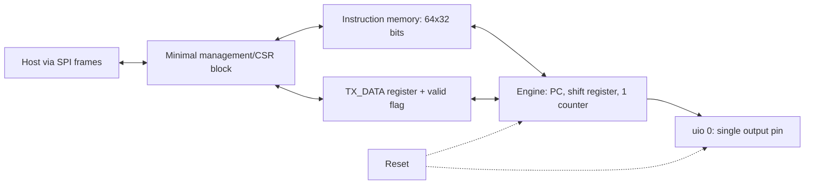

# Workstream 1 — Architecture: Staged, Incremental Plan

Companion to [PROTOCOL_EMULATOR_ARCHITECTURE.md](PROTOCOL_EMULATOR_ARCHITECTURE.md)
and [EXECUTION_PLAN.md](EXECUTION_PLAN.md) | 2026-09-27 | Status: planning, pre-RTL

## Why a staged architecture, and the one rule that makes it safe

Building everything at once is how a small ASIC project runs out of time
re-doing early decisions. So this plan builds **one working thing at a time**,
starting from the smallest possible useful design (UART transmit only) and
adding one capability per version.

The risk with "start small" is usually: you build something minimal, then
discover the minimal version's addressing/format/wiring choices don't fit the
next feature, and you have to re-do work you already validated. This plan
avoids that with one rule:

> **Some decisions are frozen at v0.1 and never change again. Everything else
> is deliberately minimal and grows version by version.**

| Frozen from v0.1 onward (never renumbered/reshaped later) | Deliberately minimal at v0.1 (grows later) |
|---|---|
| Host frame format (12 bytes, CRC-16) | Number of opcodes implemented (7 today, ~20 later) |
| Register address windows (which address range means "engine 0", "instruction memory", etc.) | Number of registers populated inside each window |
| Instruction word format (32 bits, opcode/delay/side-set/operand fields) | Number of opcodes actually decoded (unused encodings trap) |
| Physical instruction memory size (64 words, built full-size in RTL now) | Number of instructions your v0.1 firmware actually uses (~12) |
| Pin numbering scheme (which `uio` bit is which signal, reserved slots kept empty) | Number of pins actually driven (1 today, 8 later) |
| Reset/abort-dominates-everything safety behavior | Number of things reset has to reach (trivial today, all engines/pins later) |

Because the *shape* of these contracts is fixed now, later versions only ever
**add** entries into already-reserved space — they don't rename addresses,
resize words, or renumber pins out from under earlier firmware or host code.
That is what makes each step "fail-proof" in the sense you asked for: nothing
about v0.1 needs to be revisited when v0.2 arrives, only extended.

## Version roadmap (brief — full detail for v0.1 only, further down)

| Version | Adds | One-line reason |
|---|---|---|
| **v0.1** (this document, full detail) | Single engine, UART **TX only**, 7 opcodes, 1 pin, single-byte handshake register (no FIFO yet) | Prove the entire chain works end to end: load program → run → pin toggles correctly |
| v0.2 | TX FIFO (multi-byte queueing), `PULL` opcode | Remove the "one byte at a time, host must wait" limitation without touching anything else |
| v0.3 | UART **RX**, a second engine, input synchronizer, event handshake between engines | Full-duplex UART — this needs two independently-timed engines, as discussed earlier |
| v0.4 | SPI firmware + bidirectional pin ownership/electrical mode mux | Reuses the same engine/ISA; adds pin direction switching and multi-pin side-set |
| v0.5 | I2C firmware + open-drain pin mode | Reuses everything from v0.4; adds one electrical mode and ACK/NACK handling |
| v0.6 | Trace buffer, first-fault latch, memory BIST, watchdog, full CRC/sequence-pipelined frame robustness | Debug/bring-up hardening — added once the functional core is proven, not before |
| v0.7+ | JTAG/SWD/CAN/USB/Ethernet research spike | Explicitly out of scope until v0.1–v0.6 are solid (per earlier scope decision) |

---

## v0.1 — Full detail: UART TX only, bare minimum

### Goal

One engine executes a tiny fixed program that bit-bangs UART transmit timing.
The host can write a byte into a single register and see it come out as a
correct UART waveform on one pin. Nothing else exists yet: no FIFO, no RX, no
second engine, no trace buffer, no BIST. Enough status readback exists to see
what the engine is doing, because visibility from day one is part of the goal.

### A1 — ISA: 7 opcodes only

All opcodes still use the full 32-bit word format from the main architecture
doc (opcode bits 31:27, delay bits 26:21, side-set bits 20:18, operand bits
17:0) so that later versions can add opcodes without changing the format.
Any opcode not in this table is a reserved encoding and traps.

| Opcode | Operand (bits 17:0) | Effect |
|---|---|---|
| `HALT` | unused | Stop fetching; engine enters halted state |
| `NOP` | unused | Do nothing this cycle (placeholder / alignment) |
| `LDBYTE` | none (reads TX_DATA register directly) | Copy the host-written TX_DATA byte into the internal 8-bit shift register; clear "data valid" |
| `DRIVE` | bit \[0\]: level (0/1) | Set the output pin to `level`; delay field holds it for N cycles |
| `OUT1` | none | Shift the LSB of the shift register onto the pin; delay field holds it for N cycles; shift register shifts right by 1 |
| `DJNZ` | bits \[3:0\]: counter register select, bits \[17:4\]: target address | Decrement the selected counter; if nonzero, jump to target address |
| `WAIT_DATA` | none | Stall (no side effects) until the host has written a new byte into TX_DATA (data-valid flag set) |

This is a strict subset of the full opcode family table in the main doc — no
renumbering needed when `SPI`/`WAIT edge`/`PULL`/etc. are added later.

### A2 — Register map (v0.1 subset, same address windows as the full doc)

| Address | Name | R/W | Meaning |
|---|---|---|---|
| `0x0000` | `ID` | R | Constant value confirming the management link works |
| `0x0100` | `CONTROL` | R/W | bit0 = START engine, bit1 = HALT engine |
| `0x0104` | `STATUS` | R | bit0 = HALTED, bit1 = FAULT, bit2 = TX_DATA_EMPTY (ready for next byte) |
| `0x0108` | `TX_DATA` | W | Next byte to transmit; writing this also sets the internal "data valid" flag |
| `0x1000` | `PC_READBACK` | R | Current program counter of the engine (for visibility/debugging) |
| `0x1100`–`0x117f` | Instruction memory window | R/W | 64 words reserved, v0.1 firmware uses ~12 of them |

Only these six items are implemented. Every other address in the full
register map from the main architecture doc is reserved (reads as 0, writes
ignored) — so v0.2+ only ever populates more addresses inside windows that
already exist, never moves anything.

### A3 — Host frame format (frozen, unchanged from the main doc)

Fixed 12-byte SPI frame, MSB-first bit order, little-endian multi-byte fields:

| Byte offset | Field | Size |
|---|---|---|
| 0 | Operation (read/write) | 1 |
| 1 | Sequence number | 1 |
| 2–3 | Address | 2 |
| 4–7 | Payload | 4 |
| 8–9 | Reserved/status | 2 |
| 10–11 | CRC-16/CCITT-FALSE (poly 0x1021, init 0xFFFF, no reflection, xorout 0) over bytes 0–9 | 2 |

This is deliberately the *same* frame format the full architecture doc
specifies for the finished chip — it is complex enough to need getting right
once, so it is done once, now, rather than simplified and redone later.

### A4 — Pin map (v0.1 subset: 1 of 8 pins used)

| Pin | v0.1 assignment | Future versions |
|---|---|---|
| `uio[0]` | UART TX (output only, always driven, no direction switching yet) | Stays UART TX |
| `uio[1]` | Reserved, not driven | UART RX (v0.3) |
| `uio[2]`–`uio[5]` | Reserved, not driven | SPI SCLK/MOSI/MISO/CS (v0.4) |
| `uio[6]`–`uio[7]` | Reserved, not driven | I2C SDA/SCL (v0.5) |

Pin numbering is decided once, now, for the whole roadmap — v0.1 firmware
simply never touches pins 1–7.

### A5 — Code-size budget (v0.1)

Estimated UART TX program: **~12 instruction words** (load byte, drive start
bit, 8× shift-and-drive data bits with `DJNZ` loop, drive stop bit, loop back
to `WAIT_DATA`). Physical instruction memory is still built at the full
64-word size in RTL from day one (so the address decode logic never needs to
change width later) — v0.1 simply leaves ~52 words unused.

### A6 — Scope decision (v0.1)

**In scope**: UART transmit of one byte at a time, host-paced (host must wait
for `TX_DATA_EMPTY` before writing the next byte), single engine, single pin,
minimal status visibility.

**Explicitly not in scope for v0.1** (each deferred to a named later version):
FIFO/queueing (v0.2), UART receive (v0.3), a second engine (v0.3), SPI/I2C
(v0.4/v0.5), trace buffer, first-fault latch, memory BIST, watchdog (v0.6),
any protocol beyond UART/SPI/I2C (v0.7+ research spike).

### A7 — Interconnect / signal spec (v0.1 minimal)

This is a strict subset of the full block diagram in the main architecture
doc — the boxes for the second engine, FIFOs, trace, BIST, and event fabric
are simply absent for now, not renamed or restructured when they're added.

### A8 — Verification obligations (v0.1 subset of the full V01–V14 list)

| ID | Applies at v0.1? | What to check |
|---|---|---|
| V01 (reset/abort dominates pin drive) | **Yes** | Even with 1 pin, reset must force it to a safe, non-driving state |
| V04 (every instruction has exact effect/latency) | **Yes** | Differential test against a hand-written model for all 7 opcodes |
| V10 (corrupt/partial frames can't mutate state) | **Yes** | Frame format is frozen now, so this must be right from the start |
| V13 (can't execute stale/uninitialized image) | **Yes** | Engine must not run before a program is explicitly marked ready |
| V02, V03, V05, V07, V08, V11, V14 | Not yet | No open-drain, no ownership contention, no FIFO, no second engine, no BIST, no watchdog exist yet — these apply starting at the version that introduces them |

### v0.1 bring-up checklist (concrete, in order)

1. Read `ID` register over SPI, confirm expected constant value.
2. Write the ~12-word UART TX program into the instruction memory window.
3. Write a test byte (e.g. `0x55`, alternating bits, easy to spot on a scope) into `TX_DATA`.
4. Set `CONTROL.START`.
5. Observe `uio[0]` on a scope/logic analyzer: confirm start bit, 8 data bits at the correct baud period, stop bit.
6. Read `STATUS`, confirm `TX_DATA_EMPTY` is set again after transmission.
7. Repeat with a second, different byte to confirm the engine loops back correctly via `WAIT_DATA`.

If all seven steps pass, the entire chain — host frame encoding, management
register access, instruction loading, engine execution, and pin timing — is
proven for the smallest possible case, with nothing left unverified "by
assumption."

---

## Brief roadmap for later versions (as requested — no full detail yet)

- **v0.2 — TX FIFO**: add a small FIFO between the host and the shift
  register plus a `PULL` opcode, replacing the single `TX_DATA` register.
  Nothing about the pin, frame format, or address windows changes — this is
  purely "populate more of the register window we already reserved."

- **v0.3 — Full-duplex UART**: add a second engine instance (same RTL module,
  parameterized), an input synchronizer, a receive shift register/FIFO, and
  the minimal event-bit handshake so the host can run TX and RX
  simultaneously and independently. This is the point where the "why two
  engines" discussion becomes concrete hardware.

- **v0.4 — SPI**: reuse the existing engine/ISA; add the pin ownership and
  electrical-mode mux (push-pull vs. later open-drain) plus side-set so one
  instruction can toggle SCLK and shift data on the same cycle.

- **v0.5 — I2C**: reuse v0.4's pin mux, add open-drain mode and the
  ACK/NACK/clock-stretching firmware logic.

- **v0.6 — Debug and safety hardening**: trace buffer, first-fault latch,
  memory BIST, watchdog, and the full CRC/sequence-pipelined frame robustness
  behaviors from the main architecture doc. Deliberately deferred until the
  functional core (v0.1–v0.5) is proven, so debug infrastructure is built once
  against a stable target instead of chasing a moving one.

- **v0.7+ — Research spike**: JTAG/SWD/PS2/CAN/USB/Ethernet, each requiring
  its own feasibility check against the 64-word/no-call-stack ISA model
  before any commitment is made (per the existing scope decision in
  [EXECUTION_PLAN.md](EXECUTION_PLAN.md)).
