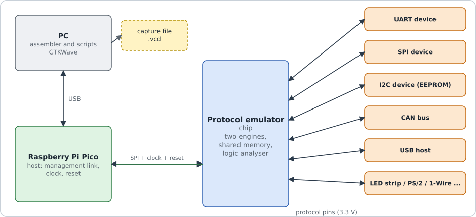
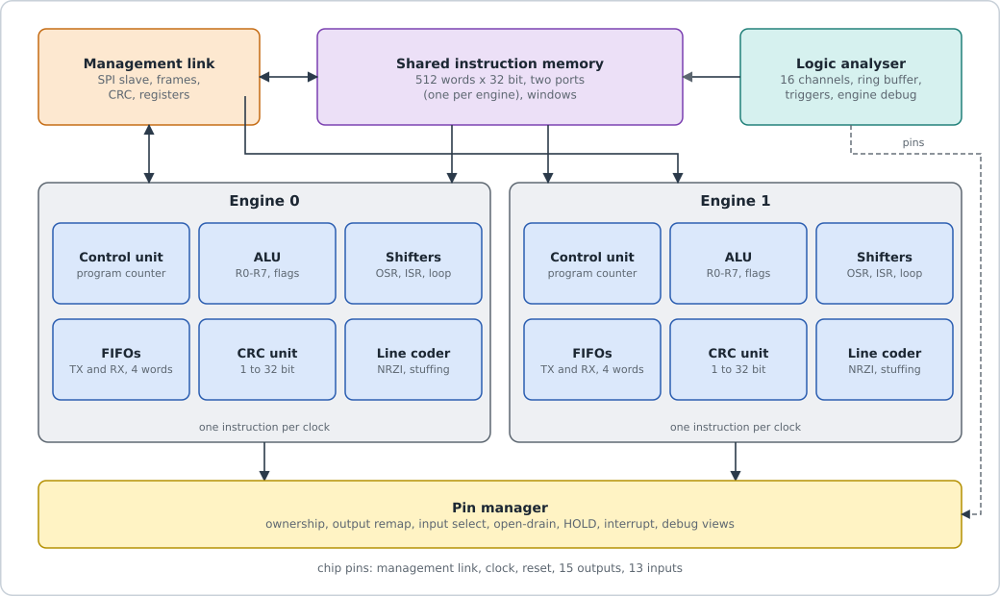
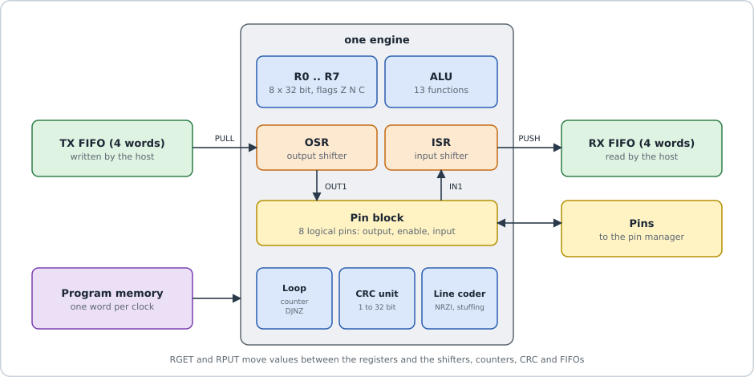
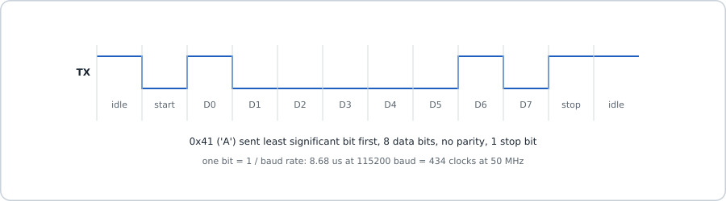
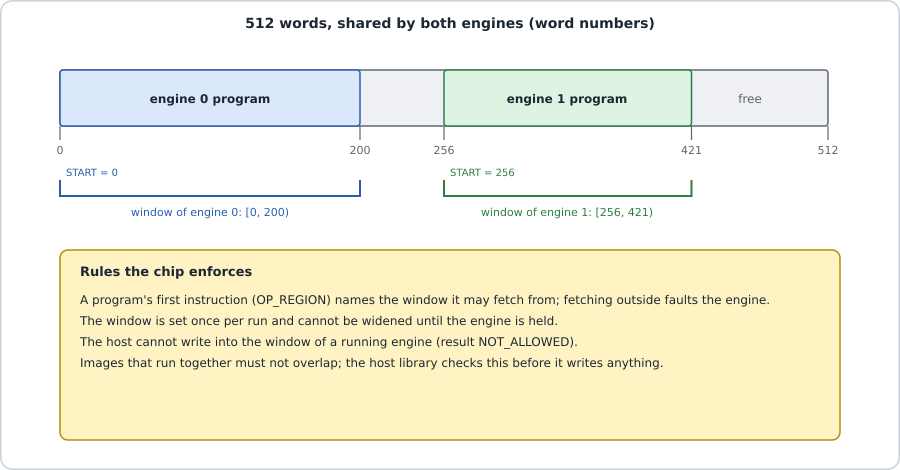
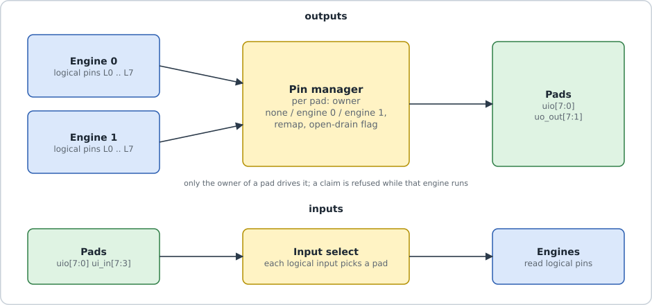

# 1. The architecture of the Protocol Emulator chip, explained simply

> Covers every branch on GitHub up to 31 October 2026. The chip described here is the one on the two submission branches,
> `submit/sh10-50mhz` and `submit/8la-43mhz`. `main` holds an older version (20 October). The branch map at the end says what
> each branch contains.

## The big idea

Electronic devices talk to each other over wires. The rules for that talk are called a **protocol**. UART (serial port), SPI,
I2C, USB and CAN are all protocols. On the wire, a protocol is just a pattern: the voltage goes high or low at exact moments.

Most chips have one fixed circuit for each protocol. This chip has **none**. Instead it has two tiny processors called
**engines**. An engine can only do simple jobs, but it does them with perfect timing: set a pin high or low, read a pin, wait an
exact number of clock ticks, shift bits in and out. A **program** (the *firmware*) tells the engine which pattern to make. Load a
UART program and the chip is a UART. Load a CAN program and it is a CAN controller. No new chip is needed.

Think of a player piano. The piano is the chip. The paper roll is the firmware. Change the roll and you get a new song.



*Figure 1. The chip sits between a host (a PC plus a Raspberry Pi Pico) and the device it talks to.*

## What is inside the chip



*Figure 2. The main blocks.*

| Block | What it does | Everyday comparison |
|---|---|---|
| Engine 0 and engine 1 | run firmware, one instruction per clock tick | two musicians |
| Shared program memory | one SRAM of 512 words x 32 bits; both engines read it at the same time through two separate ports | the book of sheet music |
| Management link | a 4-wire SPI port; the host loads programs, starts and stops engines and swaps data through it | the conductor's phone line |
| TX and RX FIFOs | two 4-word queues per engine: TX carries data from the host to the engine, RX the other way | an in-tray and an out-tray |
| Pin manager | decides which engine may drive which pin, can re-route pins, has a safe "open-drain" mode and an emergency HOLD input | a traffic officer |
| Logic analyser (optional) | records what the pins did, so you can view it as a waveform | a dash-cam |

A "word" is 32 bits, which is exactly one instruction.

## Inside one engine



*Figure 3. The parts of one engine that a program can use.*

Each engine has a **program counter** and a **control unit**; **8 registers** (R0 to R7, 32 bits each) with an **ALU** of 13
functions; an **output shift register (OSR)** that sends bits to a pin one at a time; an **input shift register (ISR)** that
collects bits from a pin; a **loop counter** and a **delay counter**; a **CRC unit** that computes the checksums many protocols
need; a **line coder** for USB's special bit encoding; and a **pin block** with 8 "logical" pins.

**The golden rule:** every instruction takes exactly one clock tick, and an instruction with a delay `d` takes `d + 1` ticks.
At 50 MHz one tick is 20 ns (20 billionths of a second). There are no interrupts and no caches, so nothing can change the
timing, and you can work out the time of every pin change on paper. The engine knows 31 instruction types (opcodes 0 to 30).

## How "emulation" works: an example

To send the letter 'A' over a UART at 115,200 bits per second, each bit must last 8.68 microseconds, which is 434 ticks at 50 MHz.
The program takes a byte from the TX FIFO, pulls the pin low for one bit time (the start bit), puts the 8 data bits on the pin one
after another, then holds the pin high for one bit time (the stop bit). That is the whole transmitter: 12 instructions.



*Figure 4. The letter 'A' on a UART wire.*

## Transmission path: from the host to the wire

```
 Host (PC + Pico)                         CHIP                                                    Device
   |  1. SPI frame "write TX_DATA"
   +----------> spi_slave --> mgmt --> TX FIFO (4 words)
                                          |  2. PULL: the engine takes one word
                                          v
                                    OSR (32-bit shift register)
                                          |  3. OUT1 d: one bit to the pin, held d+1 ticks
                                          v
                                    pin block --> pin manager --> pad uio[p] -------------------> wire
```

The host writes a word into the TX FIFO. `PULL` takes it (if the FIFO is empty, the engine waits). `OUT1` sends the bits one by
one, each for an exact number of ticks. The pin manager passes the signal only to a pad this engine owns.

## Reception path: from the wire to the host

```
 wire --> pad --> synchroniser (2 flip-flops) --> input select --> engine
                                                                    |  WAITL / JPL: wait for the start edge
                                                                    |  IN1 d: read one bit into the ISR
                                                                    v
                                                                   ISR --PUSH--> RX FIFO --> mgmt --> SPI "read RX_DATA" --> host
```

The **synchroniser** (two flip-flops) makes an outside signal safe to use inside the chip; it also means a pin is seen 2 ticks
late, which the firmware allows for. The firmware waits for the first edge, reads each bit at the right moment with `IN1`, and
`PUSH`es the result into the RX FIFO. The host sees "RX has data" in the status byte (or on the IRQ pin) and reads the word.

## The shared program memory



*Figure 5. One memory, two programs, each in its own window.*

Every program starts with the instruction `REGION`, which states its **window**: the words it may use. An engine that tries to
read an instruction outside its window gets a "trap" word and stops with a fault flag. The host can write the memory only through
a stopped engine's port, and never into a running engine's window. So a big program (for example a USB device) and a small one
can sit side by side.

## Pins and safety



*Figure 6. The pin manager connects logical pins to real pads.*

- 8 two-way pads (`uio[7:0]`), 5 extra inputs and 7 extra outputs. All can be re-routed, except the 4 management-link pins.
- Each pad has an **owner** (nobody, engine 0 or engine 1). Only the owner drives it, and the owner cannot change while it runs.
- **Open-drain** mode: the pad can only pull low or let go, never push high. I2C and 1-Wire need this.
- **HOLD** (`ui_in[3]`): when high, both engines stop and every engine pin is released.

## The management link

SPI mode 0 on four wires: SCLK, MOSI and CS_N in, MISO out. Each message is a **frame**: 7 bytes in version 1, or 12 bytes in
version 2, which adds a CRC-16 check and a sequence number so a damaged or repeated message is never carried out twice. The first
reply byte is **STATUS**: alive, error, which engines run, TX full, RX has data.

| Address | What is there |
|---|---|
| `0x0000` | ID, always `0x50454D31` ("PEM1") |
| `0x0200`-`0x02FF` / `0x0300`-`0x03FF` | pin manager / logic analyser (if built in) |
| `0x0400 + 4*w` | program word `w` (0 to 511) |
| `0x1000` / `0x2000` | engine 0 / 1: `+0x000` CTRL (bit 0 = RUN), `+0x00C` START, `+0x200` TX_DATA, `+0x204` RX_DATA |

The optional **logic analyser** records 16 channels (8 pads, 5 inputs, both RUN flags, and a firmware "marker" set with
`RPUT TRIG`) into a 256-word ring buffer with time stamps. The host turns a recording into a VCD file for the free viewer GTKWave.

## How the architecture got here (branch by branch)

| Date | Program memory and main change | Where it lives |
|---|---|---|
| 1–8 Oct | 64 words per engine, built from flip-flops; UART works on an FPGA | history of `main` |
| 11 Oct | same 64 words, moved into SRAM (65 % smaller chip) | history of `main` |
| 13 Oct | **two-tier** test: 64-word private memory per engine plus a shared 256-word one, and a `COPY` instruction | `two-tier` (stopped, not merged) |
| 17 Oct | 256 words per engine, one SRAM each | `main` |
| 18 Oct | extra fetch pipeline stage | `exp/fetch-stage` (not merged: no speed gain) |
| 19–20 Oct | **one shared 512-word, 2-port SRAM** with `REGION` windows; logic analyser built | `shared/on-v2`, `check/shared-sh8` |
| 31 Oct | two submission candidates (table below) | `submit/sh10-50mhz`, `submit/8la-43mhz` |

| | Candidate A (`submit/sh10-50mhz`) | Candidate B (`submit/8la-43mhz`) |
|---|---|---|
| Logic analyser | not built in | built in (a second 2-port SRAM as its buffer) |
| Clock in `info.yaml` | 50 MHz | 43 MHz |
| Worst-case speed reached | 19.71 ns per tick (50.7 MHz) | 22.4 ns per tick (44.6 MHz) |

The repository does not record which one will be submitted. Both use 8 x 4 Tiny Tapeout tiles (1.72 mm x 0.71 mm).

## Branch map

| Branch | Last change | What it holds |
|---|---|---|
| `main` | 2 Nov (chip 20 Oct) | private 256-word memory per engine, 29 opcodes, frame v2, pin re-routing, line coder, layout tt14b, these notes |
| `two-tier` | 13 Oct | the L1 + L2 memory experiment (phases 0–6 done, 7 unfinished) |
| `exp/fetch-stage` | 18 Oct | fetch-stage experiment |
| `ci/gpl-phi`, `ci/gpl-noroute` | 18 Oct | one-line layout settings tried on GitHub's build (`gpl-phi` adopted, `gpl-noroute` cancelled) |
| `shared/on-v2` | 20 Oct | shared memory, frame v2, logic analyser phases 1–3 (working branch) |
| `check/shared-sh8` | 20 Oct | `shared/on-v2` plus the sh8 layout settings, pushed to run GitHub's official build |
| `submit/sh10-50mhz` | 31 Oct | candidate A; the code it shares with B passes 70 of 70 test suites |
| `submit/8la-43mhz` | 31 Oct | candidate B: same code, plus the analyser in the layout |

Earlier local branches (`feat/shared-imem`, `feat/frame-v2`, `merge/frame-v2`, `exp/shared-timing`, `clean/v1`) were merged into
these; a backup is in `reproduce/branches.bundle`.

**Read more:** `docs/CODE_GUIDE.md` (submission branches), [../docs/HOST_INTERFACE.md](../docs/HOST_INTERFACE.md),
[../instructions.md](../instructions.md), [../docs/PROTOCOL_EMULATOR_ARCHITECTURE.md](../docs/PROTOCOL_EMULATOR_ARCHITECTURE.md)
(the original target design, partly out of date).
