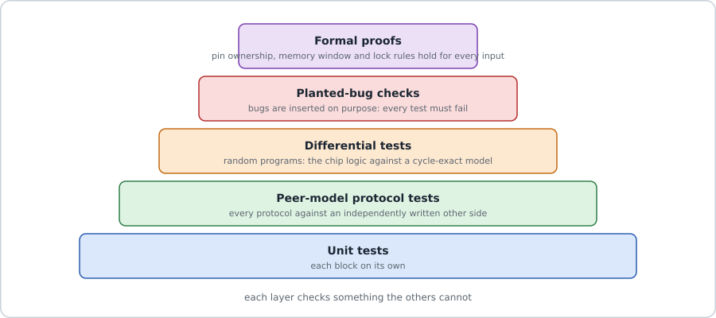

# 2. Design considerations: why the chip looks the way it does

> Covers every branch on GitHub up to 31 October 2026 (`main`, `two-tier`, `exp/fetch-stage`, `ci/gpl-phi`, `ci/gpl-noroute`,
> `shared/on-v2`, `check/shared-sh8`, `submit/sh10-50mhz`, `submit/8la-43mhz`). The chip described is the submission version.

## The goals behind every choice

1. **Flexible.** The challenge says a new protocol after the chip is made must need only a new program.
2. **Small.** The design had to fit 6 x 4 Tiny Tapeout tiles (about 0.7 mm²). Later 8 x 4 was allowed (about 30 % more).
3. **Exact timing.** Protocols need pin changes at precise moments.
4. **Safe.** A buggy program must never damage the chip or fight another device on the wire.
5. **Provable.** The challenge stresses verification. The project rule: nothing counts until it is checked against something
   written independently.
6. **Fast enough.** Target: 50 MHz under worst-case conditions.

## The main choices

Each choice: why it was made, how firmware uses it, its good (+) and bad (−) sides.

**1. Programmable engines instead of fixed protocol blocks.** Fixed UART, SPI and I2C blocks can never learn CAN or USB. The idea
comes from the RP2040's PIO and TI's PRU. *Firmware:* every protocol is a program, from 12 words (UART transmit) to 186 words (CAN
receive). \+ One chip, 13 protocols so far, about 20 more estimated with no hardware change. − Slower than a dedicated circuit;
every protocol needs its own program and tests.

**2. One instruction per clock tick, no interrupts, no cache.** If timing never varies, you can calculate it on paper.
*Firmware:* `WAIT d` lasts `d + 1` ticks; a UART bit lasts `D + 2` ticks. \+ Behaviour can be compared with a model clock for
clock. − Top speed is limited (fastest SPI slave about 6.25 MHz at a 50 MHz clock).

**3. Two engines.** Enough for a transmit and receive pair, a master and a slave, or a protocol plus a listener, at modest area.
\+ Each engine has its own memory port, so one never delays the other. − Only two jobs at once.

**4. Generic registers, ALU and a programmable CRC unit.** CAN, Modbus, USB, 1-Wire and SMBus need counting and checksums; a CRC
done bit by bit in software is too slow. *Firmware:* the `CRC` instruction feeds bits or bytes, `RGET CRC` reads the result; one
unit does any CRC (14 standard CRCs checked). − More area and a longer slowest path, so the CRC unit got an extra pipeline step.

**5. A line coder for USB.** Low-speed USB leaves only 33 ticks per bit, too few to do its bit encoding in instructions.
*Firmware:* `LINE` sends and receives whole bytes; pins, bit period and stuffing rule are settings. − Extra area for a partly
USB-specific block.

**6. A pin manager with ownership, open-drain, re-routing and HOLD.** Two engines share 8 pads and could fight; I2C must never
drive a line high; boards differ. *Firmware:* uses logical pins 0 to 7 and works on any pad (tested with random pin layouts).
\+ Safety is mathematically proven. − The largest new block (about 2,960 gates); the host must claim pads before a run.

**7. An SPI management link with checked frames (version 2).** Only 4 pins; a flipped bit must never run a command twice.
*Firmware:* data reaches it only through the FIFOs. \+ A retried frame runs exactly once. − One 32-bit word per frame, SPI clock
at most about 3 MHz; an SPI slave or UART receiver cannot pause its partner if the host is slow.

**8. One clock for everything; every input synchronised.** Two flip-flops make outside signals safe ("metastability"); the host's
SPI clock is sampled like data, not used as a second clock. *Firmware:* a pin read is 2 ticks old. − The host must hold each SPI
clock phase for at least 8 chip ticks.

**9. Small FIFOs (4 words) and an optional logic analyser.** Area. The analyser is a build option (`-DLA`) and never touches the
instruction fetch path. − Candidate B, which includes it, reaches about 44.6 MHz instead of 50.7 MHz.

## The biggest decision: how to store the programs

Program memory was redesigned five times. Each version lives on a branch, so the options can be compared directly.

| Version (branch) | How it works | + | − |
|---|---|---|---|
| Flip-flops, 64 words per engine (`main` history, 1 Oct) | each bit is a flip-flop | simple, exact | 80 % of the chip (414,137 µm²) |
| SRAM, 64 words per engine (`main` history, 11 Oct) | two small SRAM blocks per engine; the PC sends the *next* address early because SRAM answers one tick late | chip 65 % smaller | 64 words too few (I2C slave needs about 108) |
| **Two-tier** (`two-tier`, 13 Oct) | private 64-word L1 per engine + one shared 256-word L2; engines take turns reading L2; `COPY` moves code from L2 to L1 | 320 words per engine; firmware can install code itself | code in L2 can be delayed by lost turns ("bubbles", up to 1 tick per UART bit); more logic; stopped at phase 7, never merged |
| SRAM, 256 words per engine (`main`, 17 Oct) | one 256 x 32 SRAM per engine | exact timing everywhere; fastest layout (18.3 ns, tt14b) | a big program cannot borrow the other engine's space |
| **Shared 512 words, 2 ports** (`shared/on-v2` → `submit/*`, chosen 20 Oct) | one 2-port SRAM; each engine has its own port and a `REGION` window | any mix of sizes; no turn-taking, so timing stays exact; a hardware trap stops runaway code | long wires to one central block (cost about 1 ns until a gate was moved); power grid had to be matched to the block |

Two details of the chosen design: the program counter is the *physical* address (no adder in the fetch path, which is already the
slowest path), and the assembler, not the hardware, moves a program to the address the host chooses.

## Other ideas that were tried and dropped

| Idea | Branch | What happened |
|---|---|---|
| An extra fetch pipeline stage | `exp/fetch-stage` | verified, but 0.6 ns *slower* (20.6 ns, run tt11a); kept in case USB needs 60+ MHz |
| Two fixes for GitHub's failed placement | `ci/gpl-phi`, `ci/gpl-noroute` | the smaller placement step (`PL_MAX_PHI_COEFFICIENT 1.03`) passed and was adopted; the other run was cancelled |
| 6 x 4 tiles | `main` (run tt14a) | did not route after pin re-routing and the line coder (+27 % cells); moved to 8 x 4 |
| A special USB transmit instruction (`TXW`) | none | dropped for the "packet shuttle" design |
| Speed-tuned synthesis, repair after routing | shared runs sh5b, sh5c, sh7 | slower or bigger; not used |

## Testability: built to be checked

*Figure 1. Each layer of testing catches mistakes the others cannot.*

### Before manufacturing (simulation and maths)

| Design feature | How it makes testing possible |
|---|---|
| Exact timing | A separate Python model (`host/isa_model.py`) predicts every tick; random programs on the design and the model: 0 differences. |
| Protocols are firmware | Each protocol is tested against an "other side" written separately from the official standard. |
| Logical pins, movable programs | The same tests run with random pin layouts and programs at other addresses. |
| Simple safety rules | **6 formal proofs** on the shared branches (4 on `main`): pin manager, FIFO, management link, engine, memory windows, `REGION`. |
| Frame version 2 | Random bit flips must never execute (236 checks). |
| Everything goes through SPI | Whole protocol tests rerun at chip level using only the management link. |

**Mutation testing** checks the tests: deliberately broken copies of the design must all be caught (38/38 engine, 20/20 frame,
16/16 shared memory, 12/12 analyser, 47 for the formal proofs). Latest full runs: **47 of 47** suites on `main` (20 Oct),
**70 of 70** on the submission code (30–31 Oct). The `two-tier` branch used the same method (for example 22.5 million clocks
against a model with 0 differences, 16/16 mutants), which is why its results can be trusted even though it was not merged.

### After manufacturing (test hooks inside the chip)

- **ID, VERSION, SCRATCH** registers prove the link works before any program is loaded; **STATUS** and **ERRCNT** report errors.
- **Read-back** of every program word and each engine's window.
- **Debug views** on `uo_out[7:2]` (heartbeat, run, halt, fault), chosen with 3 input pins; they work without SPI.
- **IRQ** pin, and the **HOLD** pin as an emergency stop.
- **Two-engine self-test:** engine 0 speaks a protocol while engine 1 listens and checks it.
- **Logic analyser, `TSTAMP`, trigger line** (candidate B), and a **gate-level test** of the final circuit netlist.

### Honest gaps

- No scan chains and no built-in memory self-test (factory-style tests); proposed in the original architecture, not built.
- No single-step or breakpoint for engines yet, and no firmware timeouts: a stuck bus waits until the host stops the engine.

**Read more:** [../memory.md](../memory.md), [../docs/TEST_RESULTS.md](../docs/TEST_RESULTS.md),
[../formal/README.md](../formal/README.md), [../docs/ASIC_AREA_AND_MEMORY_STUDY.md](../docs/ASIC_AREA_AND_MEMORY_STUDY.md),
`docs/TWO_TIER_RESULTS.md` (branch `two-tier`), `docs/FETCH_STAGE.md` (branch `exp/fetch-stage`), `docs/SHARED_IMEM_PLAN.md`
(submission branches).
