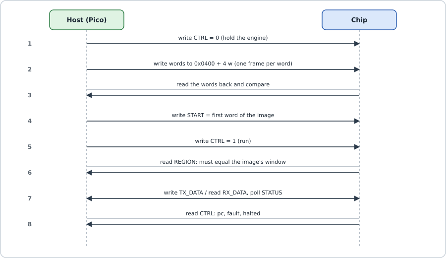
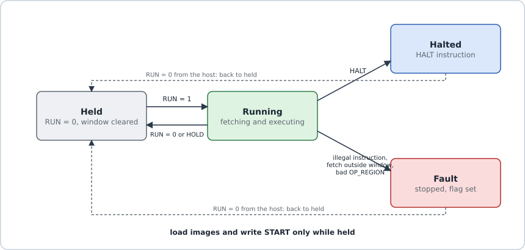
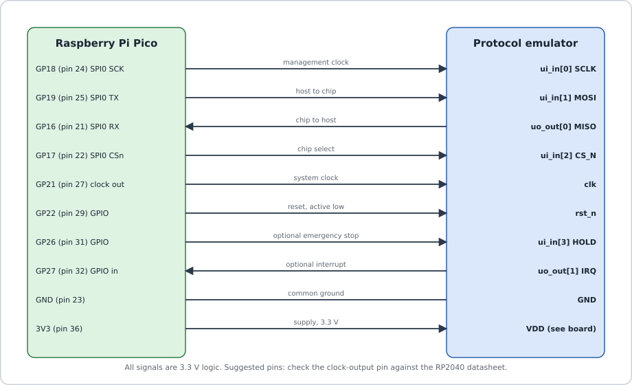

# 3. Firmware: how it works, what is left, and a quick user guide

> Based on the repository as of 31 October 2026. Some files named here (`host/shmem_host.py`, `host/fpga_bringup.py`,
> `host/serial_link.py`, `host/pico_bridge.py`, `host/la_capture.py`, `quartus/pe_chip.qpf`) exist only on the branches
> `submit/sh10-50mhz` and `submit/8la-43mhz` until they are merged into `main`.

## What "firmware" means here

Firmware is a list of 32-bit numbers. Each number is one instruction for an engine. Nobody types the numbers by hand: programs are
written in Python with the assembler `host/asm.py`. Each protocol has a **generator**, `host/<protocol>_prog.py`, that takes
settings (baud rate, SPI mode, clock frequency ...) and produces the words.

## The life of a program



*Figure 1. How the host loads and starts a program.*

1. **Generate** the words in Python.
2. **Link** the program at an address (its *origin*) in the 512-word memory. `host/shmem_host.py` checks that two programs do not
   overlap before anything is sent.
3. **Hold** the engine (CTRL = 0). Only a held engine can be loaded.
4. **Write** the words to `0x0400 + 4*w`, then **read them back** and compare.
5. Write **START** = the origin, then **RUN** = 1.
6. The program's first instruction, **`REGION`**, locks its window. The host reads the window back to make sure it is right.
7. The host and the program swap data through **TX_DATA** and **RX_DATA**. The program ends with `HALT`, or the host stops it.



*Figure 2. An engine is held, running, halted or in fault. RUN = 0 always brings it back to held.*

## A real program, line by line: the UART transmitter

This is the verified 12-instruction transmitter from [../instructions.md](../instructions.md). On the shared-memory chip a
`REGION` instruction goes in front of it.

| Instruction | What it does in plain words |
|---|---|
| `CFG 0` | use pin 0 for output, send the lowest bit first |
| `DIRO 0` | start driving pin 0 |
| `SETH 0` | line high: the "idle" state of a UART |
| **loop:** `PULL` | wait until the host has put a byte in the TX FIFO, then take it |
| `SETL 8` | loop counter = 8 (eight data bits) |
| `SETLO 0` | line low: the start bit |
| `WAIT D` | hold for the rest of the bit time |
| **bit:** `OUT1 D` | put the next bit on the pin and hold it |
| `DJNZ bit` | count down; repeat until 8 bits are sent |
| `SETH 0` | line high: the stop bit |
| `WAIT D` | hold it |
| `JMP loop` | go and wait for the next byte |

**Timing maths:** one bit lasts `D + 2` ticks. At 50 MHz and 115,200 baud: 50,000,000 / 115,200 ≈ 434 ticks, so `D = 432`.
The real rate is 115,207 baud, an error of only +0.006 %. For another clock, the generator simply recomputes `D`.

## The toolbox firmware uses

| Group | Instructions |
|---|---|
| Flow | `NOP`, `WAIT`, `JMP`, `HALT`, `SETL`/`DJNZ` (loops), `JPH`/`JPL` (jump on a pin), `JPO`, `JCC` (jump on a flag), `WAITR`, `REGION` |
| Bits and queues | `PULL`, `PUSH`, `PUSHI` (send a code to the host), `OUT1`, `IN1`, `CFG` |
| Pins | `SETH`, `SETLO`, `DIRO` (drive), `DIRI` (let go), `WAITH`/`WAITL` (wait for a level) |
| Registers | `LDI`, `ALU` (13 functions), `RGET`, `RPUT` |
| Helper units | `CRC` (checksums), `LINE` (USB bit coding), `TSTAMP` (read the clock counter) |

Common patterns:

- **I2C and 1-Wire** never push a line high. They pull it low with `DIRO` + `SETLO` and let go with `DIRI`.
- **Events for the host** (for example "NACK received") are sent with `PUSHI`.
- **Checksums** are fed to the CRC unit byte by byte and read back with `RGET CRC`.
- **Markers** for the logic analyser are raised with `RPUT TRIG`.

## The protocol library

All of these pass their tests in simulation against an independently written "other side". Only UART has also run on real
hardware (a DE0-Nano FPGA board at 115,200 baud, full duplex).

| Protocol | Size (words) | | Protocol | Size (words) |
|---|---|---|---|---|
| UART transmit / receive | 12 / 9 | | JTAG controller | 87 |
| SPI master / slave (4 modes) | 17–18 / 16–18 | | CAN 2.0A transmit / receive | 112 / 186 |
| I2C master / slave | 46 / 108 | | USB low-speed device | 203 |
| SMBus with PEC | 88 | | WS2812 LED strip | 25 |
| Modbus RTU (transmit) | 42 | | PS/2 device | 89 |
| 1-Wire master | 79 | | SWD host | 161 |

## What is left to do

**Firmware**

- **Protocol sniffers** (listen-only I2C, SPI, UART, CAN and USB decoders that can trigger the logic analyser): plan phase 5.
- **Standalone USB device** with its descriptors on the chip (about 320 to 380 words). Today the host software supplies them.
- **Ethernet 10BASE-T:** transmit looks possible at a 40 MHz clock; receive is still research.
- **CAN** arbitration and error frames; a **UART receiver** glitch filter and stop-bit check; **timeouts** for stuck buses.
- About 20 more "firmware only" protocols listed in [../docs/PROTOCOL_CATALOGUE.md](../docs/PROTOCOL_CATALOGUE.md) (MIDI, DMX512,
  LIN, I2S, DShot, IR remotes ...).
- Run the UART, USB, SMBus, WS2812, PS/2 and SWD tests from the shared memory on the full chip. So far this was done for CAN, JTAG,
  1-Wire, Modbus, SPI and I2C.
- If candidate B (43 MHz) is chosen: regenerate every program for 43 MHz and rerun the tests.
- A firmware timing checker and a larger mutation campaign.

**Chip and software around the firmware**

- Engine debug: halt, single step, breakpoint, read back registers (plan phase 4).
- A MicroPython library for the Pico (`pe_chip`). Today the Pico only forwards SPI frames.
- The whole chip on the DE0-Nano is prepared, but the Quartus build and the Pico bridge have not run on real hardware yet.
- Fill the placeholders in [../docs/USER_GUIDE.md](../docs/USER_GUIDE.md).
- Dates: design freeze 13 Dec 2026, final layout runs 14–27 Dec, submission deadline 18 Jan 2027.

## Quick user guide

### What you need

- A computer with Python 3.12 or later, Icarus Verilog 12 or later, and GTKWave (to view waveforms).
- For hardware today: a DE0-Nano FPGA board, a Raspberry Pi Pico and jumper wires. The real chip comes after manufacturing.

### Step 1: try everything without hardware

Run these from the repository folder:

```bash
bash run_tests.sh                                      # 22 small tests of the chip's blocks
python3 host/fpga_bringup.py --sim                     # first-contact checks on a simulated chip
python3 host/la_capture.py --sim --demo --out capture.vcd
gtkwave capture.vcd                                    # look at the recorded waveform
```

The bring-up script should end with `RESULT fpga_bringup: PASS`.

### Step 2: wire the Pico to the board



*Figure 3. Pico wiring for the management link. Use 3.3 V signals only.*

| Pico pin | Chip signal | DE0-Nano header |
|---|---|---|
| GP18 (SPI clock) | SCLK | `GPIO_2_IN[0]` |
| GP19 (SPI out) | MOSI | `GPIO_2_IN[1]` |
| GP17 (chip select) | CS_N | `GPIO_2_IN[2]` |
| GP16 (SPI in) | MISO | `GPIO_2[0]` |
| GND | GND | GND |

1. Open `quartus/pe_chip.qpf` in Quartus, compile it and program the board.
2. Copy `host/pico_bridge.py` to the Pico and name it `main.py`.
3. On the computer, run `pip install pyserial`.

### Step 3: first contact

```bash
python3 host/fpga_bringup.py --port /dev/ttyACM0
```

It checks five things: the "alive" bit, the ID `PEM1`, the scratch register, a counting program on both engines, and a blinking
pin `uio[0]` (`GPIO_2[1]` on the board). Watch that pin with an LED.

### Step 4: your first program

Run this from the `host/` folder. Engine 0 counts to 3 and sends the answer to the host.

```python
import asm as A, shmem_host as S
from serial_link import SerialLink

a = A.Asm()
a.REGION()                       # first instruction: claim my window
a.LDI(0, 0)                      # R0 = 0
a.label("l")
a.ALU("ADD", 0, imm=1)           # R0 = R0 + 1
a.ALU("CMP", 0, imm=3)           # compare R0 with 3
a.JCC("NZ", "l")                 # not equal yet: go back
a.RPUT("RXF", 0)                 # send R0 to the host
a.HALT()

with SerialLink("/dev/ttyACM0") as link:
    chip = S.ShmemHost(link)
    chip.start(0, S.Image.from_asm("count", a, origin=0))
    chip.wait_halt(0)
    print(chip.pop_rx(0))        # prints 3
```

To use a pin, give it to the engine first, for example `chip.claim_pad(0, 0)` (pad 0 to engine 0). The `*_test.py` file of each
protocol shows exactly how the host feeds and reads that protocol.

### If something goes wrong

| What you see | Likely cause |
|---|---|
| STATUS reads `0x00` | chip held in reset, no clock, or MISO not connected |
| error bit (STATUS bit 6) set | wrong frame length, bad address, or a write to a running engine; read ERRCNT at `0x0010` |
| engine shows "fault" | it fetched outside its window or hit an illegal instruction; check the origin and `REGION` |
| nothing on the pin | the pad was not claimed, or HOLD (`ui_in[3]`) is high |
| garbled replies | SPI clock too fast; keep it at or below 3 MHz (the bridge uses 1 MHz) |

The full draft guide (17 chapters, 47 figures) is [../docs/USER_GUIDE.md](../docs/USER_GUIDE.md).
