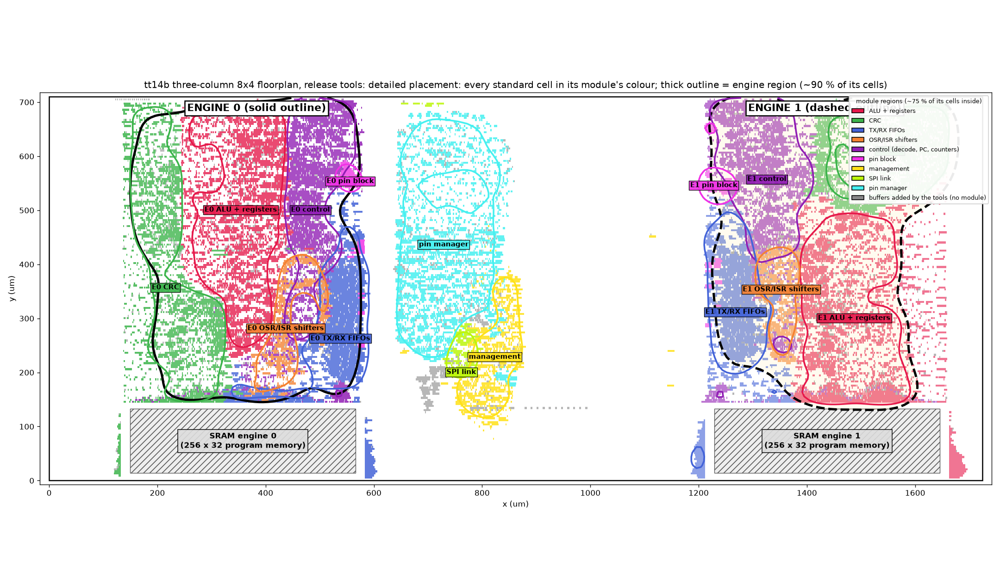
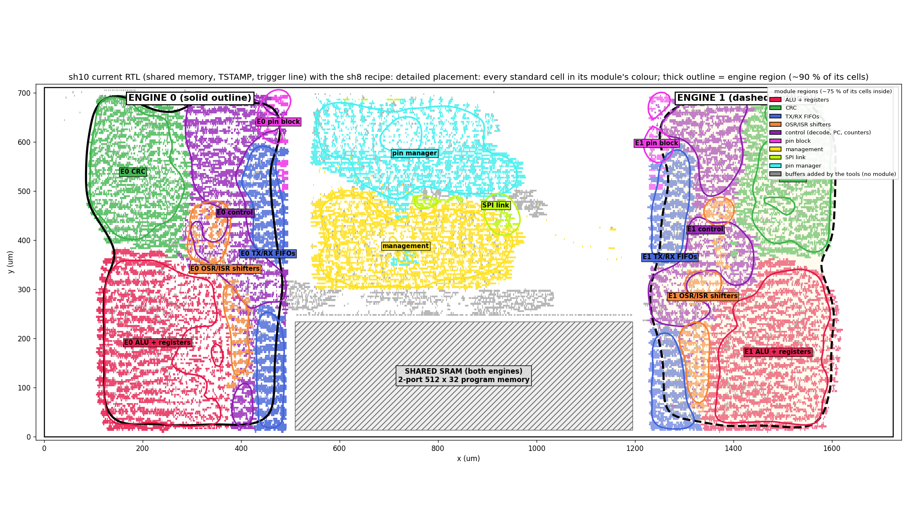

# 4. Physical design: turning code into a chip layout, and how close we get

> Covers every branch on GitHub up to 31 October 2026. Main sources: `results/tt_flow_2026-10-19/tt14b_final/` and
> `results/tt_flow_2026-10-20/sh10_final/` (metrics), `reproduce/flows/README.md`, `src/config.json`, `src/pnr.sdc`,
> `src/pdn_cfg.tcl`, `librelane_plugin_project/`, `memory.md`, and the branch commits. All numbers come from the design tools.
> Nothing has been measured on a real chip yet.

## What "physical design" means

The chip is written in Verilog, a language that describes *behaviour*. A factory cannot build behaviour. It needs a drawing of
every transistor and every wire on every layer (a **GDS** file). Physical design turns the first into the second.
Think of building a house: the Verilog is the list of rooms; physical design is the floor plan, wiring and plumbing, all checked
against the building codes.

## The ground rules

- **Process:** IHP 130 nm CMOS5L. The smallest transistor is about 600 times thinner than a human hair.
- **Tiny Tapeout:** many projects share one chip, each on a number of **tiles** of about 200 x 150 µm (µm = a millionth of a
  metre). We use **8 x 4 tiles**: a die of 1,724 x 711 µm, about 1.2 mm².
- **Tools:** LibreLane, an open-source tool chain (Yosys, OpenROAD, Magic, KLayout, Netgen), at the exact versions Tiny Tapeout's
  official GitHub build uses (LibreLane 3.1.0.dev3, PDK revision 2bbec755), so local results match theirs.

## The flow, step by step

```
 Verilog --> 1 Synthesis --> 2 Floorplan --> 3 Power grid --> 4 Placement --> 5 Clock tree --> 6 Routing --> 7 Checks --> GDS
```

| Step | What happens | Our settings |
|---|---|---|
| 1 Synthesis | Yosys turns the Verilog into **standard cells** (small ready-made gates and flip-flops); the finished layout has about 28,000 | strategy "AREA 0" |
| 2 Floorplan | sets the die size and places the big blocks | SRAM at the bottom; "fences" keep each engine in its own column |
| 3 Power grid | lays the power (VPWR) and ground (VGND) wires | Metal4 stripes only; a custom step joins them to the SRAM |
| 4 Placement | puts every cell in a row, close to its partners | 60 % target density, timing-driven |
| 5 Clock tree | spreads the clock so it reaches every flip-flop at nearly the same time | about 420 clock buffers and inverters |
| 6 Routing | draws the real wires on the metal layers | 1.5 metres of wire in total |
| 7 Checks | timing in three conditions, drawing rules (DRC), layout = circuit (LVS), antenna rule, Tiny Tapeout precheck, gate-level test | see the scorecard |

## Our floorplans

Both layouts use **three columns**: engine 0 on the left, engine 1 on the right, shared logic (management, SPI link, pin manager)
in the middle. Colours show blocks: ALU and registers (red), CRC unit (green), FIFOs (blue), pin manager (cyan).



*Figure 1. `main` (run tt14b): each engine has its own 256-word SRAM under its column.*



*Figure 2. Candidate A (`submit/sh10-50mhz`, run sh10): one shared 512-word SRAM (686 x 220 µm) at the bottom centre, the same
distance from both engines.*

Candidate B (`submit/8la-43mhz`) puts two SRAM blocks side by side along the bottom (programs and analyser buffer) and lets the
tool place cells freely, without fences.

## Problems solved on the way

| Problem | Fix | Result |
|---|---|---|
| Flip-flop program memories were 80 % of the chip | SRAM blocks ("macros") | 414,137 → 143,421 µm² (−65 %) |
| Tiny Tapeout forbids the top metal layer, but the default SRAM power hookup uses it | power on Metal4 only; stripes run over the SRAM and land on its own power columns (custom step `BridgeMacroStripes`) | precheck passes |
| With the 2-port SRAM, stripes landed on the wrong columns: **power shorted to ground** (run sh3 failed LVS) | a script tried every stripe spacing; 53.04 µm with a matching offset fits | LVS clean from sh4 on |
| Too much hold margin made the tool add 4,260 buffers (+20 % area) | 0.1 ns hold margin in our timing file `src/pnr.sdc` | routing no longer jammed |
| GitHub's build placed cells differently and failed | branches `ci/gpl-phi` and `ci/gpl-noroute` tested two fixes; `PL_MAX_PHI_COEFFICIENT 1.03` passed, plus local tools pinned to GitHub's versions | official build passed (run 39250627497) |
| 6 x 4 tiles could not be routed after new features (+27 % cells, run tt14a) | 8 x 4 tiles, three columns | routes cleanly |
| A weak gate next to the shared SRAM drove a long wire (about 1 ns lost) | moved that gate into the engines | 21.45 → 20.41 ns, for free |
| The SRAM read sits on the slowest path | an extra fetch stage was tried on `exp/fetch-stage` (run tt11a) | 20.6 ns: **slower**, not merged |

## The race to 50 MHz

Timing is checked at the **slow corner**: 1.08 V and 125 °C, the worst case (low supply, very hot). At 50 MHz each tick lasts
20 ns, so every signal must finish its trip within 20 ns there. A useful trick: ask the tool for 17 ns; it then works harder and
lands below 20 ns.

| Run | What changed | Time per tick at the slow corner |
|---|---|---|
| sh4 | first clean shared-memory layout | 21.45 ns (46.6 MHz) |
| sh6 | weak gate moved into the engines | 20.41 ns |
| sh8 | 17 ns target + resizer margin 0.5 ns | **19.64 ns (50.9 MHz)** |
| sh9a / sh9b | honest 20 ns target | 20.45 ns (both identical) |
| **sh10** | current design, sh8 recipe (candidate A) | **19.71 ns (50.7 MHz)** |
| 8la | with the logic analyser (candidate B) | 22.4 ns (44.6 MHz), so `info.yaml` says 43 MHz |

## Layout results per branch

| Branch | Run | Slow corner | Checks |
|---|---|---|---|
| `main` (private memories) | tt14b | **18.31 ns (54.6 MHz)** | 0 DRC, LVS clean, precheck passed, official GitHub build passed |
| `exp/fetch-stage` | tt11a | 20.6 ns | not merged |
| `ci/gpl-phi` | GitHub run 39144709276 | – | GitHub gds, precheck and gate-level jobs passed |
| `shared/on-v2` | sh6–sh10 (source code) | 19.64–20.45 ns | all LVS clean, 0 DRC |
| `check/shared-sh8` | GitHub official build | – | gate-level job failed: its test still targeted the old chip (fixed 31 Oct, commit `639663b`); other job results not recorded |
| `submit/sh10-50mhz` | sh10 | 19.71 ns (50.7 MHz) | scorecard below |
| `submit/8la-43mhz` | 8la | 22.4 ns (44.6 MHz) | only the speed is recorded (commit message) |
| `two-tier` | none | – | simulation only, never laid out |

`main`'s layout is the fastest, probably because each engine has its own small SRAM right below it. The shared memory was chosen
anyway for flexibility (document 2); its layout is about 1.4 ns slower.

## How accurate are we? The scorecard

For candidate A (run sh10):

| Check | Goal | Achieved |
|---|---|---|
| Speed, slow corner | 20 ns (50 MHz) | **19.71 ns (50.7 MHz)**: 0.29 ns to spare (about 1.5 %) |
| Speed, typical corner (1.2 V, 25 °C) | – | about 12.2 ns (about 82 MHz) |
| Hold time (signals must not change too early) | no violations | none; smallest margin +0.077 ns |
| DRC / LVS / antenna | 0 / 0 / 0 | 0 / 0 / 0 |
| Max slew / max capacitance warnings | 0 | 27 / 30, **not yet judged** (tt14b on `main`: 50 / 12) |
| Tiny Tapeout precheck | pass | passed on sh4 (same memory and grid); **not yet run on sh10** |
| Area used | must fit | 46 % of the core (405k µm² of cells + 151k µm² SRAM) |
| Repeatability | same result every time | a rerun of sh8, stopped at step 30 of 72, matched all 29 finished steps |
| Voltage drop on power wires | small | 0.21 mV on an older layout (tt10c); not rechecked since |

**Accuracy in a second sense: protocol timing.** Every pin change lands exactly on a tick (20 ns at 50 MHz). A UART at 115,200
baud comes out at 115,207 baud (+0.006 %). Inputs are seen 2 ticks late, and firmware allows for that. A slower clock changes the
length of a tick, not the logic; `docs/CLOCK_SPEED_EFFECTS.md` recommends 40 MHz as a comfortable operating clock.

## What is left

- Choose candidate A (50 MHz, no analyser) or B (43 MHz, analyser), and merge it into `main`.
- Judge or fix the slew and capacitance warnings.
- Run the Tiny Tapeout precheck and the official GitHub build on the final design (no result after the 31 Oct test fix is recorded).
- Final layout runs after the design freeze (13 Dec 2026), from 14 to 27 Dec, and a fresh voltage-drop check.

**Read more:** `results/shared_2026-10-20/sh10_images/index.html` and `results/tt_flow_2026-10-19/index.html` (every stage as a
picture), [../reproduce/flows/README.md](../reproduce/flows/README.md),
[../docs/PROGRESS_REPORT_2026-10-18_to_2026-10-20.md](../docs/PROGRESS_REPORT_2026-10-18_to_2026-10-20.md),
[../docs/TT_FLOW_RESULTS.md](../docs/TT_FLOW_RESULTS.md), `docs/FETCH_STAGE.md` (branch `exp/fetch-stage`).
